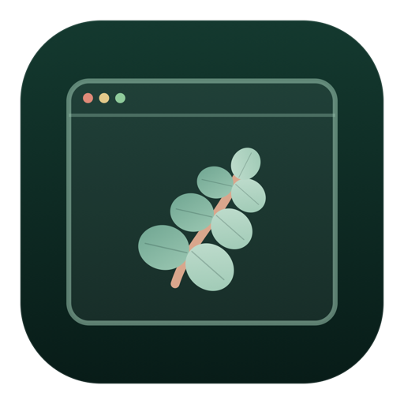
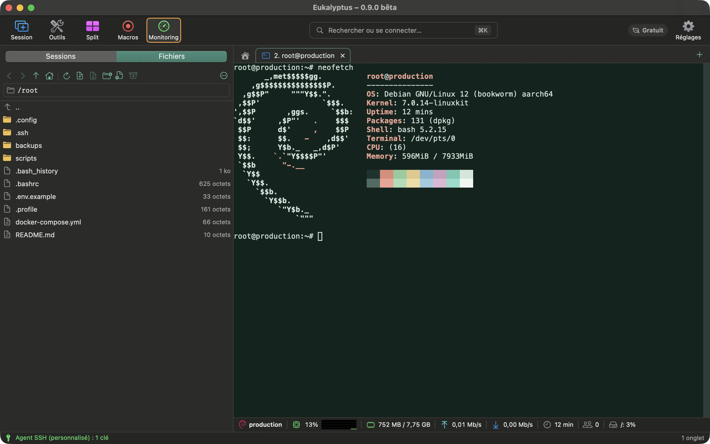

  

<h1 align="center">Eukalyptus</h1>

  <strong>Your servers, finally together.</strong> 
  Terminal, SSH, files, remote desktop and network tools in a single native app, for macOS and Windows.

  
  
  
  

  <a href="README.md">Français</a> · English

  

Eukalyptus is a **native** server administration app: terminal, SSH, SFTP, FTP, S3, RDP and VNC remote desktop, tunnels, macros,
monitoring and network tools. It is **free**, with no account, no ads and no tracking.

This repository is where **feedback** happens: bugs, ideas, questions, documentation and translations. The app's source code is not
public (see [License](#license)). Most of the text here is written in French first; you can write in English everywhere.

## Why Eukalyptus

A terminal for SSH, a client for files, an app for Windows, a scanner, an editor, notes for tunnels. All-in-one tools existed, but they
were heavy, aging or limited to a single system.

**So I built the one I wanted:** quick to open, pleasant to look at, honest with your data. And free, because a good admin tool
shouldn't cost a subscription.

— Antoine Rodrigues, creator of Eukalyptus

## Features

Mostly the same features on both systems, each written for its own system (Swift and SwiftUI on Mac, C# and WPF on Windows, no Electron).

| Feature | macOS | Windows |
|---|:---:|:---:|
| Tabbed terminal (SSH, Telnet, local terminal), 9 themes, search, automatic reconnection | Yes | Yes |
| Split, MultiExec (one command on several servers), command palette | Yes | Yes |
| SSH keys, SSH agent (including Bitwarden and 1Password), alert when a server's identity changes | Yes | Yes |
| X11 forwarding | Yes (with XQuartz) | Yes (built-in X server) |
| Mosh | Yes | Not yet |
| SFTP browser next to the terminal, drag and drop, built-in code editor | Yes | Yes |
| FTP, FTPS, S3 and compatible services (AWS, MinIO, Cloudflare R2…) | Yes | Yes |
| Several simultaneous transfers, with progress, speed and time left | Yes (0.9.5) | Yes (0.9.5) |
| Built-in RDP remote desktop in a tab, SSH gateway | Yes | Yes |
| Built-in VNC in a tab | Yes | Yes |
| Built-in browser | Yes | Yes |
| SSH tunnels (local, remote, SOCKS) | Yes | Yes |
| Macros, including at session start | Yes | Yes |
| Server monitoring (CPU, memory, network, disk) | Yes | Yes |
| Network tools: ping, traceroute, DNS, listening ports, scanner, Wake-on-LAN, packet capture | Yes | Yes |
| Import of MobaXterm and Termius sessions and .rdp files; `.eukalyptus` export | Yes | Yes |
| Passwords | macOS Keychain, Touch ID | Encrypted vault, master password |
| App in French and English (follows the system language) | Yes | Yes |
| Eukalyptus+: encrypted sync, team vault | Yes | Yes |

"Yes" means the feature is available. Some advanced features (for example RDP settings for enterprises, Entra ID sign-in, physical
security keys) are available but have been tested less on Windows than on Mac: if you run into a problem,
[report it](CONTRIBUTING.en.md#report-a-bug).

Feature-by-feature details are on [eukalyptus.app](https://eukalyptus.app/en) and in the [guides](#guides) below.

## Download

Free, no account, installed in a minute.

- **Website**: [eukalyptus.app/en/download](https://eukalyptus.app/en/download) offers the right file for your computer.
- **GitHub**: installers are also published in [Releases](https://github.com/ant-rdg/eukalyptus/releases), with their SHA-256 checksum
  and notes. The website remains the source of the app's updates.
- **Version history**: [CHANGELOG.md](CHANGELOG.md) (release notes are written in French).

| | macOS | Windows |
|---|---|---|
| System | macOS 14 (Sonoma) or later | Windows 10 (version 1809) or 11 |
| Processor | Apple silicon (M-series chips) | x64 (Intel or AMD); ARM on Windows 11, through emulation |
| Installer | `.pkg` | `.exe`, no administrator rights needed |

On Windows, the installer is not signed with a code signing certificate yet: SmartScreen may show "Windows protected your PC". Click
"More info", then "Run anyway". You can first check the SHA-256 checksum shown on the download page with `Get-FileHash`. On Mac, the app
is not notarized by Apple: macOS asks for a confirmation at first launch.

Linux, iPhone, iPad, Android and Intel-based Macs are not supported.

## Security

- **No tracking**: no account, no usage statistics, no ads. The only connections to Eukalyptus's website are listed publicly.
- **Protected secrets**: passwords in the macOS Keychain or in an encrypted vault on Windows, never in a file or in a `.eukalyptus` export.
- **Signed updates**: the version list is signed, and the SHA-256 checksum of each update is verified before installation.
- **Incoming data treated as hostile**: an imported or received session loses, by default, anything that acts without your consent.
- **End-to-end encrypted sync** (Eukalyptus+): the relay server can neither read nor modify your data.

Details are in [SECURITY.md](SECURITY.md) and on [eukalyptus.app/en/security](https://eukalyptus.app/en/security). To report a
vulnerability, follow [SECURITY.md](SECURITY.md): **do not post it in an issue**.

## Eukalyptus+

All the administration features are free. Eukalyptus+ is an optional way to support the author: **€21, once, for life**, valid on 3
computers (Mac or PC). As a thank-you, it adds new versions 15 days early, an icon and a color per session, the supporter badge, encrypted
session sync and the team vault. There is no trial period, no session limit and no reminder inside the app.
Details: [eukalyptus.app/en/pricing](https://eukalyptus.app/en/pricing).

## Roadmap

What is done, in progress, planned, and ideas to discuss: [ROADMAP.md](ROADMAP.md) (French, with a short English section at the bottom).
To suggest an idea or vote for an existing one, use [Discussions](https://github.com/ant-rdg/eukalyptus/discussions/categories/idees).

## Contributing

The code is closed, but you can help: report a bug, suggest an idea, ask a question, fix the documentation (`docs/`) or **translate the
app** (`translations/`). Everything is explained in [CONTRIBUTING.en.md](CONTRIBUTING.en.md). Please also read the
[code of conduct](CODE_OF_CONDUCT.md) (French, with an English summary).

## Guides

Step-by-step guides, with the commands and how to do it in Eukalyptus (also on [eukalyptus.app/en/blog](https://eukalyptus.app/en/blog)).

1. [SSH client for Mac: the complete guide](docs/en/ssh-client-mac.md)
2. [Free SFTP client for Mac: transfer and edit your files](docs/en/sftp-client-mac.md)
3. [Create and manage SSH keys on a Mac, step by step](docs/en/ssh-keys-mac.md)
4. [SSH tunnel on a Mac: local, remote and SOCKS forwarding](docs/en/ssh-tunnel-mac.md)
5. [X11 forwarding on a Mac: show a server's application with XQuartz](docs/en/x11-forwarding-mac-xquartz.md)
6. [S3 client for Mac: AWS S3, MinIO and Cloudflare R2 like a folder](docs/en/s3-client-mac.md)
7. [RDP on a Mac: connect to Windows with Remote Desktop](docs/en/rdp-mac-remote-desktop.md)
8. [Wake-on-LAN from a Mac: wake up a PC or a NAS remotely](docs/en/wake-on-lan-mac.md)
9. [Packet capture on a Mac: tcpdump, .pcap and a plain-language summary](docs/en/packet-capture-mac.md)
10. [Sync your SSH sessions between Mac and Windows, end-to-end encrypted](docs/en/sync-ssh-sessions.md)
11. [Import your MobaXterm sessions on a Mac](docs/en/import-mobaxterm-sessions-mac.md)
12. [The best MobaXterm alternative for Mac](docs/en/best-mobaxterm-alternative-mac.md)

The French versions are in [`docs/fr/`](docs/fr/).

## Community

- **[GitHub Discussions](https://github.com/ant-rdg/eukalyptus/discussions)**: questions, ideas (with votes), conversations between users.
- **[Issues](https://github.com/ant-rdg/eukalyptus/issues)**: bugs and precise problems.
- **[X, @Eukalyptus_app](https://x.com/Eukalyptus_app)**: announcements of new versions only.

## License

Eukalyptus is **free but not open source**: you can download, install and use it for free, on as many computers as you like, for
personal, professional, non-profit or school use. Its source code is not provided.

- [License (English)](LICENSE-en.txt)
- [Licence d'utilisation (français)](LICENSE.txt)

The bundled free components remain subject to their own licenses: the list is in the app (Settings › Credits).

## Author

Designed and developed by **Antoine Rodrigues**, in France. [eukalyptus.app](https://eukalyptus.app/en) ·
[LinkedIn](https://www.linkedin.com/in/antoine-rodrigues/) · [X](https://x.com/Eukalyptus_app) · contact@eukalyptus.app
