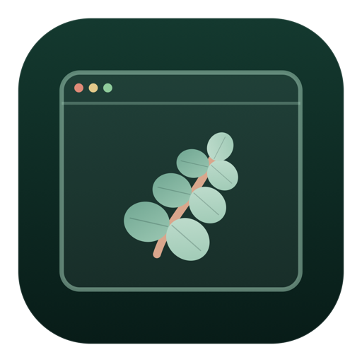
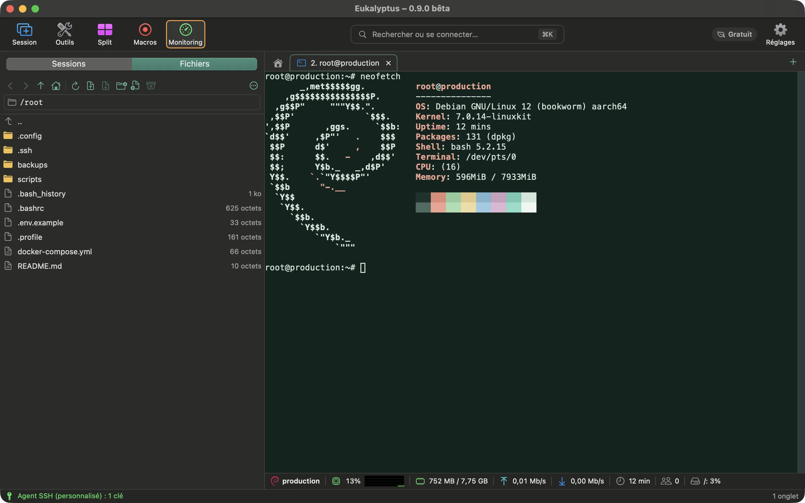

  

<h1 align="center">Eukalyptus</h1>

  <strong>Vos serveurs, enfin réunis.</strong> 
  Terminal, SSH, fichiers, bureau à distance et outils réseau dans une seule application native, pour macOS et Windows.

  
  
  
  

  Français · <a href="README.en.md">English</a>

  

Eukalyptus est une application **native** d'administration de serveurs : terminal, SSH, SFTP, FTP, S3, bureau à distance RDP et VNC,
tunnels, macros, monitoring et outils réseau. Elle est **gratuite**, sans compte, sans publicité et sans pistage.

Ce dépôt est le lieu des **retours** : bugs, idées, questions, documentation et traductions. Le code source de l'application n'est pas
public (voir [Licence](#licence)).

## Pourquoi Eukalyptus

Un terminal pour le SSH, un client pour les fichiers, une app pour Windows, un scanner, un éditeur, des notes pour les tunnels. Les outils
tout-en-un existaient, mais lourds, vieillissants ou réservés à un seul système.

**Alors j'ai construit celui que je voulais :** rapide à ouvrir, agréable à regarder, honnête avec vos données. Et gratuit, parce qu'un bon
outil d'admin ne devrait pas coûter un abonnement.

— Antoine Rodrigues, créateur d'Eukalyptus

## Fonctions

Les mêmes fonctions pour l'essentiel sur les deux systèmes, écrites chacune pour son système (Swift et SwiftUI sur Mac, C# et WPF sous
Windows, sans Electron).

| Fonction | macOS | Windows |
|---|:---:|:---:|
| Terminal à onglets (SSH, Telnet, terminal local), 9 thèmes, recherche, reconnexion automatique | Oui | Oui |
| Split, MultiExec (une commande sur plusieurs serveurs), palette de commandes | Oui | Oui |
| Clés SSH, agent SSH (dont Bitwarden et 1Password), alerte si l'identité d'un serveur change | Oui | Oui |
| X11 forwarding | Oui (avec XQuartz) | Oui (serveur X intégré) |
| Mosh | Oui | Pas encore |
| Navigateur SFTP à côté du terminal, glisser-déposer, éditeur de code intégré | Oui | Oui |
| FTP, FTPS, S3 et compatibles (AWS, MinIO, Cloudflare R2…) | Oui | Oui |
| Plusieurs transferts en même temps, avec progression, débit et temps restant | Version en cours | Oui (0.9.5) |
| Bureau à distance RDP intégré dans un onglet, passerelle SSH | Oui | Oui |
| VNC intégré dans un onglet | Oui | Oui |
| Navigateur intégré | Oui | Oui |
| Tunnels SSH (locaux, distants, SOCKS) | Oui | Oui |
| Macros, y compris au démarrage d'une session | Oui | Oui |
| Monitoring du serveur (processeur, mémoire, réseau, disque) | Oui | Oui |
| Outils réseau : ping, traceroute, DNS, ports à l'écoute, scanner, Wake-on-LAN, capture réseau | Oui | Oui |
| Import de sessions MobaXterm, Termius et fichiers .rdp ; export `.eukalyptus` | Oui | Oui |
| Mots de passe | Trousseau macOS, Touch ID | Coffre chiffré, mot de passe maître |
| Application en français et en anglais (suit la langue du système) | Oui | Oui |
| Eukalyptus+ : synchronisation chiffrée, coffre d'équipe | Oui | Oui |

« Oui » signifie que la fonction est disponible. Certaines fonctions avancées (par exemple les réglages RDP pour les entreprises, la
connexion Entra ID, les clés de sécurité physiques) sont disponibles mais ont été moins éprouvées sur Windows que sur Mac : si vous
rencontrez un problème, [signalez-le](CONTRIBUTING.md#signaler-un-bug).

Le détail, fonction par fonction, est sur [eukalyptus.app](https://eukalyptus.app) et dans les [guides](#guides) ci-dessous.

## Téléchargement

Gratuit, sans compte, installé en une minute.

- **Site** : [eukalyptus.app/telecharger](https://eukalyptus.app/telecharger) propose le bon fichier pour votre ordinateur.
- **GitHub** : les installateurs sont aussi publiés dans les [Releases](https://github.com/ant-rdg/eukalyptus/releases), avec leur
  empreinte SHA-256 et leurs notes. Le site reste la source des mises à jour de l'application.
- **Journal des versions** : [CHANGELOG.md](CHANGELOG.md).

| | macOS | Windows |
|---|---|---|
| Système | macOS 14 (Sonoma) ou plus récent | Windows 10 (version 1809) ou 11 |
| Processeur | Apple silicon (puces de la série M) | x64 (Intel ou AMD) ; ARM sous Windows 11, par émulation |
| Installateur | `.pkg` | `.exe`, sans droits d'administrateur |

Sous Windows, l'installateur n'est pas encore signé par un certificat de signature de code : SmartScreen peut afficher « Windows a
protégé votre ordinateur ». Cliquez sur « Informations complémentaires », puis sur « Exécuter quand même ». Vous pouvez d'abord vérifier
l'empreinte SHA-256 affichée sur la page de téléchargement avec `Get-FileHash`. Sur Mac, l'application n'est pas notarisée par Apple :
macOS demande une confirmation au premier lancement.

Linux, iPhone, iPad, Android et les Mac à processeur Intel ne sont pas pris en charge.

## Sécurité

- **Aucun suivi** : pas de compte, pas de statistiques d'usage, pas de publicité. Les seules connexions vers le site d'Eukalyptus sont
  listées publiquement.
- **Secrets protégés** : mots de passe dans le Trousseau macOS ou dans un coffre chiffré sous Windows, jamais dans un fichier ni dans un
  export `.eukalyptus`.
- **Mises à jour signées** : la liste des versions est signée, l'empreinte SHA-256 de chaque mise à jour est vérifiée avant installation.
- **Données reçues traitées comme hostiles** : une session importée ou reçue perd par défaut ce qui agit sans votre accord.
- **Synchronisation chiffrée de bout en bout** (Eukalyptus+) : le serveur relais ne peut ni lire ni modifier vos données.

Le détail est dans [SECURITY.md](SECURITY.md) et sur [eukalyptus.app/securite](https://eukalyptus.app/securite). Pour signaler une faille,
suivez [SECURITY.md](SECURITY.md) : **ne la publiez pas dans une issue**.

## Eukalyptus+

Toutes les fonctions d'administration sont gratuites. Eukalyptus+ est un soutien facultatif à l'auteur : **21 €, une seule fois, à vie**,
valable sur 3 ordinateurs (Mac ou PC). En remerciement, il ajoute les nouvelles versions 15 jours à l'avance, une icône et une couleur par
session, le badge de soutien, la synchronisation chiffrée des sessions et le coffre d'équipe. Il n'y a ni période d'essai, ni limite de
sessions, ni rappel dans l'application. Détails : [eukalyptus.app/tarifs](https://eukalyptus.app/tarifs).

## Feuille de route

Ce qui est fait, en cours, prévu, et les idées à discuter : [ROADMAP.md](ROADMAP.md). Pour proposer une idée ou voter pour une idée
existante, passez par les [Discussions](https://github.com/ant-rdg/eukalyptus/discussions/categories/idees).

## Contribuer

Le code est fermé, mais vous pouvez aider : signaler un bug, proposer une idée, poser une question, corriger la documentation
(`docs/`) ou **traduire l'application** (`translations/`). Tout est expliqué dans [CONTRIBUTING.md](CONTRIBUTING.md). Merci de lire
aussi le [code de conduite](CODE_OF_CONDUCT.md).

## Guides

Des guides pas à pas, avec les commandes et la façon de faire dans Eukalyptus (aussi sur [eukalyptus.app/blog](https://eukalyptus.app/blog)).

1. [Client SSH pour Mac : le guide complet](docs/fr/client-ssh-mac.md)
2. [Client SFTP gratuit pour Mac : transférer et éditer ses fichiers](docs/fr/client-sftp-mac.md)
3. [Générer et gérer ses clés SSH sur Mac, pas à pas](docs/fr/cles-ssh-mac.md)
4. [Tunnel SSH sur Mac : redirection locale, distante et SOCKS](docs/fr/tunnel-ssh-mac.md)
5. [X11 forwarding sur Mac : afficher une application d'un serveur avec XQuartz](docs/fr/x11-forwarding-mac-xquartz.md)
6. [Client S3 pour Mac : AWS S3, MinIO et Cloudflare R2 comme un dossier](docs/fr/client-s3-mac.md)
7. [Bureau à distance RDP sur Mac : se connecter à Windows](docs/fr/rdp-mac-bureau-a-distance.md)
8. [Wake-on-LAN depuis un Mac : réveiller un PC ou un NAS à distance](docs/fr/wake-on-lan-mac.md)
9. [Capture réseau sur Mac : tcpdump, .pcap et analyse en clair](docs/fr/capture-reseau-mac.md)
10. [Synchroniser ses sessions SSH entre Mac et Windows, chiffrées de bout en bout](docs/fr/synchroniser-sessions-ssh.md)
11. [Importer ses sessions MobaXterm sur Mac](docs/fr/importer-sessions-mobaxterm-mac.md)
12. [La meilleure alternative à MobaXterm sur Mac](docs/fr/meilleure-alternative-mobaxterm-mac.md)

## Communauté

- **[GitHub Discussions](https://github.com/ant-rdg/eukalyptus/discussions)** : questions, idées (avec votes), échanges entre utilisateurs.
- **[Issues](https://github.com/ant-rdg/eukalyptus/issues)** : bugs et problèmes précis.
- **[X, @Eukalyptus_app](https://x.com/Eukalyptus_app)** : annonces des nouvelles versions uniquement.

Vous pouvez écrire en français ou en anglais.

## Licence

Eukalyptus est **gratuit mais pas open source** : vous pouvez le télécharger, l'installer et l'utiliser gratuitement, sur autant
d'ordinateurs que vous le souhaitez, pour un usage personnel, professionnel, associatif ou scolaire. Son code source n'est pas fourni.

- [Licence d'utilisation (français)](LICENSE.txt)
- [License (English)](LICENSE-en.txt)

Les composants libres embarqués restent soumis à leur propre licence : la liste est dans l'application (Réglages › Crédits).

## Auteur

Conçu et développé par **Antoine Rodrigues**, en France. [eukalyptus.app](https://eukalyptus.app) ·
[LinkedIn](https://www.linkedin.com/in/antoine-rodrigues/) · [X](https://x.com/Eukalyptus_app) · contact@eukalyptus.app
