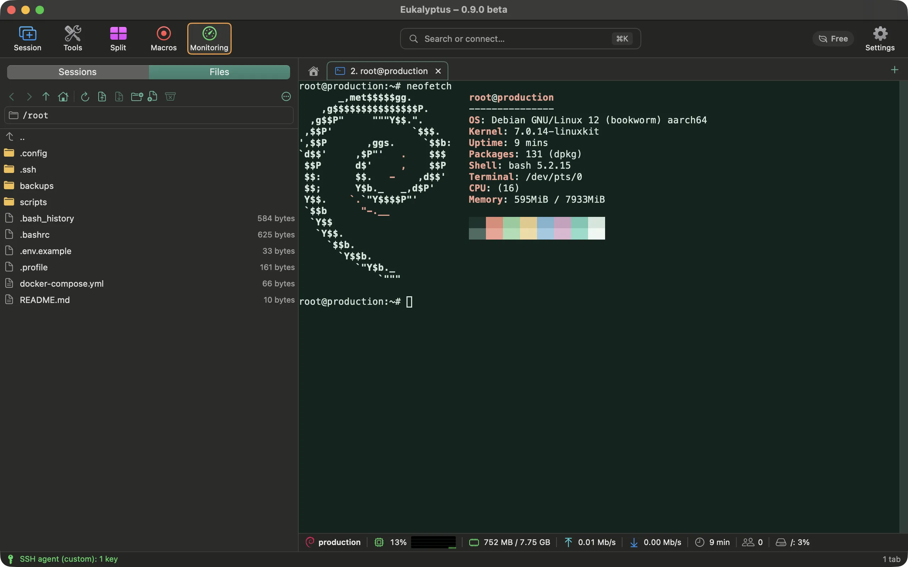
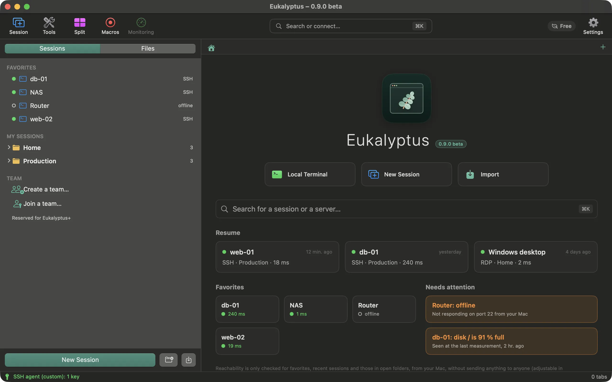
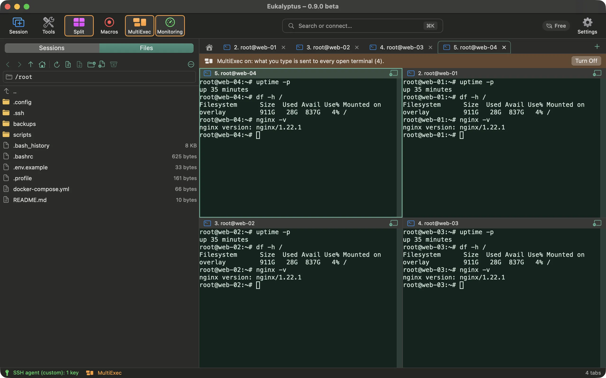

# The best MobaXterm alternative for Mac

MobaXterm is the favorite tool of many system administrators, but it only exists for Windows. Here is how to get its sessions, file browser, tunnels and macros back on a Mac, in a native, free and unlimited app: Eukalyptus.

> **In short**
>
> - MobaXterm has no Mac version: you need an app designed for macOS.
> - Eukalyptus brings together an SSH terminal, SFTP, tunnels, macros, X11, remote desktop and network tools in one app.
> - Your MobaXterm sessions import in a few clicks.
> - Free, no account, no tracking, no session limit. Apple silicon Macs, macOS 14 or later.

**In this article**

1. [MobaXterm doesn't exist on Mac](#mobaxterm-doesnt-exist-on-mac)
2. [What to expect from an alternative](#what-to-expect-from-a-mobaxterm-alternative)
3. [What you get in Eukalyptus](#what-you-get-in-eukalyptus)
4. [Migrate in two minutes](#migrate-from-mobaxterm-in-two-minutes)
5. [Security and privacy](#security-and-privacy)
6. [How much it costs](#how-much-it-costs)
7. [Frequently asked questions](#frequently-asked-questions)

## MobaXterm doesn't exist on Mac

MobaXterm puts an SSH terminal, an SFTP browser, tunnels, macros, an X server and remote desktop clients in a single window. That is exactly what makes it so handy when you manage several servers. But it is a Windows program: its publisher offers no macOS version.

So when you move to a Mac, you end up juggling: a terminal on one side, an SFTP client on the other, a remote desktop tool somewhere else, and sessions to type again in each of them. Running MobaXterm in a Windows virtual machine is possible, but it is heavy, slow to start, and you lose what makes a Mac comfortable: its shortcuts, the Keychain, drag and drop to Finder, dark mode.

Eukalyptus was written for exactly this: keeping the idea of a single workstation for the administrator, in a real macOS app.

## What to expect from a MobaXterm alternative

Before comparing tools, here is what you need to find so you don't lose your habits:

- **A native app**, quick to open, that follows macOS conventions.
- **Sessions organized** in folders, with a quick connect.
- **A file browser (SFTP)** opened with each SSH connection.
- **SSH tunnels** and **macros**, with no artificial limit.
- **X11 forwarding** for the server's graphical applications.
- **Remote desktop** (RDP, VNC) in the same tool.
- **Session import**, so you retype nothing.
- **Clear pricing**: no essential feature locked behind a subscription.

Let's see how Eukalyptus handles each point.

## What you get in Eukalyptus

*An SSH terminal, the SFTP browser of the same connection on the left, and the server monitoring bar at the bottom.*

### Organized sessions, quick connect

Your servers are organized in a folder tree ("My sessions"), with favorites, an icon for each session type, a dot that tells whether the server answers and a double-click to connect. The command palette (`⌘K`) searches your sessions and accepts `user@host:port` directly. Session types cover SSH, SFTP, FTP and FTPS, Telnet, Mosh, serial port, RDP, VNC, S3 and even a built-in web browser.

*Sessions in folders, with a filter and recent sessions on the home screen.*

### An SSH terminal built on OpenSSH

Eukalyptus runs the system's OpenSSH: your `~/.ssh/config`, your keys, your agent (including Bitwarden's), ProxyJump and agent forwarding work as usual. The terminal has tabs, search (⌘F), zoom, nine themes, and autocompletion that suggests commands from your history, never passwords. When a session ends, a screen offers *Return* to close or *R* to restart. Automatic reconnection can also restart the session after a network drop. As an option, the terminal highlights keywords on the fly: errors in red, warnings in yellow, successes in green, IP addresses in cyan, without touching what programs color themselves.

### The SFTP browser, opened with each session

Each SSH connection shows the server's files on the left. The browser reuses the terminal's connection (ControlMaster): you authenticate only once. You browse, upload and download files and folders with progress, rename, set permissions in a graphical editor (rwx checkboxes, octal mode), and drag a file straight to Finder or the Desktop.

Double-clicking a file opens it in the **built-in code editor**, with highlighting for more than twenty languages and configuration formats (shell, nginx, yaml, python, json…), find and replace. When you save with ⌘S, the file goes back to the server with its permissions, and the app warns you if someone changed it in the meantime.

### Server monitoring, with nothing to install

Under each SSH session, a bar shows live CPU usage (with its history), memory, network throughput, uptime, logged-in users and disk usage. It uses the connection that is already open: no agent to install on the server. It works with Linux and macOS servers.

### Unlimited tunnels and macros

The SSH tunnel manager handles local, remote and SOCKS forwarding, with no limit on their number. Macros are recorded, replayed with their pauses and edited. A session can also run a macro by itself when it opens, after the delay of your choice.

### MultiExec and tiled view

To act on a grid of machines, the Split button shows all open terminals side by side, and MultiExec sends what you type to all of them at once. Handy to check a version or restart a service on four servers in a single keystroke.

*MultiExec: the same command sent to four servers, tiled.*

### X11 forwarding

To run a server's graphical application and display it on your Mac, tick the session's X11 option. Eukalyptus relies on XQuartz, the free X server for macOS, installed once. It finds XQuartz's display by itself and, if XQuartz is missing, offers to download and install it instead of showing ssh's error message.

### Remote desktop

RDP sessions open in a tab, with a built-in client (FreeRDP): no other app to install. The password is stored in the Keychain, and the client covers an administrator's needs:

- **Copy and paste** text, images and files, both ways, between Finder and Windows Explorer.
- **Sharing with the Mac**: the folders of your choice, printers, smart cards and sound.
- **Full screen**, and a mode that spans the Windows desktop across all the Mac's displays.
- **Microsoft Entra ID accounts**, RD Gateway, a program to launch instead of the desktop, load balancer, Hyper-V console and Restricted Admin.
- **Smooth display** (RDPGFX), a **Retina** option for crisp text, and automatic reconnection after a drop.

VNC sessions open in Screen Sharing, the macOS VNC client. RDP and VNC can go through an automatic SSH tunnel when the server can't be reached directly.

### Files, buckets and network tools

The same file browser works for FTP and FTPS, and for S3 buckets (AWS, MinIO, Cloudflare R2, Backblaze B2, Wasabi, Scaleway, OVHcloud…), with uploads, downloads and presigned links. For troubleshooting, there is a network scanner, ping, traceroute, DNS lookup and the list of the Mac's listening ports, without leaving the app. **Packet capture** shows who talks to whom, with a plain-language summary (unencrypted protocols, refused connections, names not found) and a `.pcap` recording for Wireshark. **Wake-on-LAN** wakes a powered-off machine on the local network and, if you give its name, tells you when it answers. The tools you use most can be pinned to the top bar.

### Passwords and SSH keys

The password manager stores secrets in the macOS Keychain; showing or copying them requires Touch ID or the Mac's password, and the copy is cleared from the clipboard after 30 seconds. The SSH key manager lists the keys in `~/.ssh` and in the agent, generates new keys (Ed25519, RSA, ECDSA) and installs them on a server.

To go further, each has its own guide: [the SSH client](./ssh-client-mac.md), [the SFTP browser](./sftp-client-mac.md), [RDP remote desktop](./rdp-mac-remote-desktop.md), [SSH tunnels](./ssh-tunnel-mac.md), [X11 forwarding](./x11-forwarding-mac-xquartz.md), [SSH keys](./ssh-keys-mac.md), [S3 buckets](./s3-client-mac.md), [packet capture](./packet-capture-mac.md) and [Wake-on-LAN](./wake-on-lan-mac.md).

## Migrate from MobaXterm in two minutes

1. [Download Eukalyptus](https://eukalyptus.app/en/download) and install it: the .pkg installer runs like any Mac installer.
2. At first launch, the welcome screen offers **"Import My MobaXterm Sessions"**. Choose your `MobaXterm.ini` file or your sessions export (`.mxtsessions`). Later, the import button at the bottom of the left panel opens the same import.
3. Your folders and hosts are recreated. Enter each password only once: it goes straight into the macOS Keychain.

Where to find the file on the PC, what is imported, and what to do with your keys: it is all detailed in [the MobaXterm session import guide](./import-mobaxterm-sessions-mac.md).

Do you also have `.rdp` files? File › "Import RDP Sessions (.rdp, Folder or .zip)…" imports a file, a whole folder (subfolders included) or a `.zip` archive, with the address, user, gateway and options of each session.

Passwords are not imported: Eukalyptus asks for them once and stores them in the Keychain, instead of reading them from a file. You can keep MobaXterm as long as you like: the import doesn't touch your original files. An export in the `.eukalyptus` format, also without passwords, then lets you back up your sessions or copy them to another Mac.

## Security and privacy

Eukalyptus requires no account and goes through no server to connect you to yours. Your passwords live in the macOS Keychain, never in a file or an export. Updates are offered at launch; the version list is signed, and the app checks the file's fingerprint and signature before installing anything. Every network exchange the app makes, when it happens and what it contains, is described in detail on the [Security](https://eukalyptus.app/en/security) page.

## How much it costs

Eukalyptus is free, and complete: as many sessions, tunnels and macros as you want, with no trial period. **Eukalyptus+** is an optional €21 license, paid once and valid for life: it supports its author, gives access to new versions 15 days before everyone else and lets you choose an icon and a color for each session. It never takes anything away from the free version. Details are on the [Pricing](https://eukalyptus.app/en/pricing) page.

For reference, MobaXterm's free Home Edition is limited to 12 saved sessions, 2 SSH tunnels and 4 macros, and lifting these limits requires its Professional version (€49 per user, excluding tax). These figures come from its official website, checked on October 27, 2026. For the full feature-by-feature table, see the [Eukalyptus vs MobaXterm](https://eukalyptus.app/en/mobaxterm-alternative-mac) page.

## Frequently asked questions

Does MobaXterm exist on Mac?

No. MobaXterm is Windows software and its publisher offers no macOS version. To get the same workflow on a Mac, you need an app made for macOS, such as Eukalyptus.

Is Eukalyptus really free?

Yes. Every feature is free, with no limit on sessions, tunnels or macros, and no account to create. Eukalyptus+ (€21, once) is optional: it supports the project and adds a few extras, without ever taking a feature away from the free version.

Can I bring my MobaXterm sessions?

Yes. Eukalyptus reads the MobaXterm.ini file or your sessions export (.mxtsessions) and recreates your folders and hosts. Passwords are not imported: you type them once and they are stored in the macOS Keychain.

Which Macs does Eukalyptus run on?

Apple silicon Macs (M-series chips) with macOS 14 or later. A Windows version is planned.

Do I need an account to use it?

No. There is no account, no tracking, and nothing goes through our servers to connect you to yours.

What about X11 forwarding?

It is supported, with XQuartz (free), which Eukalyptus does not bundle. Just tick the option in the session; if XQuartz is missing, the app offers to install it.

---

MobaXterm is a trademark of Mobatek, mentioned here for comparison. Eukalyptus has no connection with this publisher. MobaXterm's limits come from its [Home and Professional editions](https://mobaxterm.mobatek.net/download.html) and [features](https://mobaxterm.mobatek.net/features.html) pages, checked on October 27, 2026. Has something changed? Write to [contact@eukalyptus.app](mailto:contact@eukalyptus.app) and we will fix it.
