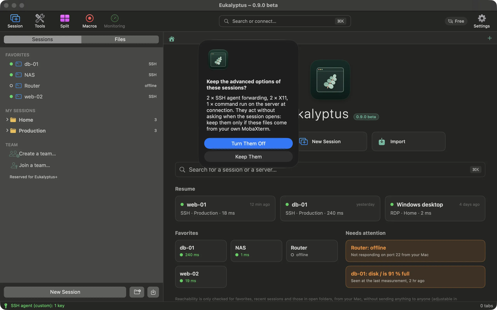

# Import your MobaXterm sessions on a Mac

Dozens of servers organized in folders in MobaXterm, and a new Mac: nobody wants to type everything again. Eukalyptus reads MobaXterm's sessions file directly. Here is where to find it on the PC, how to import it, and what is kept.

> **In short**
>
> - Two possible files: MobaXterm.ini, or a .mxtsessions export.
> - Folders, hosts, ports, users, SSH jump hosts, keys and RDP options are imported.
> - SSH, SFTP, Telnet, Mosh, RDP, VNC, FTP, serial, shell and browser: ten session types.
> - Passwords are not imported; options that act on their own are kept only if you agree.

**In this article**

1. [Get your sessions from the Windows PC](#get-your-sessions-from-the-windows-pc)
2. [Import into Eukalyptus](#import-into-eukalyptus)
3. [What is imported](#what-is-imported)
4. [Advanced options, kept on request](#advanced-options-kept-on-request)
5. [After the import: passwords and keys](#after-the-import-passwords-and-keys)
6. [Termius, .rdp files and backup](#termius-rdp-files-and-backup)
7. [When the import finds nothing](#when-the-import-finds-nothing)
8. [Frequently asked questions](#frequently-asked-questions)

## Get your sessions from the Windows PC

MobaXterm stores all your sessions in a single text file. Two ways to get it:

### Export the sessions (the simplest)

1. In MobaXterm, right-click **"User sessions"**, in the Sessions pane on the left.
2. Choose **"Export all sessions to file"** and save the `.mxtsessions` file.

### Copy MobaXterm.ini

The configuration file contains the same sessions. Its location depends on the edition:

- **Installer edition**: `%APPDATA%\MobaXterm\MobaXterm.ini`, usually `C:\Users\your-name\AppData\Roaming\MobaXterm\MobaXterm.ini`. Paste `%APPDATA%\MobaXterm` into File Explorer's address bar.
- **Portable edition**: `MobaXterm.ini` sits next to the executable, on the USB stick or in the folder where you put it.

Get the file onto the Mac however you like: USB stick, shared folder, an email to yourself. It contains no clear-text password, but it lists your servers: don't leave it lying around in a shared space.

## Import into Eukalyptus

1. At first launch, the welcome screen offers **"Import My MobaXterm Sessions"**. Later: the **File › Import MobaXterm Sessions…** menu, or a right-click on "User sessions".
2. Choose your `MobaXterm.ini` or `.mxtsessions` file.
3. Tick or not **"Turn on agent forwarding for the imported SSH sessions"**. MobaXterm turns it off by default; tick it if your jump hosts or your Git commands on the server need your keys.
4. If some sessions have advanced options, Eukalyptus asks whether to keep them (see below).
5. The report appears: the number of sessions imported, the sessions set aside and why.

The sessions land in an **"Import MobaXterm"** folder, with the tree of your original folders. The file is read as UTF-8 or, failing that, as Windows-1252, the encoding of older versions: accented folder names are preserved.

## What is imported

MobaXterm's file format is not documented. Eukalyptus reads it from the description of the session parameters built into MobaXterm itself, field by field:

- **For every session**: the name, folder, host, port, user and comment, which becomes the session's note.
- **SSH**: X11 forwarding, compression, command to run, private key, agent forwarding and SSH gateway, which becomes a jump host (`ssh -J`).
- **RDP**: admin console, shared drives and printers, clipboard, resolution (including full screen), sound and SSH gateway.
- **VNC**: the SSH gateway, imported as a tunnel.
- **SFTP, FTP, Telnet, Mosh**: the connection, and the private key for SFTP and Mosh.
- **Serial**: the speed. A Windows port (`COM3`) is flagged: replace it with the Mac's port, of the form `/dev/tty.usbserial-…`.
- **Shell and browser**: the session type and the page address.

Not imported: MobaXterm's WSL, Rsh, XDMCP, "File" and AWS S3 sessions, and passwords. The import report lists the sessions left out.

## Advanced options, kept on request

*During the import: options that act on their own are counted, and turned off by default.*

Some options act with no further question when the session opens: a command run on the server, X11 forwarding, agent forwarding, free `ssh` options, and for RDP the sharing of the Mac's drives and printers. In a file received from someone else, they could be used to booby-trap a session. Eukalyptus counts them, by type, and asks:

- **"Turn Them Off"** (default button): the sessions are imported without them. You turn them back on one by one in the session's settings.
- **"Keep Them"**: only if the file comes from your own MobaXterm.

Invalid addresses, for example a host name that starts with a dash and looks like an `ssh` option, are set aside and counted in the report.

## After the import: passwords and keys

### Passwords

On the first connection, enter the password and save it: it is stored in the macOS Keychain, and showing or copying it requires Touch ID or the Mac's password. Better still, switch to [SSH keys](./ssh-keys-mac.md): the Eukalyptus key manager creates one and installs it on the server.

### Private keys

MobaXterm saves Windows paths (`_ProfileDir_\.ssh\id_ed25519`, `C:\…`). Eukalyptus keeps the file name and looks for it in `~/.ssh` on the Mac. So copy your keys to `~/.ssh` **before** the import, then protect them:

1. Copy the key files (for example `id_ed25519`) to the `.ssh` folder of your home folder.
2. In Terminal: `chmod 600 ~/.ssh/id_ed25519`. OpenSSH refuses a key that other accounts can read.
3. A key in PuTTY format (`.ppk`) must be converted first, with PuTTYgen on the PC (Conversions › Export OpenSSH key) or on the Mac after `brew install putty`: `puttygen key.ppk -O private-openssh -o ~/.ssh/key`.

A key that can't be found doesn't block the import: the session will use your SSH agent, and the report names the missing keys.

## Termius, .rdp files and backup

- **Termius**: File › Import Termius Sessions… reads a CSV (Termius import template) or an OpenSSH configuration.
- **.rdp files**: File › Import RDP Sessions (.rdp, Folder or .zip)… imports a file, a whole folder or a `.zip` archive. See [the RDP guide](./rdp-mac-remote-desktop.md).
- **Backup**: File › Export Sessions (.eukalyptus)… creates a file with no passwords, for another Mac or a backup.

## When the import finds nothing

### "0 session(s) imported"

The file probably contains no sessions section. Open it in a text editor: sessions sit under `[Bookmarks]`, `[Bookmarks_1]`… headings. If there are none, it may be the file of another MobaXterm installation: export again from the right-click on "User sessions".

### A session opens but the connection is refused

Check the user and the key in the session's settings. An SSH gateway imported from MobaXterm becomes a jump host: the jump server must be reachable from the Mac, not only from the PC.

For everything else Eukalyptus does, see [the best MobaXterm alternative for Mac](./best-mobaxterm-alternative-mac.md).

## Frequently asked questions

Are the passwords saved in MobaXterm imported?

No. MobaXterm encrypts them with its master password, and a sessions file has no business carrying secrets. Eukalyptus asks for each password on the first connection and can save it in the macOS Keychain.

Does the import change my MobaXterm installation?

No. Eukalyptus reads a copy of the file, without writing anything to it: you can keep MobaXterm on your PC as long as you like.

Can I import several times?

Yes. Each import creates its sessions in the "Import MobaXterm" folder, which you can rename, reorganize or delete.

Are my MobaXterm S3 and WSL sessions imported?

No: MobaXterm's WSL, Rsh, XDMCP, "File" and AWS S3 sessions are not imported, and the import report lists them. For S3, create an S3 session in Eukalyptus, with the same endpoint.

Is it free?

Yes, the import like the rest of the app, with no account.

