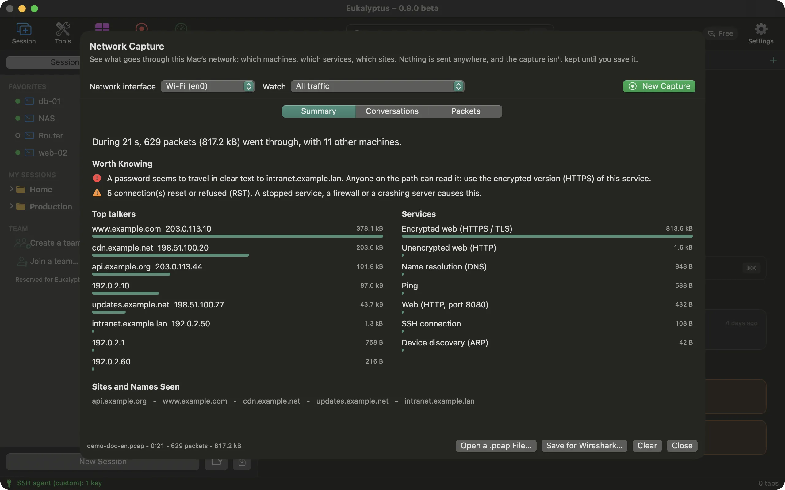

# Packet capture on a Mac: tcpdump, .pcap and a plain-language summary

A connection that fails with no clear message, an app that contacts an unknown server, a service that sends a password in clear text: to find out, you need to look at what goes over the network. On a Mac, tcpdump does it on the command line. Eukalyptus does it in three clicks, with a plain-language summary.

> **In short**
>
> - A capture shows who talks to whom, with which protocol, and what fails.
> - tcpdump is built into macOS; Eukalyptus drives it and decodes the result.
> - The summary reports first clear-text passwords, HTTP, Telnet and FTP, refused connections and names not found.
> - Saved as .pcap for Wireshark. Nothing is sent anywhere.

**In this article**

1. [What a network capture is for](#what-a-network-capture-is-for)
2. [The classic way: tcpdump](#the-classic-way-tcpdump)
3. [Capture in three clicks with Eukalyptus](#capture-in-three-clicks-with-eukalyptus)
4. [Read the result: summary, conversations, packets](#read-the-result-summary-conversations-packets)
5. [Four real-world cases](#four-real-world-cases)
6. [Open and save .pcap files](#open-and-save-pcap-files)
7. [What the capture keeps, and what it doesn't see](#what-the-capture-keeps-and-what-it-doesnt-see)
8. [Frequently asked questions](#frequently-asked-questions)

## What a network capture is for

A capture records the packets that go through one of the Mac's network interfaces: where they come from, where they go, on which port, with which protocol. It is the most direct way to answer questions that error messages leave open:

- Does the connection to the server really go out, and does the server answer?
- Is it a firewall refusing, or a DNS name that doesn't exist?
- Which servers does an app contact when it starts?
- Does this old web service or this printer send credentials in clear text?

## The classic way: tcpdump

macOS ships `tcpdump`, the reference capture tool on Unix. It needs administrator rights and a filter syntax you have to know:

*List the network interfaces, then capture en0's web traffic to a file*

```sh
tcpdump -D
sudo tcpdump -i en0 -s 600 -w capture.pcap 'tcp port 80 or tcp port 443'
```

The file is then read with `tcpdump -r capture.pcap`, line by line, or in Wireshark. It is powerful, but slow to read when you just want to know what happened.

## Capture in three clicks with Eukalyptus

1. Open **Tools › Network Capture…** (or pin the "Capture" tool to the top bar).
2. Choose the **network interface** and what you want to **watch**: all traffic, the web (HTTP and HTTPS), site names (DNS), SSH connections, pings, remote desktop (RDP), a specific machine or a specific port.
3. Click **Start Capture**: macOS asks for your password.
4. Do what you want to observe: open a page, start a connection, print…
5. Click **Stop**. The summary appears; the packets themselves are decoded as the capture goes.

Behind the scenes, Eukalyptus runs `tcpdump` with administrator rights, a single command built from checked values: the interface name, and a filter taken from the list or a checked address and port. No free text is passed to the command. The capture is written to a new folder reserved for your account.

## Read the result: summary, conversations, packets



*A capture's summary: problems first, then who talked, with which services.*

### Summary

One sentence first: how long, how many packets, with how many other machines. Then the "Worth Knowing" remarks, from the most serious to the simplest:

- a password that seems to travel in clear text, and to which server;
- unencrypted Telnet or FTP;
- unencrypted HTTP exchanges, with the sites concerned;
- connections cut or refused (TCP RST packets);
- ICMP "unreachable" messages;
- names not found (DNS), often a typo or a name that no longer exists.

Then comes the list of **sites and names seen**, taken from DNS queries, the site name an HTTPS connection presents (SNI) and the Host header of HTTP requests. IP addresses are linked to the names learned during the capture, which makes the exchanges readable.

### Conversations

A table of the exchanges, machine by machine and service by service, with the number of packets and the volume. An open orange padlock marks what isn't encrypted, a red triangle the failures.

### Packets

The full list, with for each packet its source, its destination, the service and a sentence that describes it ("Ping (request)", "Destination unreachable"…). A click shows its bytes.

## Four real-world cases

### An SSH connection that doesn't go through

Watch "SSH connections", then start the session. No packet to the server: the problem is on the Mac (name, route, VPN). Packets sent with no answer: a firewall drops them. Refused connections (RST): the server is reachable, but nothing listens on port 22.

### A website that doesn't open

Watch "Site names (DNS)". A name not found shows up in the remarks: the problem is the name or the DNS server, not the website.

### Find out what an app contacts

Watch "The web", start the app, stop. The "Sites and Names Seen" list gives the servers it reached, even over HTTPS, since the site name travels in clear text at the start of the connection.

### Check a device on the network

A printer, a camera or an old admin interface: watch "A specific machine…" with its address, then log in to its interface. If the capture reports a clear-text password, change it, and switch to the HTTPS version of the interface if there is one.

## Open and save .pcap files

**Save for Wireshark…** saves the capture in the `.pcap` format, readable by Wireshark, tcpdump and most analysis tools. Until you save, nothing is kept: the temporary files are deleted when the window closes.

**Open a .pcap File…** does the reverse, with no password: a capture made on a server with `tcpdump -w`, fetched with the [SFTP browser](./sftp-client-mac.md), is analyzed with the same summary. Only the classic `.pcap` format is read, not the `.pcapng` that Wireshark saves by default.

*Capture on a Linux server, then fetch the file in Eukalyptus*

```sh
sudo tcpdump -i eth0 -s 600 -c 5000 -w /tmp/server.pcap port 443
```

## What the capture keeps, and what it doesn't see

- **600 bytes per packet**: enough for addresses, site names and the start of requests, without keeping the content of the exchanges.
- **10 minutes and 100,000 packets at most**: the capture stops by itself, even if you forget to stop it.
- **Nothing is sent**: the analysis happens on the Mac.
- **Encrypted content stays encrypted**: over HTTPS, SSH or RDP, you see who talks to whom and how much, not what is said.
- **Only the Mac's traffic** (and what is broadcast to the whole network) is visible on a switched network or on Wi-Fi: to observe another machine, capture on it, or on a mirror port of the switch.

For the rest of the diagnosis, Eukalyptus also offers a network scanner, ping, traceroute, DNS lookup and listening ports, and [Wake-on-LAN](./wake-on-lan-mac.md) to wake up a machine that is off. See also [our comparison of Mac tools](./best-mobaxterm-alternative-mac.md).

## Frequently asked questions

<details>
<summary>Why is the administrator password needed?</summary>

macOS reserves direct reading of network interfaces to the administrator. Eukalyptus runs a single tcpdump command with these rights, built from checked values (network interface, filter), and never from free text.

</details>

<details>
<summary>Can the capture read my passwords?</summary>

Not those that go through an encrypted connection (HTTPS, SSH, RDP): only site names and the size of the exchanges are visible. A password sent in clear text, over HTTP, FTP or Telnet, can show up, however: the summary reports it first.

</details>

<details>
<summary>Does Eukalyptus replace Wireshark?</summary>

For a quick diagnosis, often: the summary says in plain language what happened. To dissect a protocol field by field, Wireshark remains the reference tool: save the capture and open it there.

</details>

<details>
<summary>Can I open a .pcapng file?</summary>

No, only the classic .pcap format, the one tcpdump writes. In Wireshark, File › Save As… with the "pcap" format converts it.

</details>

<details>
<summary>Is it free?</summary>

Yes, like all the Eukalyptus tools.

</details>
