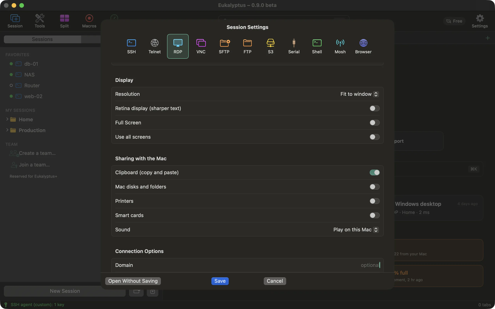

# RDP on a Mac: connect to Windows with Remote Desktop

Open the desktop of a Windows PC or server from a Mac, copy a file from one side to the other, print, go through the company gateway: it all happens in an Eukalyptus tab, with its built-in RDP client. Here is how to prepare Windows, set up the session and fix connection failures.

> **In short**
>
> - The RDP client (FreeRDP) is built in: no other app to install.
> - Copy and paste text, images and files both ways; folders, printers, smart cards and sound shared as you choose.
> - Full screen, all the Mac's displays, Retina, RD Gateway, Entra ID, Hyper-V.
> - Import .rdp files one by one, by folder or as a .zip.

**In this article**

1. [RDP in a nutshell](#rdp-in-a-nutshell)
2. [Prepare the Windows PC or server](#prepare-the-windows-pc-or-server)
3. [Create the session in Eukalyptus](#create-the-session-in-eukalyptus)
4. [Keyboard, mouse and shortcuts](#keyboard-mouse-and-shortcuts)
5. [Copy and paste text, images and files](#copy-and-paste-text-images-and-files)
6. [Share folders, printers and sound](#share-folders-printers-and-sound)
7. [Full screen and multiple displays](#full-screen-and-multiple-displays)
8. [RD Gateway, Entra ID and enterprise settings](#rd-gateway-entra-id-and-enterprise-settings)
9. [Reach a Windows machine that isn't exposed](#reach-a-windows-machine-that-isnt-exposed)
10. [Bring your .rdp files](#bring-your-rdp-files)
11. [When the connection fails](#when-the-connection-fails)
12. [Frequently asked questions](#frequently-asked-questions)

## RDP in a nutshell

RDP (Remote Desktop Protocol) is Microsoft's remote desktop protocol. The Windows PC or server listens on TCP port `3389`; the client shows its screen and sends it the keyboard and mouse. The connection is encrypted with TLS, and Network Level Authentication (NLA) checks your account *before* opening a Windows session, which protects the server from anonymous connections.

*Diagram: The Mac connects over RDP to port 3389 of the Windows server, with TLS and NLA; the clipboard and shared folders go through the same connection.*

| Your Mac |  | Windows |  | Your session |
|---|---|---|---|---|
| Eukalyptus FreeRDP client | RDP (TLS + NLA) → | Remote Desktop port 3389 | opens → | desktop, files printers, sound |

## Prepare the Windows PC or server

1. **Turn on Remote Desktop**: on Windows 10 or 11 Pro, Settings › System › Remote Desktop; on Windows Server, Server Manager › Local Server › Remote Desktop. Home editions can't receive RDP connections.
2. **Keep Network Level Authentication (NLA)** ticked: it is the default setting, and Eukalyptus uses it.
3. **Allow the account**: administrators are allowed by default; for another account, add it to the "Remote Desktop Users" group.
4. **Open port 3389** in the firewall, for the local network only (turning on Remote Desktop creates the rule).

## Create the session in Eukalyptus

1. Click **New Session** and choose the **RDP** type.
2. Enter the **host** (name or IP address), the **user** and, for a domain account, the **domain**. The password can be saved: it is stored in the macOS Keychain.
3. In **Display**, choose the resolution; by default, the Windows desktop follows the size of the tab. The **Retina display** option asks for a desktop in Retina pixels and scales the Windows interface to 200%, for sharper text.
4. Double-click the session. On the first connection, Eukalyptus shows the fingerprint of the server's certificate; check it, then accept. If it changes later, you are warned.

The tab's toolbar offers Ctrl+Alt+Del (which macOS can't send from the keyboard), full screen, reconnect and disconnect. After a network drop, the session reconnects by itself ("Reconnect automatically after a drop" setting).

## Keyboard, mouse and shortcuts

- **⌘ acts as Ctrl** (default setting): ⌘C, ⌘V and ⌘Z copy, paste and undo in Windows, as on the Mac.
- **The Mac's keyboard layout** is passed on, ISO keyboards included (the key to the left of Z).
- **The mouse and scroll wheel** work as expected, with the server's cursor.

## Copy and paste text, images and files

The clipboard is shared by default, both ways. **Text** goes across with its accents and with line endings converted. **Images** go from a Mac screenshot to Paint, and the other way round. **Files and folders** are copied in Finder and pasted in Windows Explorer, and the other way round: the tab's toolbar shows the progress.

What comes from Windows is limited to 128 MB and 500 items per copy; beyond that, use a shared folder. Received files carry the macOS quarantine attribute, like a download: an app or a script coming from the server goes through Gatekeeper before it opens.

## Share folders, printers and sound

*Display and sharing for an RDP session: everything is set in the session's settings.*

In "Session Settings", the **Sharing with the Mac** section sets what Windows can use:

- **Mac disks and folders**: choose the folders to share (Downloads by default). They appear in Explorer, under "This PC".
- **Printers**: the Mac's printers are offered in Windows.
- **Smart cards**: for accounts that authenticate with a card.
- **Sound**: played on this Mac (default), on the server, or muted.

Folders, printers and smart cards are off by default: only share what the session needs, especially with a server you don't own.

## Full screen and multiple displays

The **Full Screen** button moves the session into its own window, in macOS full screen. The **All Screens** mode spans a single Windows desktop across all the Mac's displays, following their arrangement (including a display placed to the left of or above the main one). To leave it: `Ctrl+Option+Cmd+F` or the toolbar button. **Smooth display** (RDPGFX) is on by default for movement and scrolling.

## RD Gateway, Entra ID and enterprise settings

The "Enterprise and Advanced Options" section opens by itself as soon as one of its settings is used:

- **RD Gateway**: its address, "Always" or "Except for local network addresses", and credentials that are the same as the server's or different (stored separately in the Keychain).
- **Microsoft Entra ID account**: you sign in on Microsoft's page, in a window; Eukalyptus doesn't see your password.
- **Program to start** instead of the desktop, with its working folder.
- **Load balancer** (RD Connection Broker) for server farms.
- **Hyper-V virtual machine**: its identifier opens its console, on port 2179.
- **Restricted Admin**: your password is not sent to the server.
- **Classic RDP encryption**, only for very old servers: it can be intercepted, so leave it off otherwise.

## Reach a Windows machine that isn't exposed

Never open port 3389 to the Internet: it is one of the most attacked targets. Three clean solutions: an RD Gateway, a VPN, or an SSH jump. For the latter, fill in the session's **SSH gateway** field (for example `user@bastion:22`): Eukalyptus opens the SSH tunnel itself, then the RDP session through it. The principle is explained in [the SSH tunnels guide](./ssh-tunnel-mac.md).

## Bring your .rdp files

File › **"Import RDP Sessions (.rdp, Folder or .zip)…"** imports a file, a whole folder (its subfolders become session folders) or a `.zip` archive. The address, user, domain, display, sharing, gateway and options are imported. The password saved in an .rdp file is not (it is encrypted for the Windows account that created it). As a precaution, what acts without your consent (shared folders, program to start, gateway) is offered turned off; you can keep it if the files come from you. Coming from Windows? Also read [our comparison of Mac tools](./best-mobaxterm-alternative-mac.md).

## When the connection fails

### No answer from the server

Remote Desktop isn't turned on, port 3389 is closed by a firewall, or the PC is asleep. Check from the Mac with `nc -vz pc-address 3389`. A PC that is off or asleep can be started remotely with [Wake-on-LAN](./wake-on-lan-mac.md), from Eukalyptus.

### Credentials refused

For a domain account, fill in the Domain field, or write the user as `DOMAIN\user`. For a Microsoft account on a personal PC, the user is the account's email address, and the password is the account's password (not the Windows Hello PIN).

### The certificate changed

That is expected after a reinstall or a certificate renewal. Otherwise, don't continue: someone may be sitting between you and the server.

### A very old server refuses the connection

Servers older than Windows Server 2008 and Windows Vista don't know NLA, and the oldest ones (Windows 2000, Server 2003 without SP1) don't even know TLS. Turn off "Network Level Authentication (NLA)", then, as a last resort, turn on "Classic RDP encryption" for that server only.

## Frequently asked questions

Do I need another app for RDP?

No. The RDP client (FreeRDP) is built into Eukalyptus: the session opens in a tab, next to your terminals.

Which port does RDP use?

TCP port 3389 by default. A Hyper-V virtual machine console uses port 2179.

Are the microphone, camera or USB redirected?

No. Eukalyptus shares the clipboard, the folders of your choice, printers, smart cards and the sound played on the Mac.

Are published applications (RemoteApp) supported?

Not yet. In the meantime, the "Program to start" setting opens a program instead of the Windows desktop.

What about VNC?

VNC sessions open in Screen Sharing, the macOS VNC client, and can also go through an SSH tunnel.

Is it free?

Yes, like all of Eukalyptus: no session limit and no account.

