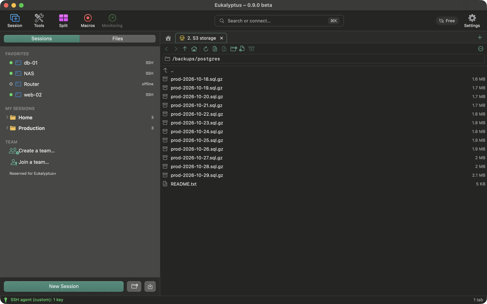

# S3 client for Mac: AWS S3, MinIO and Cloudflare R2 like a folder

Backups on Backblaze B2, static files on Cloudflare R2, MinIO on the home NAS: object storage is everywhere, but browsing it from a Mac often means the command line or the web console. Eukalyptus opens your S3 buckets like a folder, with drag and drop, the editor and share links.

> **In short**
>
> - An S3 session opens your buckets in the same file browser as SFTP.
> - AWS S3 and compatible services: MinIO, Cloudflare R2, Backblaze B2, Wasabi, Scaleway, OVHcloud, DigitalOcean Spaces.
> - Multipart upload above 64 MiB, presigned links from 1 hour to 7 days.
> - Secret key in the macOS Keychain. Free, no account.

**In this article**

1. [An S3 bucket is not a disk](#an-s3-bucket-is-not-a-disk)
2. [Compatible providers](#compatible-providers)
3. [Create an S3 session](#create-an-s3-session)
4. [MinIO or a NAS on the local network](#minio-or-a-nas-on-the-local-network)
5. [Browse, upload, edit](#browse-upload-edit)
6. [Share a file: the presigned link](#share-a-file-the-presigned-link)
7. [Access keys and best practices](#access-keys-and-best-practices)
8. [When it doesn't work](#when-it-doesnt-work)
9. [Frequently asked questions](#frequently-asked-questions)

## An S3 bucket is not a disk

S3 (Simple Storage Service) is Amazon's object storage protocol, which has become a standard: most hosting providers offer a service that speaks it. You don't store files in folders, but **objects** in **buckets**. Each object has a key, for example `photos/2026/holidays.jpg`, and "folders" are just a way of reading the keys: everything that starts with `photos/2026/` appears to be in the same folder.

This difference has practical consequences. An object can't be changed in place: it is replaced. A rename is a copy followed by a deletion. There are no Unix permissions (`chmod`): access is controlled by keys and bucket policies. Eukalyptus presents all this as a file system, and performs these operations for you.

*The equivalent with Amazon's tool (AWS CLI)*

```sh
aws s3 ls s3://my-bucket/photos/2026/
aws s3 cp holidays.jpg s3://my-bucket/photos/2026/
```

## Compatible providers

Eukalyptus signs its requests with AWS's method (Signature V4), which every S3-compatible service understands. The "Fill in for…" menu in the session settings pre-fills the endpoint, region and addressing for the most common ones:

- **Amazon S3**: `s3.amazonaws.com`. Each bucket's region is found automatically.
- **MinIO or NAS on the local network**: port 9000, path addressing.
- **Cloudflare R2**: `ACCOUNT_ID.r2.cloudflarestorage.com`, region `auto`; replace the identifier with your account's.
- **Backblaze B2**, **Wasabi**, **Scaleway**, **OVHcloud** and **DigitalOcean Spaces**: a sample region is filled in, to adapt to yours.

Any other compatible service works too: you only need to know its endpoint, its region and how it writes a bucket's address, in the path (`https://host/bucket/object`) or as a subdomain (`https://bucket.host/object`). In "Automatic" mode, Eukalyptus uses the subdomain at AWS and the path elsewhere.

## Create an S3 session

1. Click **Session**, then choose the **S3** type.
2. In **"Fill in for…"**, choose your provider. Check the region, which is your bucket's.
3. Fill in the **access key** (Access Key ID). For the secret key, choose an entry from the password manager, or leave "None": it will be asked for on connection.
4. Optional: a **bucket to open** (`my-bucket` or `my-bucket/folder`). Empty, the session opens on the list of your buckets.
5. Save, then double-click the session: the file browser opens in a tab.

An access key limited to a single bucket often can't list all the account's buckets. In that case, fill in the "Bucket to open" field: the session opens directly on it.

## MinIO or a NAS on the local network

MinIO, or a NAS's S3 service (Synology, TrueNAS, QNAP…), often runs over `http` on port 9000. Eukalyptus accepts an unencrypted connection, but shows it in orange: the access key, the signed requests and the files then travel in clear text. macOS also only allows it to a local IP address or a `.local` name.

Over `https` with a self-signed certificate, Eukalyptus shows the certificate's SHA-256 fingerprint and asks whether you trust it. The default button is "Refuse". If you accept, the fingerprint is remembered for this server; if the certificate changes later, the question comes back, with the old and new fingerprints side by side.

*Show the certificate fingerprint on the MinIO server, to compare it*

```sh
openssl x509 -in ~/.minio/certs/public.crt -noout -fingerprint -sha256
```

## Browse, upload, edit



*A bucket like a folder: a right-click offers the s3:// address and the presigned link.*

The browser is the [SFTP](./sftp-client-mac.md) one, with the same gestures. At the root, the buckets; in a bucket, its folders and objects, with their size and date.

- **Upload**: drag files or folders from Finder, or right-click › "Upload Files Here…". Above 64 MiB, the upload is split into several parts, four at a time.
- **Download**: drag to Finder, or right-click › "Download…". Received files are marked "downloaded" for Gatekeeper, as in Safari.
- **Edit**: double-click a text file, and it opens in the built-in editor; saving replaces the object.
- **Organize**: create a folder, rename, move, delete. A deleted folder is removed in batches of 1,000 objects, as S3 allows.
- **Create a bucket**: at the root, "New Folder" becomes "New Bucket…".
- **Copy the address**: right-click › "Copy s3:// Address", to paste into a script or the AWS CLI.

## Share a file: the presigned link

A private bucket can't be shared by giving its address. A **presigned link** contains a signature computed with your key: it gives read access to a single object, with no credentials, until it expires.

1. Right-click the file › **"Copy Presigned Link…"**.
2. Choose the duration: 1 hour, 24 hours or 7 days (the maximum S3 allows).
3. The link is copied: send it. It is computed on your Mac, with no request to the server.

A presigned link can't be revoked before it expires, except by disabling the access key that signed it. So choose the shortest duration possible.

## Access keys and best practices

- **One key per use**, limited to the buckets you need. Don't use the account's main key day to day.
- **The secret key in the Keychain**: save it in the Eukalyptus password manager. Showing or copying it requires Touch ID or the Mac's password. Without saving, it is kept in memory for the session only.
- **HTTPS by default**: requests go over TLS, and no redirect is followed, so that a signed request never goes to another server.
- **Safe names**: an object named `../../.zshrc` in a booby-trapped bucket can't make the app write outside the folder you chose.

The details of the exchanges are described on the [Security](https://eukalyptus.app/en/security) page.

## When it doesn't work

### "Access key or secret key refused by the server"

The secret key is asked for again on the next attempt. Also check the **region**: at most providers, a signature computed for the wrong region is refused like a wrong key.

### The bucket list is refused

Your key probably isn't allowed to list the account's buckets. Enter the bucket in "Bucket to open".

### A bucket can't be found although it exists

The addressing doesn't suit the service. Set "Bucket addressing" to "In the path" (MinIO, most NAS) or "Bucket subdomain" (AWS, DigitalOcean Spaces). A bucket whose name contains a dot is always addressed in the path.

Coming from Windows? See also [our comparison of Mac tools](./best-mobaxterm-alternative-mac.md), which brings S3, SFTP, SSH and RDP together in the same window.

## Frequently asked questions

<details>
<summary>Does Eukalyptus work with MinIO?</summary>

Yes. Choose "MinIO or NAS on the local network" in the session's "Fill in for…" menu: port 9000, buckets addressed in the path. Then enter your server's address and your access key.

</details>

<details>
<summary>Where is the secret key stored?</summary>

In the macOS Keychain if you save it in the password manager. Otherwise, it is asked for on connection and kept in memory for the session, never written to a file.

</details>

<details>
<summary>Can I upload large files?</summary>

Yes. Above 64 MiB, the upload is split into several parts (multipart upload), sent four at a time: it's faster, and essential above 5 GB, the limit of a single-request upload on S3.

</details>

<details>
<summary>Can I access a public bucket without a key?</summary>

Yes: leave the "Access key" field empty, and the connection is anonymous. Only buckets open for public reading answer.

</details>

<details>
<summary>Is it free?</summary>

Yes, like the rest of Eukalyptus: no limit on sessions or transfers, and no account.

</details>
