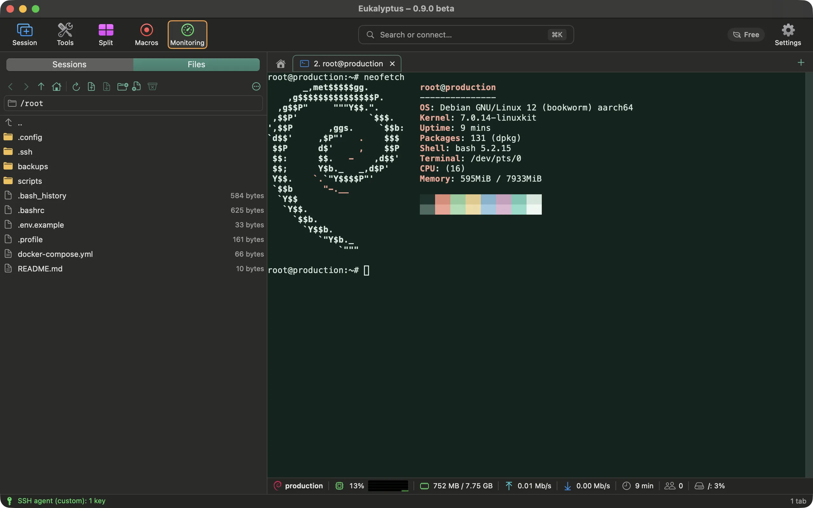

# Free SFTP client for Mac: transfer and edit your files

Upload a file to a server, fetch a log, fix a configuration: on a Mac, all of this happens in a single window with Eukalyptus. Here is how to transfer, drag and drop, set permissions and edit your files remotely, for free.

> **In short**
>
> - SFTP goes through SSH: nothing to install on the server, and end-to-end encryption.
> - The file browser opens with each SSH session, over the same connection as the terminal.
> - Drag and drop to Finder, permissions as checkboxes, a built-in code editor.
> - FTP, FTPS and S3 buckets in the same browser. Free, no account.

**In this article**

1. [SFTP, FTP, FTPS, SCP: what's the difference?](#sftp-ftp-ftps-scp-whats-the-difference)
2. [A file browser opened with each session](#a-file-browser-opened-with-each-session)
3. [Upload and download](#upload-and-download)
4. [Drag and drop and shortcuts](#drag-and-drop-and-shortcuts)
5. [Set file permissions](#set-file-permissions)
6. [Edit a file without downloading it](#edit-a-file-without-downloading-it)
7. [FTP, FTPS and S3 buckets](#ftp-ftps-and-s3-buckets)
8. [Frequently asked questions](#frequently-asked-questions)

## SFTP, FTP, FTPS, SCP: what's the difference?

**FTP** is the oldest: it sends credentials and files in clear text, and should no longer be used over the Internet. **FTPS** adds TLS encryption to it. Despite its name, **SFTP** has nothing to do with FTP: it is a file transfer protocol that travels inside an [SSH](./ssh-client-mac.md) connection. It therefore uses the same port (22), the same keys and the same encryption. The **scp** command also copies files over SSH; since OpenSSH 9.0, it actually uses the SFTP protocol.

For a server you administer, SFTP is almost always the right choice: nothing more to install or open in the firewall than SSH.

## A file browser opened with each session

In Eukalyptus, SFTP is not a separate program: when you open an SSH session, the left pane shows the server's files. It reuses the **same connection** as the terminal, so you authenticate only once, even with a passphrase or a password.

*The server's files on the left, the terminal on the right: a single connection.*

You browse it like Finder: parent folder, back and forward history, refresh, hidden files shown.

## Upload and download

1. To **upload**: drag files or folders from Finder into the list, or use the upload button in the pane's toolbar.
2. To **download**: select one or more items and use the download button, or drag them to the Desktop or Finder.
3. Folders are transferred **recursively**, with progress and the option to cancel.

You can also rename, delete, and create a file or a folder.

## Drag and drop and shortcuts

The browser behaves like a real macOS file list:

- **To Finder or the Desktop**: drag a remote file, and it is downloaded when you drop it.
- **From Finder to the server**: drop the files on the list or on a specific folder.
- **Between server folders**: drag to a folder, or to ".." to go up; the ⌥ key copies instead of moving.
- **Shortcuts**: ⌘C, ⌘X, ⌘V to copy, cut and paste (⌘C also downloads the files so that ⌘V in Finder pastes the real files, up to 1 GB), ⌘⌫ to delete, ⌘↑ and ⌘↓ to move up and down the tree.

## Set file permissions

On Linux, a file's permissions (read, write, execute for the owner, the group and others) are written in octal, such as `644` or `755`. The Eukalyptus permissions editor shows `rwx` checkboxes, the matching octal mode and a preview of the result, with common presets, the special bits and a recursive option for folders. No more need to remember what `chmod 750` means.

## Edit a file without downloading it

Double-click a file on the server: it opens in a tab of the **built-in code editor**. You get line numbers, syntax highlighting for more than twenty languages and formats (shell, nginx, yaml, python, json, configuration files, logs…), find and replace, automatic indentation and undo per file.

### Save without breaking anything

⌘S sends the file back to the server keeping its **permissions** (including the executable bit), its **encoding** and its **line endings**. If the file changed on the server in the meantime, the app warns you before overwriting anything, and it asks for confirmation if you close a tab with unsaved changes.

### Your usual editor, if you prefer

Eukalyptus asks only once which program should open your files: its editor, the app the system associates with the file, or a program of your choice. You can then set a program per file type in Settings › Editor. With an external program, the file is sent back to the server each time you save.

## FTP, FTPS and S3 buckets

The same browser works for the other file protocols. An **FTP** session offers the "Encrypt the connection (FTPS)" option, with explicit TLS (AUTH TLS); without a user, the connection is anonymous. An **S3** session opens your buckets (AWS S3, MinIO, Cloudflare R2, Backblaze B2, Wasabi, Scaleway, OVHcloud and compatible services): the root lists the buckets, "folders" are prefixes, and you can upload, download, rename, delete and generate **presigned links** valid for 1 hour, 24 hours or 7 days. The details are in [the S3 client guide](./s3-client-mac.md).

To go further, see [SSH tunnels](./ssh-tunnel-mac.md) to reach a service that isn't exposed, and [our comparison](./best-mobaxterm-alternative-mac.md) if you come from Windows.

## Frequently asked questions

Do I need to install anything on the server?

No. SFTP works with the SSH server you already use: if you can connect over SSH, you can use SFTP (unless the administrator turned it off).

Does Eukalyptus support plain FTP?

Yes, FTP and FTPS (encrypted connection). The file browser is the same as for SFTP, with drag and drop, editor and permissions.

Can I see hidden files?

Yes, they are shown by default, which is handy to edit files such as .bashrc or .env.

Is there a size limit?

For copy and paste to Finder, files are downloaded up to 1 GB. For the built-in editor, a confirmation is asked above 100 MB, and a binary file offers "Open Anyway".

Is it free?

Yes, with no limit on sessions or transfers, and no account.

