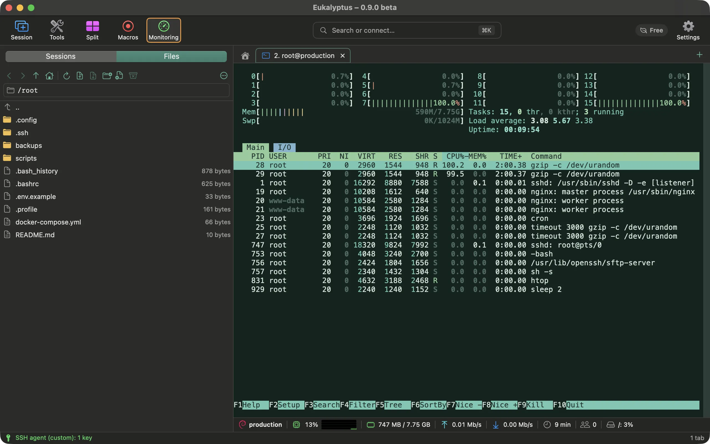
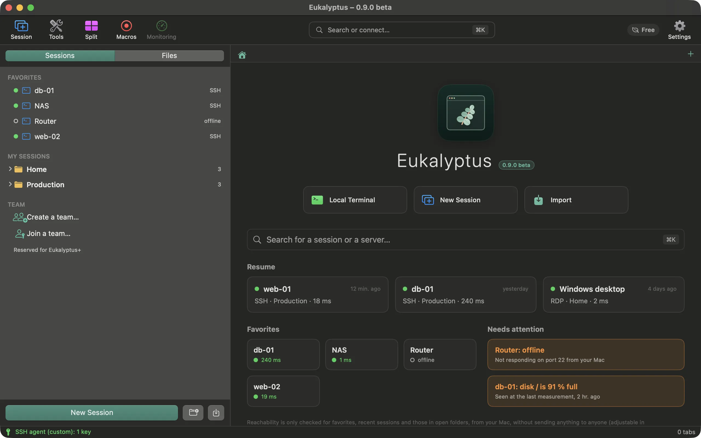

# SSH client for Mac: the complete guide

Your Mac can already do SSH. But as soon as you manage several servers, the terminal alone is not enough. Here is how to connect, authenticate, go through a bastion and work comfortably with Eukalyptus, a native SSH client that is free and needs no account.

> **In short**
>
> - macOS ships OpenSSH: Eukalyptus relies on it, so your \~/.ssh/config and your keys work as they are.
> - Sessions organized in folders and favorites, search and quick connect with ⌘K, an SFTP browser opened with each connection.
> - Keys, agent (Bitwarden included), password in the Keychain, jump through a bastion.
> - Free, no account, no tracking. Apple silicon Macs, macOS 14 or later.

**In this article**

1. [SSH on a Mac: what's already there](#ssh-on-a-mac-whats-already-there)
2. [Why an SSH client on top of Terminal](#why-an-ssh-client-on-top-of-terminal)
3. [Create your first session](#create-your-first-session)
4. [Keys, agent and passwords](#keys-agent-and-passwords)
5. [Go through a jump host](#go-through-a-jump-host)
6. [A comfortable terminal](#a-comfortable-terminal)
7. [Beyond the terminal](#beyond-the-terminal)
8. [Security](#security)
9. [Frequently asked questions](#frequently-asked-questions)

## SSH on a Mac: what's already there

SSH (Secure Shell) is the standard protocol to connect to a server, send it commands and transfer files over an encrypted channel. On a Mac, there is nothing to install: macOS ships OpenSSH, and a command like `ssh user@server.example.com` in the Terminal app is enough to open a session.

*Connect from the macOS Terminal*

```sh
ssh user@server.example.com
ssh -p 2222 user@192.168.1.20
```

Everything that follows relies on that same OpenSSH: a good client doesn't replace the protocol, it makes it nicer to use.

## Why an SSH client on top of Terminal

With three servers, Terminal and an alias file are enough. With thirty, the limits show: finding the right host, sending a file (you need to open another tool), keeping a tunnel open, watching a machine's load, replaying the same series of commands.

- **Sessions** are organized in folders, with favorites, and found with a search (⌘K).
- **The server's files** are shown next to the terminal, over the same connection.
- **Tunnels and macros** are managed in the app, with no command to remember.
- **Server monitoring** (CPU, memory, disks) stays visible under the terminal.



*An SSH terminal running htop, the server's files on the left and monitoring at the bottom.*

## Create your first session

1. [Download and install Eukalyptus](https://eukalyptus.app/en/download), then open it.
2. Click **New Session** (or "Session" in the top bar) and choose the **SSH** type.
3. Fill in the **host** (name or IP address), the **port** if it isn't 22, and the **user**.
4. Give the session a name and, if you like, a folder (for example `Prod/Web`). Save, then double-click the session.

For a one-off connection, the **command palette** (`⌘K`) accepts `user@host:port` directly: no need to create a session.



*Sessions in folders and favorites, with server status, ⌘K search and recent sessions.*

SSH-specific options are in "Session Settings": agent forwarding (`-A`), X11 (`-Y`), private key, jump host (`ProxyJump`), compression (`-C`), a command to run on connection and extra ssh options.

## Keys, agent and passwords

### SSH keys: the recommended method

An SSH key replaces the password with a pair of files: the private key stays on your Mac, the public key is installed on the server. Eukalyptus uses your keys in `~/.ssh` and those in the agent. A session's "Private key" field stays empty to let the agent or your `~/.ssh/config` do the work. To create and install a key, follow the guide [Create and manage SSH keys on a Mac](./ssh-keys-mac.md).

### The SSH agent

The agent keeps your keys unlocked in memory so you don't type the passphrase at every connection. By default, Eukalyptus follows your configuration; in Settings, you can also choose Bitwarden's agent or another socket. The status bar shows the agent actually in use and how many keys it holds. The "Forward the SSH agent" option lets you hop from one server to another with your keys; keep it for servers you trust.

### The password, when there is no choice

Some devices only accept a password. The Eukalyptus password manager (Tools › Passwords…, ⇧⌘P) stores them in the macOS Keychain. On connection, the password is sent only once, at the login prompt, never to `sudo` or to a passphrase prompt, and never twice in a row. Showing or copying it requires Touch ID or the Mac's password.

## Go through a jump host

Many networks expose a single server (the bastion), which gives access to the others. In OpenSSH, this is the `ProxyJump` option:

*Command-line equivalent*

```sh
ssh -J user@bastion.example.com:22 user@10.0.0.15
```

In Eukalyptus, just fill in the session's **Jump host (ProxyJump)** field with `user@bastion:22`. The file browser, which shares the terminal's connection, goes through this jump host too.

## A comfortable terminal

- **Numbered tabs**, which can be detached into their own window (⇧⌘D).
- **Search** in the terminal (⌘F), **zoom** (⌘+ ⌘- ⌘0), saving the output to a file.
- **Autocompletion**: a suggestion appears in gray from your history, and the right arrow accepts it. Passwords and tokens are never remembered.
- **Nine color themes**, from Solarized to Tokyo Night, and an option that highlights keywords (errors, warnings, successes, IP addresses).
- **Startup macro**: a session can replay a recorded macro as soon as it opens, after the delay of your choice.
- **Automatic reconnection** (optional setting) when the connection drops, with a one-key restart when the session ends.
- **Tiling and MultiExec**: show several terminals side by side and send the same keystrokes to all of them.

## Beyond the terminal

What sets an administration client apart is what it puts around the terminal. With Eukalyptus, each SSH connection also opens the server's SFTP browser (see [the SFTP guide](./sftp-client-mac.md)), the monitoring bar, and gives access to [SSH tunnels](./ssh-tunnel-mac.md) and, for graphical applications, to [X11 forwarding](./x11-forwarding-mac-xquartz.md). If you come from Windows, also read [our comparison of Mac tools](./best-mobaxterm-alternative-mac.md).

## Security

Eukalyptus requires no account and goes through no server to connect you to yours: the connection goes from your Mac to your server. Secrets live in the macOS Keychain. Every network exchange the app makes is described on the [Security](https://eukalyptus.app/en/security) page.

## Frequently asked questions

<details>
<summary>Can a Mac already do SSH?</summary>

Yes. macOS ships OpenSSH: the ssh command works in the Terminal app. A client like Eukalyptus adds what is missing to manage many servers: organized sessions, file browser, tunnels, macros and monitoring.

</details>

<details>
<summary>Does Eukalyptus read my ~/.ssh/config file?</summary>

Yes, because it relies on the system's SSH. Your aliases, keys, ProxyJump and options still apply.

</details>

<details>
<summary>Can I use Bitwarden's SSH agent or another agent?</summary>

Yes. By default, Eukalyptus follows your configuration (\~/.ssh/config). You can also choose Bitwarden's agent or another socket in Settings.

</details>

<details>
<summary>Do I need to create an account?</summary>

No. Eukalyptus is free, with no account and no tracking.

</details>

<details>
<summary>Which servers can I connect to?</summary>

Any SSH server: Linux, macOS, BSD, most routers and NAS devices. Eukalyptus relies on OpenSSH, the reference SSH client.

</details>
