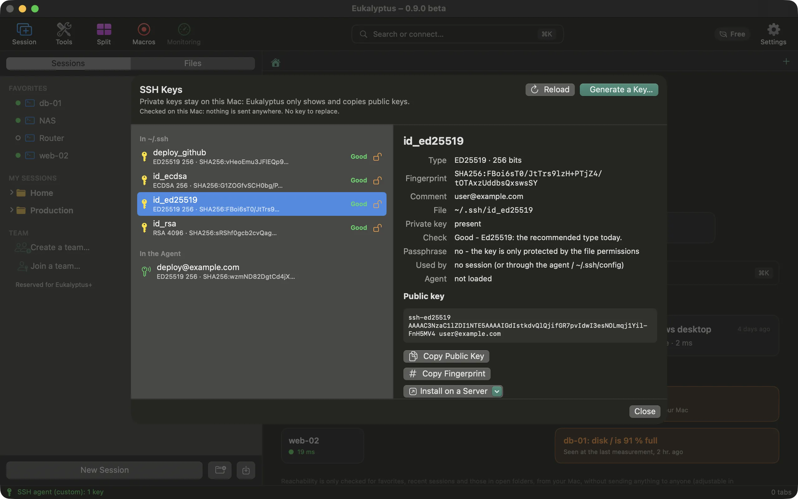

# Create and manage SSH keys on a Mac, step by step

An SSH key replaces the password with a pair of files: safer, more convenient, and essential as soon as you manage several servers. Here is how to create one on a Mac, install it on a server, load it into the agent and protect it, from the command line and then with the Eukalyptus key manager.

> **In short**
>
> - An SSH key is made of a private key (which stays on the Mac) and a public key (copied to the servers).
> - Choose Ed25519 and protect the key with a passphrase.
> - One ssh-keygen command, or the "Generate a Key…" button in Eukalyptus (⇧⌘K).
> - The manager installs the key on a server, loads it into the agent and copies the public key.

**In this article**

1. [Why keys rather than a password](#why-keys-rather-than-a-password)
2. [Which key type to choose](#which-key-type-to-choose)
3. [Generate a key](#generate-a-key)
4. [Install the key on the server](#install-the-key-on-the-server)
5. [Load the key into the agent](#load-the-key-into-the-agent)
6. [Do it all in Eukalyptus](#do-it-all-in-eukalyptus)
7. [Best practices](#best-practices)
8. [Frequently asked questions](#frequently-asked-questions)

## Why keys rather than a password

A password can be guessed, reused and stolen. An SSH key is a pair of files: the **private key** stays on your Mac and never travels; the **public key** is installed on each server you want to access. On connection, the server checks that you hold the matching private key, without any secret being sent. The result: no password to type or to steal, and the option to turn off password authentication on the server entirely.

## Which key type to choose

- **Ed25519**: the default choice today. A short, fast, strong key, accepted by OpenSSH since version 6.5 (2014).
- **RSA**: for very old devices that don't know Ed25519. Take at least 3072 bits.
- **ECDSA**: possible, but Ed25519 is generally preferred.

## Generate a key

In the macOS Terminal:

```sh
ssh-keygen -t ed25519 -C "me@mac" -f ~/.ssh/id_ed25519_server
```

The `-f` option sets the file name; `-C` adds a comment to recognize the key. The command asks for a **passphrase**: choose one. It encrypts the private key, so that a stolen copy of the file is useless. You get two files: `id_ed25519_server` (private) and `id_ed25519_server.pub` (public).

## Install the key on the server

The `ssh-copy-id` command adds the public key to the server's `~/.ssh/authorized_keys` file:

```sh
ssh-copy-id -i ~/.ssh/id_ed25519_server.pub user@server.example.com
```

It asks for the account's password one last time. After that, you connect with the key. Once everything works, you can turn off passwords on the server (`PasswordAuthentication no` and `KbdInteractiveAuthentication no` in `sshd_config`); keep a session open during the change, just in case.

## Load the key into the agent

The SSH agent keeps the key unlocked in memory: you type the passphrase only once. On a Mac, it can also store it in the Keychain:

```sh
ssh-add --apple-use-keychain ~/.ssh/id_ed25519_server
```

For macOS to reload the key automatically and use it for this server, add this to your `~/.ssh/config` file:

```sshconfig
Host server.example.com
  IdentityFile ~/.ssh/id_ed25519_server
  IdentitiesOnly yes

Host *
  IgnoreUnknown UseKeychain
  AddKeysToAgent yes
  UseKeychain yes
```

`UseKeychain` only exists in Apple's OpenSSH: the `IgnoreUnknown` line avoids an error if you share this file with a Linux machine. `IdentitiesOnly` limits the keys offered to the server to the one given.

## Do it all in Eukalyptus



*The key manager: type, fingerprint, passphrase, presence in the agent, and the buttons to copy or install the key.*

The key manager (**Tools › SSH Keys…** or **⇧⌘K**) lists the keys in `~/.ssh` and those in the agent, with their type, size and fingerprint, and shows which ones are already loaded in the agent.

### Generate a key

1. Click **Generate a Key…**.
2. Choose the type (Ed25519, RSA or ECDSA) and the file name, for example `id_ed25519_server`.
3. Keep **"With a passphrase (recommended)"**, then click **Create**. The passphrase is typed in a terminal, not in a field of the app.

The key is created in `~/.ssh`. An existing key is never overwritten.

### Install and use it

- **Install on a Server**: choose one of your SSH sessions, and Eukalyptus takes care of the copy (the equivalent of `ssh-copy-id`).
- **Add to Agent**: loads the key so you no longer retype the passphrase.
- **Copy Public Key** or its **fingerprint**, to paste them into an admin panel, GitHub, or an `authorized_keys` file.
- **Show in Finder** and **move to the Trash** (recoverable) a key you no longer need.

In a session, leave the "Private key" field empty to let the agent and your `~/.ssh/config` choose; fill it in only to force a specific key. Everything else is in [the SSH client guide](./ssh-client-mac.md).

## Best practices

- **Always protect the key with a passphrase**; a key without a passphrase is ready-to-use access for anyone who copies the file.
- **Never share the private key** (the file without `.pub`): not by email, not in a repository, not in a chat. Only the public key is shared.
- **One key per use** (work, personal, a client): if one is lost, you only revoke one scope.
- **Remove lost or old keys** from the servers' `authorized_keys` file.
- **Back them up** somewhere encrypted (your company password manager, an encrypted disk): without the private key, you have to create a new one.

Once your keys are in place, [SSH tunnels](./ssh-tunnel-mac.md) and the [SFTP browser](./sftp-client-mac.md) use them without asking for anything more.

## Frequently asked questions

<details>
<summary>Where are my SSH keys stored on a Mac?</summary>

In the hidden \~/.ssh folder of your home folder. The private key has no extension (for example id_ed25519); the public key has the .pub extension.

</details>

<details>
<summary>Ed25519 or RSA?</summary>

Ed25519, unless a very old server doesn't understand it: the key is short, fast and strong. If you must use RSA, choose at least 3072 bits.

</details>

<details>
<summary>I forgot my key's passphrase. Can it be recovered?</summary>

No, by design. You need to create a new key and install it on your servers in place of the old one.

</details>

<details>
<summary>Can I use the same key for several servers?</summary>

Yes, it's common, since only the public key is copied to the servers. To separate uses (work, personal, a client), one key per use limits the damage if one is lost.

</details>

<details>
<summary>Can Eukalyptus show my private key?</summary>

No. It only shows and copies public keys and fingerprints: private keys stay on your Mac.

</details>
