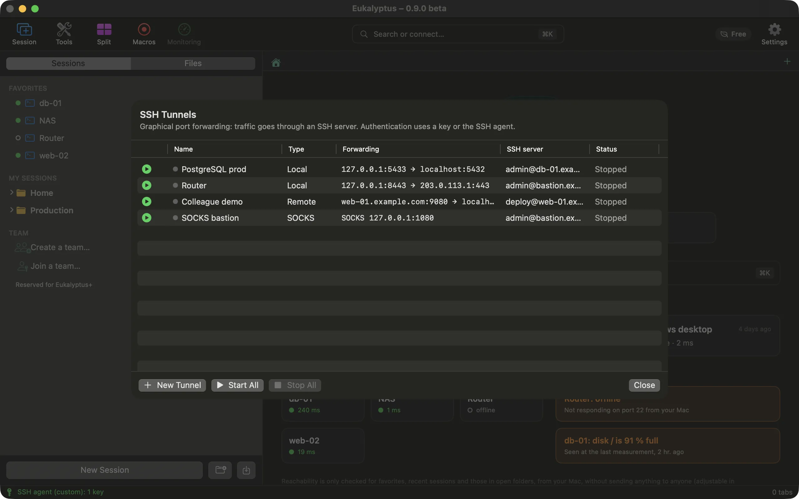

# SSH tunnel on a Mac: local, remote and SOCKS forwarding

Reach a database that only listens locally, open the web interface of a device behind a server, expose a service from your Mac: an SSH tunnel does all of this without a VPN. Here are the three kinds, explained with diagrams, then how to create them on a Mac with Eukalyptus.

> **In short**
>
> - An SSH tunnel carries a port's traffic through an encrypted SSH connection.
> - Three kinds: local (-L), remote (-R) and SOCKS proxy (-D).
> - In Eukalyptus: Tools › SSH Tunnels…, a form, a play button. No limit on tunnels.
> - Free, no account, with your keys and your SSH agent.

**In this article**

1. [What is an SSH tunnel?](#what-is-an-ssh-tunnel)
2. [Local forwarding (-L)](#local-forwarding--l-reach-a-service-behind-the-server)
3. [Remote forwarding (-R)](#remote-forwarding--r-expose-a-service-from-your-mac)
4. [SOCKS proxy (-D)](#socks-proxy--d-go-out-through-the-server)
5. [Create a tunnel in Eukalyptus](#create-a-tunnel-in-eukalyptus)
6. [Three real-world examples](#three-real-world-examples)
7. [Security best practices](#security-best-practices)
8. [When it doesn't work](#when-it-doesnt-work)
9. [Frequently asked questions](#frequently-asked-questions)

## What is an SSH tunnel?

An [SSH](./ssh-client-mac.md) connection is not only for opening a terminal: it can also carry other connections, encrypted. This is called a tunnel, or port forwarding. You use it when a service is not open to the Internet (a database, an admin interface) but you have SSH access to a machine that can reach it.

The diagrams below read from left to right; the thick line is the SSH connection, which is encrypted.

## Local forwarding (-L): reach a service behind the server

You open a port on **your Mac**; everything that connects to it comes out of the SSH server toward the destination of your choice, as seen from the server. This is the most common tunnel.

*Diagram: Local forwarding: the Mac listens on port 8080, traffic goes through the SSH server and reaches port 80 of the destination.*

| Your Mac |  | SSH server |  | Destination |
|---|---|---|---|---|
| listens on<br>127.0.0.1:8080 | SSH tunnel → | server.example.com | connection → | localhost:80<br>(seen from the server) |

*Command-line equivalent (-N: no shell, forwarding only)*

```sh
ssh -N -L 8080:localhost:80 user@server.example.com
```

Then open `http://localhost:8080` in your browser: you see the website running on the server's port 80, even if it isn't exposed to the outside.

## Remote forwarding (-R): expose a service from your Mac

The reverse: the **SSH server** opens a port, and the traffic that connects to it comes back to a service reachable from your Mac. Handy to show a colleague the website you are developing locally.

*Diagram: Remote forwarding: the SSH server listens on port 9000, traffic comes back through the tunnel to port 3000 on the Mac.*

| Your Mac |  | SSH server |  | A client |
|---|---|---|---|---|
| app on<br>localhost:3000 | ← SSH tunnel | listens on<br>port 9000 | ← connection | connects to<br>server:9000 |

*Command-line equivalent*

```sh
ssh -N -R 9000:localhost:3000 user@server.example.com
```

By default, the server only listens on its own local interface (`localhost`). For other machines to connect to it, the server's administrator must allow `GatewayPorts` in the sshd configuration.

## SOCKS proxy (-D): go out through the server

Instead of a fixed destination, the Mac opens a **SOCKS proxy**: any application you configure to use it (browser, mail client…) goes out to the Internet from the SSH server. Useful to reach a whole internal network from a browser, without creating one tunnel per service.

*Diagram: SOCKS proxy: the Mac opens a proxy on port 1080, and applications go out through the SSH server to any destination.*

| Your Mac |  | SSH server |  | The network |
|---|---|---|---|---|
| SOCKS proxy on<br>127.0.0.1:1080 | SSH tunnel → | server.example.com | connections → | any<br>destination |

*Command-line equivalent*

```sh
ssh -N -D 1080 user@server.example.com
```

In System Settings › Network (your connection's details › Proxies), or in your browser's settings, set a SOCKS proxy on `127.0.0.1`, port `1080`. OpenSSH speaks SOCKS 4 and SOCKS 5: for DNS names to be resolved by the server too, the client must use SOCKS 5 with remote resolution (for example `curl --socks5-hostname 127.0.0.1:1080`).

## Create a tunnel in Eukalyptus



*Saved tunnels: a button to start each one, the forwarding in plain words, and the status of each.*

1. Open **Tools › SSH Tunnels…** then click **New Tunnel**.
2. Choose the **type**: local, remote or dynamic port forwarding (SOCKS proxy). A sentence below describes in plain words what the tunnel will do.
3. Fill in "Listening on This Mac" (address and port; for remote forwarding, "Listening on the SSH Server") and, except for SOCKS, the "Destination Server" (host and port).
4. Fill in the **SSH server**: host, port, user. Leave the "Private key" field empty to use your SSH agent.
5. Save, then click the play button: the light turns green when the tunnel is up, and red if the connection fails.

Tunnels are saved: you start or stop them again in one click, without retyping the command. There is no limit on their number, and the "Tunnels" button in the top bar lights up when one of them is active.

### What Eukalyptus does behind the scenes

Each tunnel is a `/usr/bin/ssh` process started with `-N -T` (no shell), `ExitOnForwardFailure=yes` (if the forwarding can't be set up, the tunnel stops instead of staying open and forwarding nothing), `ServerAliveInterval=30` (a drop is detected) and `BatchMode=yes`: a tunnel runs in the background and can't ask for a password. So it authenticates with a key or the SSH agent; see [the SSH keys guide](./ssh-keys-mac.md).

## Three real-world examples

### Connect to a database that only listens locally

A PostgreSQL database on a server only accepts local connections, which is good practice. Create a **local** tunnel: listening on `127.0.0.1`, port `5433`; destination `localhost`, port `5432`; SSH server: your server. Your database tool then connects to `127.0.0.1:5433`, as if the database were on the Mac.

### Open the interface of a device on the internal network

A router or a NAS can only be reached from the server's network. **Local** tunnel: listening on port `8443` of your Mac, destination `192.168.1.1` port `443`. Open `https://localhost:8443`. The browser may complain about the certificate, since the name doesn't match: that is expected in this case.

### Browse from the server's network

A **dynamic** tunnel on port `1080`, then a SOCKS proxy in the browser: your pages go out through the server, which gives access to websites restricted to its network.

## Security best practices

- **Keep listening on `127.0.0.1`** (the default). Listening on `0.0.0.0` exposes the tunnel to your whole local network.
- **Only tunnel what is needed**: a tunnel is access to the server's network, just like your SSH connection.
- **Prefer keys** to passwords (see [the SSH keys guide](./ssh-keys-mac.md)) and stop the tunnels you no longer use.

## When it doesn't work

- **"bind \[127.0.0.1\]:8080: Address already in use"**: another program already listens on this port of the Mac (`lsof -nP -iTCP:8080 -sTCP:LISTEN` shows it). Choose another listening port.
- **"administratively prohibited: open failed"**: the server forbids port forwarding (`AllowTcpForwarding no` in `sshd_config`). Ask its administrator to allow it.
- **Connection refused on the destination side**: check that the service really listens on the address and port given, *as seen from the server* (test with `curl localhost:80` on the server).
- **Red light**: the forwarding couldn't be set up, or the SSH server can't be reached or refuses authentication. A tunnel never asks for a password: check that your key is loaded in the agent, then try opening a normal session on the same server.

## Frequently asked questions

<details>
<summary>What is the difference between -L and -R?</summary>

With -L, a port opens on your Mac and leads to a service reachable from the server. With -R, it's the other way round: a port opens on the server and leads to a service reachable from your Mac.

</details>

<details>
<summary>Is an SSH tunnel a VPN?</summary>

Not quite. A tunnel only forwards the ports you choose (or, with SOCKS, the applications you configure), whereas a VPN forwards all of the Mac's traffic. To reach a specific service, a tunnel is simpler and needs nothing installed on the server.

</details>

<details>
<summary>How many tunnels can I create in Eukalyptus?</summary>

As many as you like, with no limit. You save them, then start and stop them in one click.

</details>

<details>
<summary>Is the traffic encrypted?</summary>

Yes, between your Mac and the SSH server. Between the SSH server and the final destination, the connection is a normal one: it is only encrypted if the service itself is.

</details>
