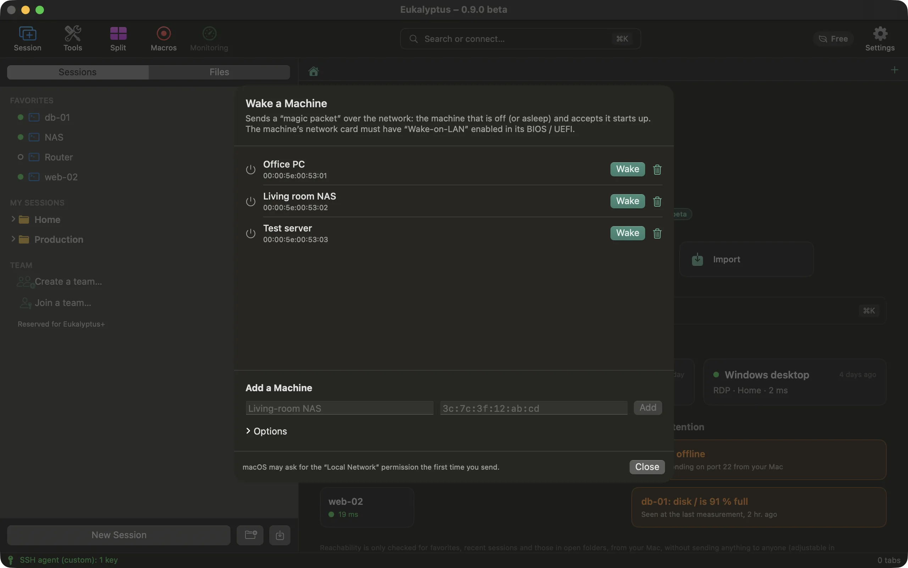

# Wake-on-LAN from a Mac: wake up a PC or a NAS remotely

A gaming PC to turn on for a remote desktop session, a NAS that sleeps at night, a test server switched off to save power: Wake-on-LAN starts them over the network. Here is how to prepare it, then wake your machines in one click from a Mac.

> **In short**
>
> - Wake-on-LAN starts a powered-off machine with a "magic packet" sent on the local network.
> - It is turned on in the machine's BIOS or UEFI, and in its network card settings.
> - In Eukalyptus: Tools › Wake a Machine, a name, a MAC address, a button.
> - Eukalyptus tells you when the machine answers, and remembers the list of your machines.

**In this article**

1. [How Wake-on-LAN works](#how-wake-on-lan-works)
2. [Prepare the machine to wake](#prepare-the-machine-to-wake)
3. [Find the MAC address](#find-the-mac-address)
4. [Wake a machine with Eukalyptus](#wake-a-machine-with-eukalyptus)
5. [Wake a machine on another network](#wake-a-machine-on-another-network)
6. [From outside: go through an SSH server](#from-outside-go-through-an-ssh-server)
7. [When the machine doesn't wake up](#when-the-machine-doesnt-wake-up)
8. [Frequently asked questions](#frequently-asked-questions)

## How Wake-on-LAN works

A machine that is off, but still plugged in, keeps its network card powered. That card watches for one specific message: the **magic packet**, made of six `FF` bytes followed by its MAC address repeated sixteen times. When it receives it, it starts the computer.

*Diagram: Wake-on-LAN: the Mac broadcasts a magic packet on the local network, the network card of the powered-off machine recognizes it and starts it.*

| Your Mac |  | Local network |  | Machine that is off |
|---|---|---|---|---|
| magic packet<br>UDP, port 9 | broadcast → | broadcast<br>192.168.1.255 | wake → | its network card<br>starts it |

The packet is sent as a **broadcast**: every machine on the network receives it, and only the one whose MAC address matches wakes up. That is also why it doesn't cross routers: it stays on the local network.

## Prepare the machine to wake

1. **In the BIOS or UEFI**: turn on the option, called "Wake on LAN", "Power On By PCI-E" or "Resume by LAN" depending on the manufacturer. Turn off "ErP" or "Deep Sleep" if they exist: these modes cut power to the network card.
2. **On Windows**: Device Manager › network adapter › Properties. In "Power Management", tick "Allow this device to wake the computer" and "Only allow a magic packet to wake the computer". In "Advanced", turn on "Wake on Magic Packet". If waking only works after sleep and not after a shutdown, turn off fast startup (Power Options).
3. **On Linux**: check with `ethtool`, and make the setting permanent (NetworkManager or systemd-networkd).
4. **On a NAS** (Synology, QNAP, TrueNAS…): the option is in the power or hardware settings.

*Linux: see and turn on Wake-on-LAN for the eth0 card ("g" = magic packet)*

```sh
sudo ethtool eth0 | grep Wake-on
sudo ethtool -s eth0 wol g
```

Plug the machine in with Ethernet: most Wi-Fi cards don't keep listening once the computer is off.

## Find the MAC address

The MAC address is the network card's identifier, six pairs of characters such as `3c:7c:3f:12:ab:cd`. Write it down while the machine is on:

*Windows (PowerShell), Linux, or from the Mac for a machine that just answered*

```text
Get-NetAdapter | Select-Object Name, MacAddress
ip link show
arp -a
```

The Eukalyptus **network scanner** lists the machines that answer on the local network; right after, `arp -a` gives their MAC addresses. Your Internet router usually also shows the list of connected devices with their MAC addresses.

## Wake a machine with Eukalyptus



*Your saved machines: a click on "Wake" sends the magic packet.*

1. Open **Tools › Wake a Machine (Wake-on-LAN)…**, or pin the "Wake" tool to the top bar.
2. In "Add a Machine", give a **name** ("Living room NAS") and the **MAC address**. The forms `3c:7c:3f:12:ab:cd`, `3c-7c-3f-12-ab-cd`, `3c7c.3f12.abcd` and `3c7c3f12abcd` are accepted.
3. Optional but useful: the machine's **name or address** (`nas.local`, `192.168.1.20`). Eukalyptus uses it to tell you when it answers.
4. Click **Wake**.

The packet goes out on each active IPv4 network of the Mac, as a broadcast, then as a general broadcast. If you gave its name, Eukalyptus then sends a ping every four seconds, for three minutes at most, and shows "it is up" as soon as it answers. Starting usually takes one to two minutes.

On the first send, macOS may ask for the "Local Network" permission for Eukalyptus: allow it, otherwise the packet doesn't go out. Your machines stay in the list: the next wake-up is a single click. Then open your [remote desktop](./rdp-mac-remote-desktop.md) or [SSH](./ssh-client-mac.md) session.

## Wake a machine on another network

If the machine is on another network at your site, for example a server VLAN, enter its **broadcast address** in "Broadcast address": `192.168.20.255` for the `192.168.20.0/24` network. The packet is then sent to that address only.

For it to arrive, the router between the two networks must forward directed broadcasts (on Cisco equipment, `ip directed-broadcast` on the destination network's interface). Many routers block it by default, on purpose: only open this forwarding for the network concerned.

## From outside: go through an SSH server

Away from home, the magic packet can't cross the Internet. The cleanest solution is to send it from a machine that is on in that network (a Raspberry Pi, a server, a NAS), which you connect to over SSH with Eukalyptus:

*On the machine that is on (Debian, Ubuntu): install the tool, then wake*

```sh
sudo apt install wakeonlan
wakeonlan 3c:7c:3f:12:ab:cd
```

An Eukalyptus **macro** can remember this command, to replay it in one click in the session. On the other hand, avoid forwarding a UDP port on your router to the network's broadcast address: anyone on the Internet could then send packets to your whole network.

## When the machine doesn't wake up

### Nothing happens

- Check the **MAC address**: the one of the Ethernet card, not the Wi-Fi one.
- Check that the card stays on while the machine is off: a light usually blinks on the network port.
- Test from the same network, with no VLAN or router between the Mac and the machine.
- On Windows, turn off fast startup, then shut down completely.

### "Sending failed"

macOS is blocking access to the local network: System Settings › Privacy & Security › Local Network, then turn Eukalyptus on.

### Check that the packet goes out

Open the Eukalyptus [packet capture](./packet-capture-mac.md) watching "A specific port…" (9), start the wake-up, then stop: the packet must appear in the list. If it goes out but the machine doesn't start, the problem is on its side (BIOS, card, power supply).

## Frequently asked questions

<details>
<summary>Does Wake-on-LAN work over Wi-Fi?</summary>

Rarely for the machine to wake: most Wi-Fi cards are powered off when the computer is off. Plug it in with Ethernet. The Mac that sends the packet, on the other hand, can be on Wi-Fi on the same network.

</details>

<details>
<summary>Can I wake a machine over the Internet?</summary>

Not directly: the magic packet is broadcast on the local network and doesn't cross routers. Go through a machine that is on in that network, over SSH, or through the wake feature of your router or NAS.

</details>

<details>
<summary>Do I need to install anything on the machine to wake?</summary>

No. Waking is handled by the network card and the BIOS (or UEFI), before any operating system. You only need to turn the option on.

</details>

<details>
<summary>Which port does Eukalyptus use?</summary>

UDP port 9, broadcast on each active IPv4 network of the Mac, then as a general broadcast (255.255.255.255).

</details>

<details>
<summary>Is it free?</summary>

Yes, like all the Eukalyptus tools.

</details>
