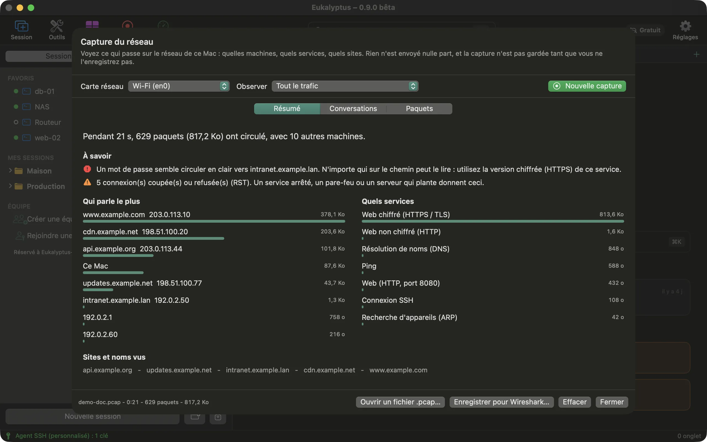

# Capture réseau sur Mac : tcpdump, .pcap et analyse en clair

Une connexion qui échoue sans message clair, une application qui contacte un serveur inconnu, un service qui envoie un mot de passe en clair : pour savoir, il faut regarder ce qui passe sur le réseau. Sur Mac, tcpdump le fait en ligne de commande. Eukalyptus le fait en trois clics, avec un résumé en français.

> **En bref**
>
> - Une capture montre qui parle à qui, avec quel protocole, et ce qui échoue.
> - tcpdump est intégré à macOS ; Eukalyptus le pilote et décode le résultat.
> - Le résumé signale en premier les mots de passe en clair, le HTTP, le Telnet et le FTP, les connexions refusées et les noms introuvables.
> - Enregistrement en .pcap pour Wireshark. Rien n'est envoyé nulle part.

**Dans cet article**

1. [À quoi sert une capture du réseau](#à-quoi-sert-une-capture-du-réseau)
2. [La méthode classique : tcpdump](#la-méthode-classique--tcpdump)
3. [Capturer en trois clics avec Eukalyptus](#capturer-en-trois-clics-avec-eukalyptus)
4. [Lire le résultat : résumé, conversations, paquets](#lire-le-résultat--résumé-conversations-paquets)
5. [Quatre cas concrets](#quatre-cas-concrets)
6. [Ouvrir et enregistrer des .pcap](#ouvrir-et-enregistrer-des-pcap)
7. [Ce que la capture garde, et ce qu'elle ne voit pas](#ce-que-la-capture-garde-et-ce-quelle-ne-voit-pas)
8. [Questions fréquentes](#questions-fréquentes)

## À quoi sert une capture du réseau

Une capture enregistre les paquets qui passent par une carte réseau du Mac : d'où ils viennent, où ils vont, sur quel port, avec quel protocole. C'est le moyen le plus direct de répondre à des questions que les messages d'erreur laissent sans réponse :

- La connexion au serveur part-elle vraiment, et le serveur répond-il ?
- Est-ce un pare-feu qui refuse, ou un nom DNS qui n'existe pas ?
- Quels serveurs une application contacte-t-elle au démarrage ?
- Ce vieux service web ou cette imprimante envoie-t-il des identifiants en clair ?

## La méthode classique : tcpdump

macOS fournit `tcpdump`, l'outil de capture de référence sous Unix. Il demande les droits administrateur et une syntaxe de filtre à connaître :

*Lister les cartes réseau, puis capturer le trafic web de en0 dans un fichier*

```sh
tcpdump -D
sudo tcpdump -i en0 -s 600 -w capture.pcap 'tcp port 80 or tcp port 443'
```

Le fichier se lit ensuite avec `tcpdump -r capture.pcap`, ligne par ligne, ou dans Wireshark. C'est puissant, mais long à lire quand on veut simplement savoir ce qui s'est passé.

## Capturer en trois clics avec Eukalyptus

1. Ouvrez **Outils › Capture du réseau…** (ou épinglez l'outil « Capture » dans la barre du haut).
2. Choisissez la **carte réseau** et ce que vous voulez **observer** : tout le trafic, le web (HTTP et HTTPS), les noms de sites (DNS), les connexions SSH, les pings, le bureau à distance (RDP), une machine précise ou un port précis.
3. Cliquez sur **Démarrer la capture** : macOS demande votre mot de passe.
4. Faites ce que vous voulez observer : ouvrir une page, lancer une connexion, imprimer…
5. Cliquez sur **Arrêter**. Le résumé s'affiche ; les paquets, eux, se décodent au fil de la capture.

En coulisse, Eukalyptus lance `tcpdump` avec les droits administrateur, une seule commande construite à partir de valeurs vérifiées : le nom de la carte, et un filtre tiré de la liste ou une adresse et un port contrôlés. Aucun texte libre n'est passé à la commande. La capture s'écrit dans un dossier neuf, réservé à votre compte.

## Lire le résultat : résumé, conversations, paquets



*Le résumé d'une capture : les problèmes d'abord, puis qui a parlé, avec quels services.*

### Résumé

Une phrase d'abord : combien de temps, combien de paquets, avec combien d'autres machines. Puis les remarques « À savoir », de la plus grave à la plus simple :

- un mot de passe qui semble circuler en clair, et vers quel serveur ;
- du Telnet ou du FTP non chiffré ;
- des échanges HTTP non chiffrés, avec les sites concernés ;
- des connexions coupées ou refusées (paquets TCP RST) ;
- des messages ICMP « injoignable » ;
- des noms introuvables (DNS), souvent une faute de frappe ou un nom qui n'existe plus.

Suit la liste des **sites et noms vus**, tirée des requêtes DNS, du nom de site que présente une connexion HTTPS (SNI) et de l'en-tête Host des requêtes HTTP. Les adresses IP sont reliées aux noms appris pendant la capture, ce qui rend les échanges lisibles.

### Conversations

Un tableau des échanges, machine par machine et service par service, avec le nombre de paquets et le volume. Un cadenas ouvert orange marque ce qui n'est pas chiffré, un triangle rouge les échecs.

### Paquets

La liste complète, avec pour chaque paquet sa source, sa destination, le service et une phrase qui le décrit (« Ping (demande) », « Destination injoignable »…). Un clic affiche ses octets.

## Quatre cas concrets

### Une connexion SSH qui n'aboutit pas

Observez « Les connexions SSH », puis lancez la session. Aucun paquet vers le serveur : le problème est sur le Mac (nom, route, VPN). Des paquets envoyés sans réponse : un pare-feu les ignore. Des connexions refusées (RST) : le serveur est joignable, mais rien n'écoute sur le port 22.

### Un site qui ne s'ouvre pas

Observez « Les noms de sites (DNS) ». Un nom introuvable apparaît dans les remarques : le problème est le nom ou le serveur DNS, pas le site.

### Savoir ce qu'une application contacte

Observez « Le web », lancez l'application, arrêtez. La liste « Sites et noms vus » donne les serveurs joints, même en HTTPS, puisque le nom du site circule en clair au début de la connexion.

### Vérifier un équipement du réseau

Une imprimante, une caméra ou une vieille interface d'administration : observez « Une machine précise… » avec son adresse, puis connectez-vous à son interface. Si la capture signale un mot de passe en clair, changez-le, et passez à la version HTTPS de l'interface si elle existe.

## Ouvrir et enregistrer des .pcap

**Enregistrer pour Wireshark…** sauvegarde la capture au format `.pcap`, lisible par Wireshark, tcpdump et la plupart des outils d'analyse. Tant que vous n'enregistrez pas, rien n'est gardé : les fichiers temporaires sont effacés à la fermeture de la fenêtre.

**Ouvrir un fichier .pcap…** fait l'inverse, sans mot de passe : une capture faite sur un serveur avec `tcpdump -w`, récupérée par le [navigateur SFTP](./client-sftp-mac.md), s'analyse avec le même résumé. Seul le format `.pcap` classique est lu, pas le `.pcapng` qu'enregistre Wireshark par défaut.

*Capturer sur un serveur Linux, puis récupérer le fichier dans Eukalyptus*

```sh
sudo tcpdump -i eth0 -s 600 -c 5000 -w /tmp/serveur.pcap port 443
```

## Ce que la capture garde, et ce qu'elle ne voit pas

- **600 octets par paquet** : assez pour les adresses, les noms de sites et le début des requêtes, sans garder le contenu des échanges.
- **10 minutes et 100 000 paquets au plus** : la capture s'arrête seule, même si vous oubliez de l'arrêter.
- **Rien n'est envoyé** : l'analyse se fait sur le Mac.
- **Le contenu chiffré reste chiffré** : en HTTPS, SSH ou RDP, on voit qui parle à qui et combien, pas ce qui est dit.
- **Seul le trafic du Mac** (et ce qui est diffusé à tout le réseau) est visible sur un réseau commuté ou en Wi-Fi : pour observer une autre machine, capturez sur elle, ou sur un port miroir du switch.

Pour la suite du diagnostic, Eukalyptus propose aussi un scanner réseau, le ping, le traceroute, la résolution DNS et les ports à l'écoute, et le [Wake-on-LAN](./wake-on-lan-mac.md) pour réveiller une machine éteinte. Voir aussi [notre comparatif des outils pour Mac](./meilleure-alternative-mobaxterm-mac.md).

## Questions fréquentes

<details>
<summary>Pourquoi faut-il le mot de passe administrateur ?</summary>

macOS réserve la lecture directe des cartes réseau à l'administrateur. Eukalyptus lance une seule commande tcpdump avec ces droits, construite à partir de valeurs vérifiées (carte réseau, filtre), et jamais de texte libre.

</details>

<details>
<summary>La capture peut-elle lire mes mots de passe ?</summary>

Pas ceux qui passent par une connexion chiffrée (HTTPS, SSH, RDP) : seuls les noms des sites et la taille des échanges sont visibles. Un mot de passe envoyé en clair, en HTTP, FTP ou Telnet, peut en revanche apparaître : le résumé le signale en premier.

</details>

<details>
<summary>Eukalyptus remplace-t-il Wireshark ?</summary>

Pour un diagnostic rapide, souvent : le résumé dit en français ce qui s'est passé. Pour décortiquer un protocole champ par champ, Wireshark reste l'outil de référence : enregistrez la capture et ouvrez-la dedans.

</details>

<details>
<summary>Peut-on ouvrir un fichier .pcapng ?</summary>

Non, seulement le format .pcap classique, celui de tcpdump. Dans Wireshark, Fichier › Enregistrer sous… et le format « pcap » le convertissent.

</details>

<details>
<summary>Est-ce gratuit ?</summary>

Oui, comme tous les outils d'Eukalyptus.

</details>
