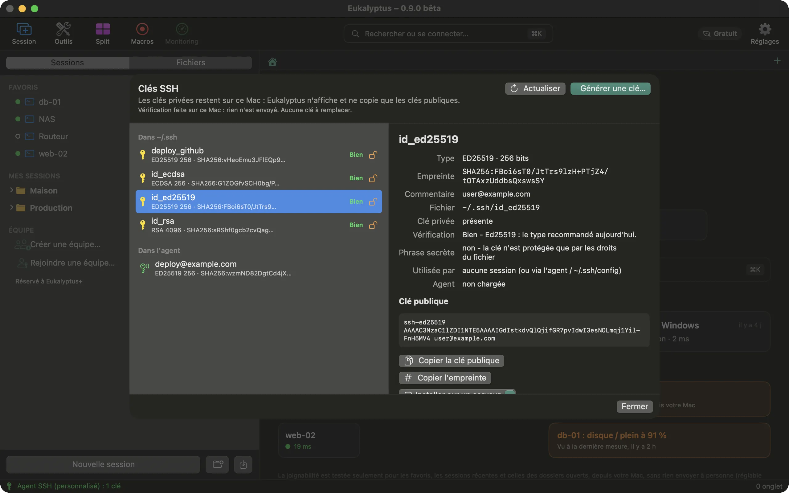

# Générer et gérer ses clés SSH sur Mac, pas à pas

Une clé SSH remplace le mot de passe par une paire de fichiers : plus sûre, plus pratique, et indispensable dès qu'on gère plusieurs serveurs. Voici comment en créer une sur Mac, l'installer sur un serveur, la charger dans l'agent et la protéger, en ligne de commande puis avec le gestionnaire de clés d'Eukalyptus.

> **En bref**
>
> - Une clé SSH se compose d'une clé privée (qui reste sur le Mac) et d'une clé publique (copiée sur les serveurs).
> - Choisissez Ed25519 et protégez la clé par une phrase secrète.
> - Une commande ssh-keygen, ou le bouton « Générer une clé… » d'Eukalyptus (⇧⌘K).
> - Le gestionnaire installe la clé sur un serveur, la charge dans l'agent et copie la clé publique.

**Dans cet article**

1. [Pourquoi des clés plutôt qu'un mot de passe](#pourquoi-des-clés-plutôt-quun-mot-de-passe)
2. [Quel type de clé choisir](#quel-type-de-clé-choisir)
3. [Générer une clé](#générer-une-clé)
4. [Installer la clé sur le serveur](#installer-la-clé-sur-le-serveur)
5. [Charger la clé dans l'agent](#charger-la-clé-dans-lagent)
6. [Tout faire dans Eukalyptus](#tout-faire-dans-eukalyptus)
7. [Bonnes pratiques](#bonnes-pratiques)
8. [Questions fréquentes](#questions-fréquentes)

## Pourquoi des clés plutôt qu'un mot de passe

Un mot de passe se devine, se réutilise et se vole. Une clé SSH est une paire de fichiers : la **clé privée** reste sur votre Mac et ne circule jamais ; la **clé publique** est installée sur chaque serveur auquel vous voulez accéder. À la connexion, le serveur vérifie que vous détenez la clé privée correspondante, sans qu'aucun secret ne transite. Résultat : pas de mot de passe à taper ni à voler, et la possibilité d'interdire complètement l'authentification par mot de passe sur le serveur.

## Quel type de clé choisir

- **Ed25519** : le choix par défaut aujourd'hui. Clé courte, rapide, solide, acceptée par OpenSSH depuis la version 6.5 (2014).
- **RSA** : pour les très anciens équipements qui ne connaissent pas Ed25519. Prenez au moins 3072 bits.
- **ECDSA** : possible, mais Ed25519 lui est généralement préféré.

## Générer une clé

Dans le Terminal de macOS :

```sh
ssh-keygen -t ed25519 -C "moi@mac" -f ~/.ssh/id_ed25519_serveur
```

L'option `-f` choisit le nom du fichier ; `-C` ajoute un commentaire pour reconnaître la clé. La commande vous demande une **phrase secrète** : choisissez-en une. Elle chiffre la clé privée, de sorte qu'une copie volée du fichier ne serve à rien. Vous obtenez deux fichiers : `id_ed25519_serveur` (privée) et `id_ed25519_serveur.pub` (publique).

## Installer la clé sur le serveur

La commande `ssh-copy-id` ajoute la clé publique au fichier `~/.ssh/authorized_keys` du serveur :

```sh
ssh-copy-id -i ~/.ssh/id_ed25519_serveur.pub utilisateur@serveur.exemple.fr
```

Elle demande une dernière fois le mot de passe du compte. Ensuite, la connexion se fait avec la clé. Une fois que tout fonctionne, vous pouvez désactiver les mots de passe côté serveur (`PasswordAuthentication no` et `KbdInteractiveAuthentication no` dans `sshd_config`) ; gardez une session ouverte pendant ce changement, au cas où.

## Charger la clé dans l'agent

L'agent SSH garde la clé déverrouillée en mémoire : vous ne tapez la phrase secrète qu'une fois. Sur Mac, il peut aussi la mémoriser dans le Trousseau :

```sh
ssh-add --apple-use-keychain ~/.ssh/id_ed25519_serveur
```

Pour que macOS recharge la clé automatiquement et l'associe à ce serveur, ajoutez ceci à votre fichier `~/.ssh/config` :

```sshconfig
Host serveur.exemple.fr
  IdentityFile ~/.ssh/id_ed25519_serveur
  IdentitiesOnly yes

Host *
  IgnoreUnknown UseKeychain
  AddKeysToAgent yes
  UseKeychain yes
```

`UseKeychain` n'existe que dans l'OpenSSH d'Apple : la ligne `IgnoreUnknown` évite une erreur si vous partagez ce fichier avec une machine Linux. `IdentitiesOnly` limite les clés proposées au serveur à celle indiquée.

## Tout faire dans Eukalyptus



*Le gestionnaire de clés : type, empreinte, phrase secrète, présence dans l'agent, et les boutons pour copier ou installer la clé.*

Le gestionnaire de clés (**Outils › Clés SSH…** ou **⇧⌘K**) liste les clés de `~/.ssh` et celles de l'agent, avec leur type, leur taille et leur empreinte, et indique celles qui sont déjà chargées dans l'agent.

### Générer une clé

1. Cliquez sur **Générer une clé…**.
2. Choisissez le type (Ed25519, RSA ou ECDSA) et le nom du fichier, par exemple `id_ed25519_serveur`.
3. Gardez **« Avec une phrase secrète (recommandé) »**, puis cliquez sur **Créer**. La phrase secrète se saisit dans un terminal, pas dans un champ de l'application.

La clé est créée dans `~/.ssh`. Une clé existante n'est jamais écrasée.

### L'installer et l'utiliser

- **Installer sur un serveur** : choisissez l'une de vos sessions SSH, et Eukalyptus s'occupe de la copie (l'équivalent de `ssh-copy-id`).
- **Ajouter à l'agent** : charge la clé pour ne plus retaper la phrase secrète.
- **Copier la clé publique** ou son **empreinte**, pour les coller dans un panneau d'administration, GitHub, ou un fichier `authorized_keys`.
- **Afficher dans le Finder** et **mettre à la corbeille** (récupérable) une clé devenue inutile.

Dans une session, le champ « Clé privée » reste vide pour laisser l'agent et votre `~/.ssh/config` choisir ; renseignez-le seulement pour imposer une clé précise. Vous retrouvez tout le reste dans [le guide du client SSH](./client-ssh-mac.md).

## Bonnes pratiques

- **Protégez toujours la clé par une phrase secrète** ; une clé sans phrase secrète est un accès prêt à l'emploi pour quiconque copie le fichier.
- **Ne partagez jamais la clé privée** (le fichier sans `.pub`) : ni par e-mail, ni dans un dépôt, ni dans une messagerie. Seule la clé publique se partage.
- **Une clé par usage** (travail, personnel, un client) : en cas de perte, on ne révoque qu'un périmètre.
- **Retirez les clés perdues ou anciennes** du fichier `authorized_keys` des serveurs.
- **Sauvegardez-les** dans un endroit chiffré (le gestionnaire de mots de passe d'entreprise, un disque chiffré) : sans la clé privée, il faut en recréer une.

Une fois vos clés en place, [les tunnels SSH](./tunnel-ssh-mac.md) et le [navigateur SFTP](./client-sftp-mac.md) les utilisent sans rien demander de plus.

## Questions fréquentes

<details>
<summary>Où sont stockées mes clés SSH sur Mac ?</summary>

Dans le dossier caché \~/.ssh de votre dossier personnel. La clé privée n'a pas d'extension (par exemple id_ed25519) ; la clé publique porte l'extension .pub.

</details>

<details>
<summary>Ed25519 ou RSA ?</summary>

Ed25519, sauf si un très ancien serveur ne le comprend pas : la clé est courte, rapide et solide. Si vous devez utiliser RSA, choisissez au moins 3072 bits.

</details>

<details>
<summary>J'ai oublié la phrase secrète de ma clé. Peut-on la récupérer ?</summary>

Non, par conception. Il faut créer une nouvelle clé et l'installer à la place de l'ancienne sur vos serveurs.

</details>

<details>
<summary>Puis-je utiliser la même clé pour plusieurs serveurs ?</summary>

Oui, c'est courant, car seule la clé publique est copiée sur les serveurs. Pour séparer les usages (travail, personnel, un client), une clé par usage limite les dégâts en cas de perte.

</details>

<details>
<summary>Eukalyptus peut-il afficher ma clé privée ?</summary>

Non. Il n'affiche et ne copie que les clés publiques et les empreintes : les clés privées restent sur votre Mac.

</details>
