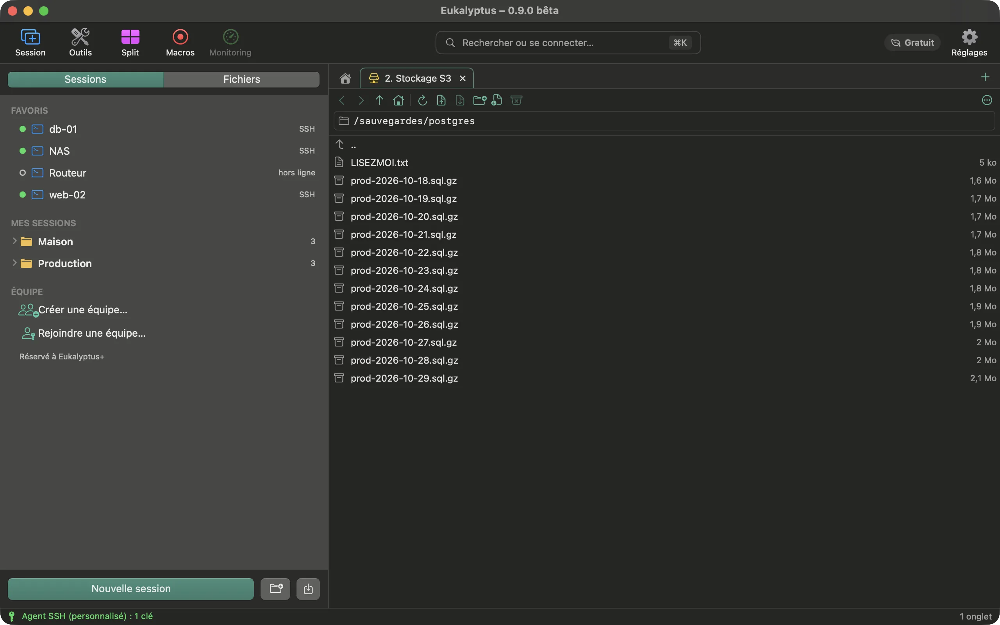

# Client S3 pour Mac : AWS S3, MinIO et Cloudflare R2 comme un dossier

Sauvegardes sur Backblaze B2, fichiers statiques sur Cloudflare R2, MinIO sur le NAS de la maison : le stockage objet est partout, mais le parcourir depuis un Mac passe souvent par la ligne de commande ou la console web. Eukalyptus ouvre vos buckets S3 comme un dossier, avec le glisser-déposer, l'éditeur et les liens de partage.

> **En bref**
>
> - Une session S3 ouvre vos buckets dans le même navigateur de fichiers que le SFTP.
> - AWS S3 et les services compatibles : MinIO, Cloudflare R2, Backblaze B2, Wasabi, Scaleway, OVHcloud, DigitalOcean Spaces.
> - Envoi en plusieurs parties au-delà de 64 Mio, liens présignés de 1 heure à 7 jours.
> - Clé secrète dans le Trousseau macOS. Gratuit, sans compte.

**Dans cet article**

1. [Un bucket S3 n'est pas un disque](#un-bucket-s3-nest-pas-un-disque)
2. [Les fournisseurs compatibles](#les-fournisseurs-compatibles)
3. [Créer une session S3](#créer-une-session-s3)
4. [MinIO ou un NAS sur le réseau local](#minio-ou-un-nas-sur-le-réseau-local)
5. [Parcourir, envoyer, modifier](#parcourir-envoyer-modifier)
6. [Partager un fichier : le lien présigné](#partager-un-fichier--le-lien-présigné)
7. [Clés d'accès et bonnes pratiques](#clés-daccès-et-bonnes-pratiques)
8. [Quand ça ne marche pas](#quand-ça-ne-marche-pas)
9. [Questions fréquentes](#questions-fréquentes)

## Un bucket S3 n'est pas un disque

S3 (Simple Storage Service) est le protocole de stockage objet d'Amazon, devenu un standard : la plupart des hébergeurs proposent un service qui le parle. On n'y range pas des fichiers dans des dossiers, mais des **objets** dans des **buckets**. Chaque objet a une clé, par exemple `photos/2026/vacances.jpg`, et les « dossiers » ne sont qu'une façon de lire les clés : tout ce qui commence par `photos/2026/` semble être dans le même dossier.

Cette différence a des conséquences concrètes. Un objet ne se modifie pas sur place : on le remplace. Un renommage est une copie suivie d'une suppression. Il n'y a pas de droits Unix (`chmod`) : l'accès se règle par les clés et les politiques du bucket. Eukalyptus présente tout cela comme un système de fichiers, et fait ces opérations à votre place.

*L'équivalent avec l'outil d'Amazon (AWS CLI)*

```sh
aws s3 ls s3://mon-bucket/photos/2026/
aws s3 cp vacances.jpg s3://mon-bucket/photos/2026/
```

## Les fournisseurs compatibles

Eukalyptus signe ses requêtes avec la méthode d'AWS (Signature V4), que comprennent tous les services compatibles S3. Le menu « Remplir selon… » de la fiche de session préremplit le point d'accès, la région et l'adressage pour les plus courants :

- **Amazon S3** : `s3.amazonaws.com`. La région de chaque bucket est trouvée toute seule.
- **MinIO ou NAS sur le réseau local** : port 9000, adressage dans le chemin.
- **Cloudflare R2** : `ID_DU_COMPTE.r2.cloudflarestorage.com`, région `auto` ; remplacez l'identifiant par celui de votre compte.
- **Backblaze B2**, **Wasabi**, **Scaleway**, **OVHcloud** et **DigitalOcean Spaces** : un exemple de région est rempli, à adapter à la vôtre.

Un autre service compatible fonctionne aussi : il suffit de connaître son point d'accès, sa région et la façon dont il écrit l'adresse d'un bucket, dans le chemin (`https://hôte/bucket/objet`) ou en sous-domaine (`https://bucket.hôte/objet`). En mode « Automatique », Eukalyptus utilise le sous-domaine chez AWS et le chemin ailleurs.

## Créer une session S3

1. Cliquez sur **Session**, puis choisissez le type **S3**.
2. Dans **« Remplir selon… »**, choisissez votre fournisseur. Vérifiez la région, qui est celle de votre bucket.
3. Renseignez la **clé d'accès** (Access Key ID). Pour la clé secrète, choisissez une entrée du gestionnaire de mots de passe, ou laissez « Aucun » : elle sera demandée à la connexion.
4. Facultatif : un **bucket à ouvrir** (`mon-bucket` ou `mon-bucket/dossier`). Vide, la session s'ouvre sur la liste de vos buckets.
5. Enregistrez, puis double-cliquez sur la session : le navigateur de fichiers s'ouvre dans un onglet.

Une clé d'accès limitée à un seul bucket ne peut souvent pas lister tous les buckets du compte. Dans ce cas, renseignez le champ « Bucket à ouvrir » : la session s'ouvre directement dessus.

## MinIO ou un NAS sur le réseau local

MinIO, ou le service S3 d'un NAS (Synology, TrueNAS, QNAP…), tourne souvent en `http` sur le port 9000. Eukalyptus accepte une connexion non chiffrée, mais l'affiche en orange : la clé d'accès, les requêtes signées et les fichiers circulent alors en clair. macOS ne l'autorise d'ailleurs que vers une adresse IP locale ou un nom en `.local`.

En `https` avec un certificat auto-signé, Eukalyptus montre l'empreinte SHA-256 du certificat et vous demande si vous lui faites confiance. Le bouton par défaut est « Refuser ». Si vous acceptez, l'empreinte est retenue pour ce serveur ; si le certificat change ensuite, la question revient, avec l'ancienne et la nouvelle empreinte côte à côte.

*Afficher l'empreinte du certificat sur le serveur MinIO, pour la comparer*

```sh
openssl x509 -in ~/.minio/certs/public.crt -noout -fingerprint -sha256
```

## Parcourir, envoyer, modifier



*Un bucket comme un dossier : le clic droit propose l'adresse s3:// et le lien présigné.*

Le navigateur est celui du [SFTP](./client-sftp-mac.md), avec les mêmes gestes. À la racine, les buckets ; dans un bucket, ses dossiers et ses objets, avec leur taille et leur date.

- **Envoyer** : glissez des fichiers ou des dossiers depuis le Finder, ou clic droit › « Envoyer des fichiers ici… ». Au-delà de 64 Mio, l'envoi passe en plusieurs parties, quatre à la fois.
- **Télécharger** : glissez vers le Finder, ou clic droit › « Télécharger… ». Les fichiers reçus sont marqués « téléchargés » pour Gatekeeper, comme dans Safari.
- **Modifier** : double-cliquez sur un fichier texte, il s'ouvre dans l'éditeur intégré ; l'enregistrement remplace l'objet.
- **Organiser** : créer un dossier, renommer, déplacer, supprimer. Un dossier supprimé l'est par lots de 1 000 objets, comme le permet S3.
- **Créer un bucket** : à la racine, « Nouveau dossier » devient « Nouveau bucket… ».
- **Copier l'adresse** : clic droit › « Copier l'adresse s3:// », à coller dans un script ou l'AWS CLI.

## Partager un fichier : le lien présigné

Un bucket privé ne se partage pas en donnant son adresse. Un **lien présigné** contient une signature calculée avec votre clé : il donne accès en lecture à un seul objet, sans identifiants, jusqu'à son expiration.

1. Clic droit sur le fichier › **« Copier un lien présigné… »**.
2. Choisissez la durée : 1 heure, 24 heures ou 7 jours (le maximum autorisé par S3).
3. Le lien est copié : envoyez-le. Le lien est calculé sur votre Mac, sans aucune requête au serveur.

Un lien présigné ne se révoque pas avant son expiration, sauf en désactivant la clé d'accès qui l'a signé. Choisissez donc la durée la plus courte possible.

## Clés d'accès et bonnes pratiques

- **Une clé par usage**, limitée aux buckets dont vous avez besoin. Ne vous servez pas de la clé principale du compte au quotidien.
- **La clé secrète dans le Trousseau** : enregistrez-la dans le gestionnaire de mots de passe d'Eukalyptus. L'afficher ou la copier demande Touch ID ou le mot de passe du Mac. Sans enregistrement, elle est gardée en mémoire pour la session seulement.
- **HTTPS par défaut** : les requêtes passent en TLS, et aucune redirection n'est suivie, pour qu'une requête signée ne parte jamais vers un autre serveur.
- **Des noms sûrs** : un objet nommé `../../.zshrc` sur un bucket piégé ne peut pas faire écrire hors du dossier que vous avez choisi.

Le détail des échanges est décrit sur la page [Sécurité](https://eukalyptus.app/securite).

## Quand ça ne marche pas

### « Clé d'accès ou clé secrète refusée par le serveur »

La clé secrète est redemandée à la tentative suivante. Vérifiez aussi la **région** : chez la plupart des fournisseurs, une signature calculée pour la mauvaise région est refusée comme une mauvaise clé.

### La liste des buckets est refusée

Votre clé n'a probablement pas le droit de lister les buckets du compte. Indiquez le bucket dans « Bucket à ouvrir ».

### Un bucket est introuvable alors qu'il existe

L'adressage ne convient pas au service. Passez « Adressage des buckets » sur « Dans le chemin » (MinIO, la plupart des NAS) ou « Sous-domaine du bucket » (AWS, DigitalOcean Spaces). Un bucket dont le nom contient un point est toujours adressé dans le chemin.

Vous venez de Windows ? Voir aussi [notre comparatif des outils pour Mac](./meilleure-alternative-mobaxterm-mac.md), qui réunit S3, SFTP, SSH et RDP dans la même fenêtre.

## Questions fréquentes

<details>
<summary>Eukalyptus fonctionne-t-il avec MinIO ?</summary>

Oui. Choisissez « MinIO ou NAS sur le réseau local » dans le menu « Remplir selon… » de la session : port 9000, adressage des buckets dans le chemin. Indiquez ensuite l'adresse de votre serveur et votre clé d'accès.

</details>

<details>
<summary>Où est rangée la clé secrète ?</summary>

Dans le Trousseau macOS si vous l'enregistrez dans le gestionnaire de mots de passe. Sinon, elle est demandée à la connexion et gardée en mémoire le temps de la session, jamais écrite dans un fichier.

</details>

<details>
<summary>Peut-on envoyer de gros fichiers ?</summary>

Oui. Au-delà de 64 Mio, l'envoi passe en plusieurs parties (multipart upload), envoyées quatre par quatre : c'est plus rapide, et indispensable au-delà de 5 Go, la limite d'un envoi en une seule fois sur S3.

</details>

<details>
<summary>Peut-on accéder à un bucket public sans clé ?</summary>

Oui : laissez le champ « Clé d'accès » vide, la connexion est alors anonyme. Seuls les buckets ouverts en lecture publique répondent.

</details>

<details>
<summary>Est-ce gratuit ?</summary>

Oui, comme le reste d'Eukalyptus : sans limite de sessions ni de transferts, et sans compte.

</details>
