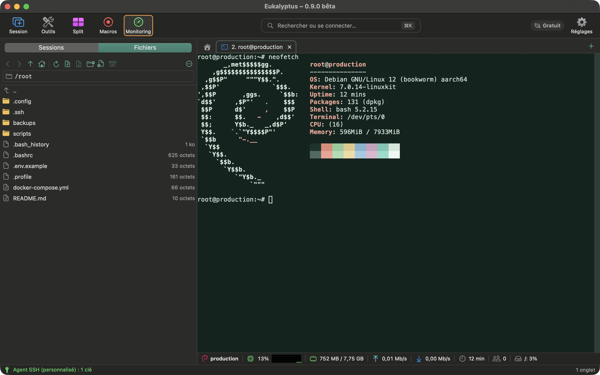

# Client SFTP gratuit pour Mac : transférer et éditer ses fichiers

Envoyer un fichier sur un serveur, récupérer un journal, corriger une configuration : sur Mac, tout cela se fait dans une seule fenêtre avec Eukalyptus. Voici comment transférer, glisser-déposer, régler les droits et modifier ses fichiers à distance, gratuitement.

> **En bref**
>
> - Le SFTP passe par SSH : aucune installation côté serveur, et un chiffrement de bout en bout.
> - Le navigateur de fichiers s'ouvre avec chaque session SSH, sur la même connexion que le terminal.
> - Glisser-déposer vers le Finder, droits en cases à cocher, éditeur de code intégré.
> - FTP, FTPS et buckets S3 dans le même navigateur. Gratuit, sans compte.

**Dans cet article**

1. [SFTP, FTP, FTPS, SCP : quelle différence ?](#sftp-ftp-ftps-scp--quelle-différence-)
2. [Un navigateur de fichiers ouvert avec chaque session](#un-navigateur-de-fichiers-ouvert-avec-chaque-session)
3. [Envoyer et télécharger](#envoyer-et-télécharger)
4. [Glisser-déposer et raccourcis](#glisser-déposer-et-raccourcis)
5. [Régler les droits des fichiers](#régler-les-droits-des-fichiers)
6. [Modifier un fichier sans le télécharger](#modifier-un-fichier-sans-le-télécharger)
7. [FTP, FTPS et buckets S3](#ftp-ftps-et-buckets-s3)
8. [Questions fréquentes](#questions-fréquentes)

## SFTP, FTP, FTPS, SCP : quelle différence ?

Le **FTP** est le plus ancien : il transmet identifiants et fichiers en clair, et ne devrait plus servir sur Internet. Le **FTPS** y ajoute le chiffrement TLS. Le **SFTP** n'a rien à voir avec le FTP malgré son nom : c'est un protocole de transfert de fichiers qui voyage à l'intérieur d'une connexion [SSH](./client-ssh-mac.md). Il utilise donc le même port (22), les mêmes clés et le même chiffrement. La commande **scp** copie aussi des fichiers par SSH ; depuis OpenSSH 9.0, elle utilise d'ailleurs le protocole SFTP.

Pour un serveur que vous administrez, le SFTP est presque toujours le bon choix : rien de plus à installer ni à ouvrir dans le pare-feu que le SSH.

## Un navigateur de fichiers ouvert avec chaque session

Dans Eukalyptus, le SFTP n'est pas un programme à part : quand vous ouvrez une session SSH, le panneau de gauche affiche les fichiers du serveur. Il réutilise la **même connexion** que le terminal, donc une seule authentification, même avec une phrase secrète ou un mot de passe.

*Les fichiers du serveur à gauche, le terminal à droite : une seule connexion.*

On y navigue comme dans le Finder : dossier parent, historique précédent et suivant, actualisation, fichiers cachés visibles.

## Envoyer et télécharger

1. Pour **envoyer** : glissez des fichiers ou des dossiers du Finder dans la liste, ou utilisez le bouton d'envoi de la barre du panneau.
2. Pour **télécharger** : sélectionnez un ou plusieurs éléments et utilisez le bouton de téléchargement, ou glissez-les vers le Bureau ou le Finder.
3. Les dossiers sont transférés **récursivement**, avec une progression et la possibilité d'annuler.

On peut aussi renommer, supprimer, et créer un fichier ou un dossier.

## Glisser-déposer et raccourcis

Le navigateur se comporte comme une vraie liste de fichiers macOS :

- **Vers le Finder ou le Bureau** : glissez un fichier distant, il est téléchargé au moment du dépôt.
- **Du Finder vers le serveur** : déposez les fichiers sur la liste ou sur un dossier précis.
- **Entre dossiers du serveur** : glissez vers un dossier, ou vers « .. » pour remonter ; la touche ⌥ copie au lieu de déplacer.
- **Raccourcis** : ⌘C, ⌘X, ⌘V pour copier, couper et coller (⌘C télécharge aussi les fichiers pour qu'un ⌘V dans le Finder colle les vrais fichiers, jusqu'à 1 Go), ⌘⌫ pour supprimer, ⌘↑ et ⌘↓ pour monter et descendre dans l'arborescence.

## Régler les droits des fichiers

Sous Linux, les droits d'un fichier (lecture, écriture, exécution pour le propriétaire, le groupe et les autres) s'écrivent en octal, comme `644` ou `755`. L'éditeur de droits d'Eukalyptus affiche des cases à cocher `rwx`, le mode octal correspondant et un aperçu du résultat, avec des préréglages courants, les bits spéciaux et une option récursive pour les dossiers. Plus besoin de se souvenir de ce que veut dire `chmod 750`.

## Modifier un fichier sans le télécharger

Double-cliquez sur un fichier du serveur : il s'ouvre dans un onglet de l'**éditeur de code intégré**. Vous avez les numéros de ligne, la coloration syntaxique pour plus de vingt langages et formats (shell, nginx, yaml, python, json, fichiers de configuration, journaux…), la recherche et le remplacement, l'indentation automatique et l'annulation fichier par fichier.

### Enregistrer sans rien casser

⌘S renvoie le fichier sur le serveur en gardant ses **droits** (y compris le bit exécutable), son **encodage** et ses **fins de ligne**. Si le fichier a changé sur le serveur entre-temps, l'application vous prévient avant d'écraser quoi que ce soit, et elle demande confirmation si vous fermez un onglet qui contient des modifications.

### Votre éditeur habituel, si vous préférez

Eukalyptus demande une seule fois avec quel programme ouvrir vos fichiers : son éditeur, l'application associée par le système, ou un programme de votre choix. Vous pouvez ensuite régler un programme par type de fichier dans Réglages › Éditeur. Avec un programme externe, le fichier est renvoyé sur le serveur à chaque enregistrement.

## FTP, FTPS et buckets S3

Le même navigateur sert pour les autres protocoles de fichiers. Une session **FTP** propose l'option « Chiffrer la connexion (FTPS) », en TLS explicite (AUTH TLS) ; sans utilisateur, la connexion est anonyme. Une session **S3** ouvre vos buckets (AWS S3, MinIO, Cloudflare R2, Backblaze B2, Wasabi, Scaleway, OVHcloud et compatibles) : la racine liste les buckets, les « dossiers » sont des préfixes, et l'on peut envoyer, télécharger, renommer, supprimer et générer des **liens présignés** valables 1 heure, 24 heures ou 7 jours. Le détail est dans [le guide du client S3](./client-s3-mac.md).

Pour aller plus loin, voir [les tunnels SSH](./tunnel-ssh-mac.md) pour atteindre un service qui n'est pas exposé, et[notre comparatif](./meilleure-alternative-mobaxterm-mac.md) si vous veniez de Windows.

## Questions fréquentes

Faut-il installer quelque chose sur le serveur ?

Non. Le SFTP fonctionne avec le serveur SSH que vous utilisez déjà : si vous pouvez vous connecter en SSH, vous pouvez utiliser le SFTP (sauf si l'administrateur l'a désactivé).

Eukalyptus gère-t-il le FTP classique ?

Oui, FTP et FTPS (connexion chiffrée). Le navigateur de fichiers est le même que pour le SFTP, avec glisser-déposer, éditeur et droits.

Peut-on voir les fichiers cachés ?

Oui, ils sont affichés par défaut, ce qui est utile pour modifier des fichiers comme .bashrc ou .env.

Y a-t-il une limite de taille ?

Pour le copier-coller vers le Finder, les fichiers sont téléchargés jusqu'à 1 Go. Pour l'éditeur intégré, une confirmation est demandée au-delà de 100 Mo, et un fichier binaire propose « ouvrir quand même ».

Est-ce gratuit ?

Oui, sans limite de sessions ni de transferts, et sans compte.

