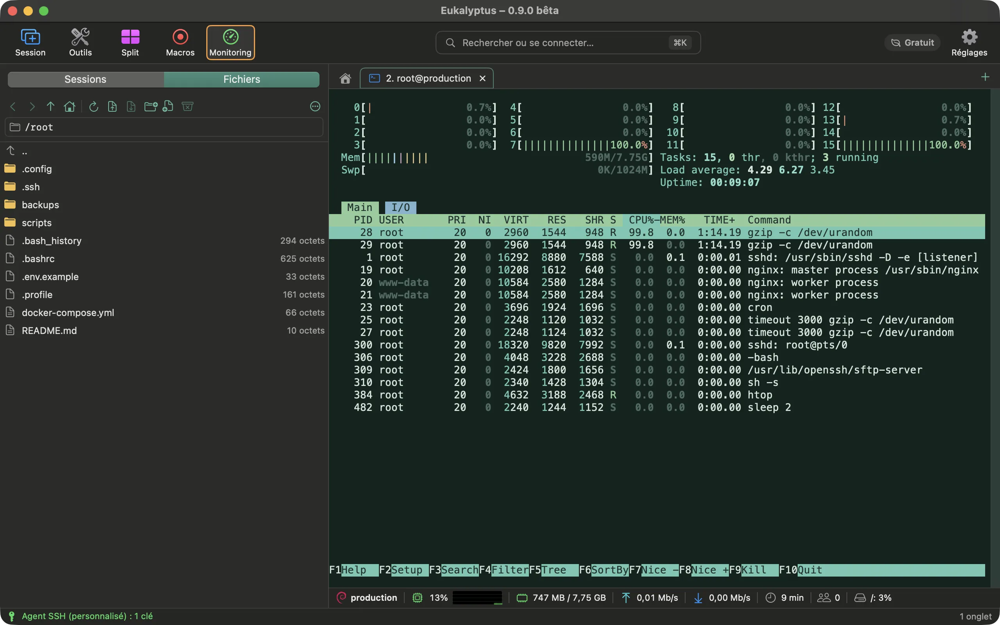
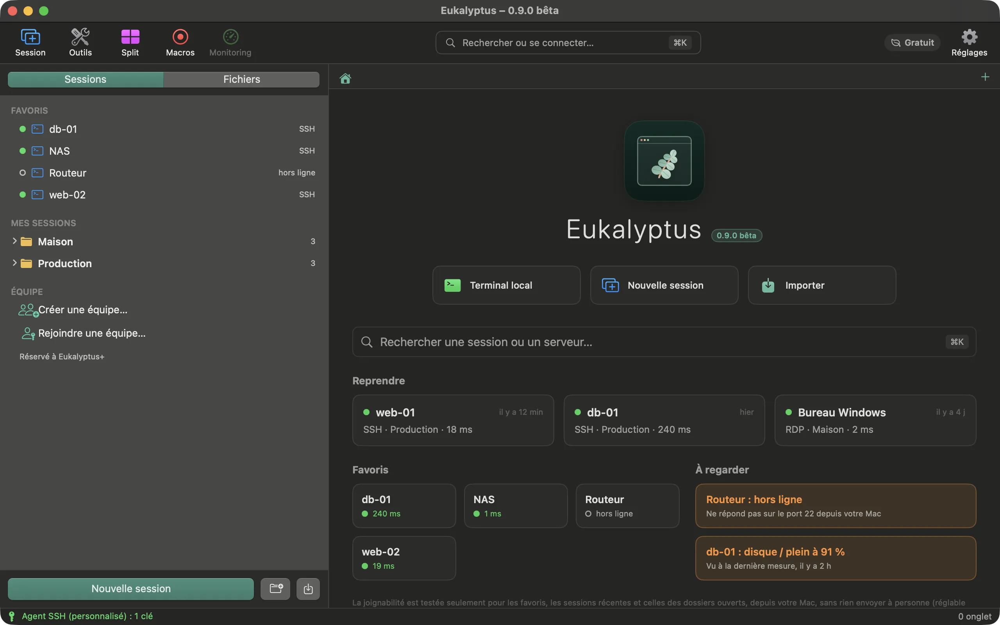

# Client SSH pour Mac : le guide complet

Votre Mac sait déjà faire du SSH. Mais dès qu'on gère plusieurs serveurs, le terminal seul ne suffit plus. Voici comment se connecter, s'authentifier, passer par un bastion et travailler confortablement avec Eukalyptus, un client SSH natif, gratuit et sans compte.

> **En bref**
>
> - macOS embarque OpenSSH : Eukalyptus s'appuie dessus, donc votre \~/.ssh/config et vos clés fonctionnent tels quels.
> - Sessions rangées en dossiers et favoris, recherche et connexion rapide par ⌘K, navigateur SFTP ouvert avec chaque connexion.
> - Clés, agent (y compris Bitwarden), mot de passe dans le Trousseau, rebond par un bastion.
> - Gratuit, sans compte, sans pistage. Mac Apple silicon, macOS 14 ou plus.

**Dans cet article**

1. [SSH sur Mac : ce qui est déjà là](#ssh-sur-mac--ce-qui-est-déjà-là)
2. [Pourquoi un client SSH en plus du Terminal](#pourquoi-un-client-ssh-en-plus-du-terminal)
3. [Créer sa première session](#créer-sa-première-session)
4. [Clés, agent et mots de passe](#clés-agent-et-mots-de-passe)
5. [Passer par un serveur de rebond](#passer-par-un-serveur-de-rebond)
6. [Un terminal confortable](#un-terminal-confortable)
7. [Au-delà du terminal](#au-delà-du-terminal)
8. [Sécurité](#sécurité)
9. [Questions fréquentes](#questions-fréquentes)

## SSH sur Mac : ce qui est déjà là

SSH (Secure Shell) est le protocole standard pour se connecter à un serveur, lui envoyer des commandes et transférer des fichiers de façon chiffrée. Sur Mac, il n'y a rien à installer : macOS livre OpenSSH, et une commande comme `ssh utilisateur@serveur.exemple.fr` dans l'app Terminal suffit pour ouvrir une session.

*Se connecter depuis le Terminal de macOS*

```sh
ssh utilisateur@serveur.exemple.fr
ssh -p 2222 utilisateur@192.168.1.20
```

Tout ce qui suit repose sur ce même OpenSSH : un bon client ne remplace pas le protocole, il le rend plus agréable à utiliser.

## Pourquoi un client SSH en plus du Terminal

Avec trois serveurs, le Terminal et un fichier d'alias suffisent. Avec trente, les limites apparaissent : retrouver le bon hôte, envoyer un fichier (il faut ouvrir un autre outil), garder un tunnel ouvert, surveiller la charge d'une machine, rejouer la même série de commandes.

- **Les sessions** sont rangées en dossiers, avec des favoris, et se retrouvent par une recherche (⌘K).
- **Les fichiers** du serveur s'affichent à côté du terminal, sur la même connexion.
- **Les tunnels et les macros** se gèrent dans l'application, sans commande à retenir.
- **La surveillance** du serveur (processeur, mémoire, disques) reste visible sous le terminal.



*Un terminal SSH avec htop, les fichiers du serveur à gauche et la surveillance en bas.*

## Créer sa première session

1. [Téléchargez et installez Eukalyptus](https://eukalyptus.app/telecharger), puis lancez-le.
2. Cliquez sur **Nouvelle session** (ou sur « Session » dans la barre du haut) et choisissez le type **SSH**.
3. Renseignez l'**hôte** (nom ou adresse IP), le **port** si ce n'est pas 22 et l'**utilisateur**.
4. Donnez un nom à la session et, si vous le souhaitez, un dossier (par exemple `Prod/Web`). Enregistrez, puis double-cliquez sur la session.

Pour une connexion ponctuelle, la **palette de commandes** (`⌘K`) accepte directement `utilisateur@hôte:port` : pas besoin de créer une session.



*Les sessions en dossiers et favoris, avec l'état des serveurs, la recherche ⌘K et les sessions récentes.*

Les options propres au SSH se trouvent dans « Paramètres de la session » : transfert de l'agent (`-A`), X11 (`-Y`), clé privée, rebond (`ProxyJump`), compression (`-C`), commande à lancer à la connexion et options ssh supplémentaires.

## Clés, agent et mots de passe

### Les clés SSH : la méthode recommandée

Une clé SSH remplace le mot de passe par une paire de fichiers : la clé privée reste sur votre Mac, la clé publique est installée sur le serveur. Eukalyptus utilise vos clés de `~/.ssh` et celles de l'agent. Le champ « Clé privée » d'une session reste vide pour laisser faire l'agent ou votre `~/.ssh/config`. Pour créer et installer une clé, suivez le guide [Générer et gérer ses clés SSH sur Mac](./cles-ssh-mac.md).

### L'agent SSH

L'agent garde vos clés déverrouillées en mémoire pour ne pas retaper la phrase secrète à chaque connexion. Par défaut, Eukalyptus suit votre configuration ; dans les réglages, vous pouvez aussi choisir l'agent de Bitwarden ou un autre socket. La barre d'état indique l'agent réellement utilisé et le nombre de clés qu'il porte. L'option « Transférer l'agent SSH » permet de rebondir d'un serveur à l'autre avec vos clés, à réserver aux serveurs de confiance.

### Le mot de passe, quand il n'y a pas le choix

Certains équipements n'acceptent que le mot de passe. Le gestionnaire de mots de passe d'Eukalyptus (Outils › Mots de passe…, ⇧⌘P) les range dans le Trousseau macOS. À la connexion, le mot de passe est envoyé une seule fois à l'invite de connexion, jamais à `sudo` ni à une phrase secrète, et jamais deux essais de suite. L'afficher ou le copier demande Touch ID ou le mot de passe du Mac.

## Passer par un serveur de rebond

Beaucoup de réseaux n'exposent qu'un seul serveur (le bastion), qui donne accès aux autres. Dans OpenSSH, c'est l'option `ProxyJump` :

*Équivalent en ligne de commande*

```sh
ssh -J utilisateur@bastion.exemple.fr:22 utilisateur@10.0.0.15
```

Dans Eukalyptus, remplissez simplement le champ **Rebond (ProxyJump)** de la session avec `utilisateur@bastion:22`. Le navigateur de fichiers, qui partage la connexion du terminal, passe lui aussi par ce rebond.

## Un terminal confortable

- **Onglets** numérotés, détachables dans leur propre fenêtre (⇧⌘D).
- **Recherche** dans le terminal (⌘F), **zoom** (⌘+ ⌘- ⌘0), enregistrement de la sortie dans un fichier.
- **Autocomplétion** : une suggestion apparaît en gris à partir de votre historique, avec la flèche droite pour l'accepter. Les mots de passe et les jetons ne sont jamais mémorisés.
- **Neuf thèmes** de couleurs, de Solarized à Tokyo Night, et une option qui colore les mots-clés (erreurs, alertes, réussites, adresses IP).
- **Macro au démarrage** : une session peut rejouer une macro enregistrée dès son ouverture, après le délai de votre choix.
- **Reconnexion automatique** (réglage facultatif) quand la connexion tombe, avec une relance en une touche à la fin de la session.
- **Mosaïque et MultiExec** : afficher plusieurs terminaux côte à côte et envoyer la même frappe à tous.

## Au-delà du terminal

Ce qui distingue un client d'administration, c'est ce qu'il met autour du terminal. Avec Eukalyptus, chaque connexion SSH ouvre aussi le navigateur SFTP du serveur (voir [le guide SFTP](./client-sftp-mac.md)), la barre de surveillance, et donne accès aux [tunnels SSH](./tunnel-ssh-mac.md) et, pour les applications graphiques, au [X11 forwarding](./x11-forwarding-mac-xquartz.md). Si vous venez de Windows, lisez aussi [notre comparatif des outils pour Mac](./meilleure-alternative-mobaxterm-mac.md).

## Sécurité

Eukalyptus ne demande aucun compte et ne passe par aucun serveur pour vous connecter aux vôtres : la connexion part de votre Mac vers votre serveur. Les secrets vivent dans le Trousseau macOS. Les échanges réseau de l'application sont tous décrits sur la page [Sécurité](https://eukalyptus.app/securite).

## Questions fréquentes

<details>
<summary>Un Mac sait-il déjà faire du SSH ?</summary>

Oui. macOS embarque OpenSSH : la commande ssh fonctionne dans l'app Terminal. Un client comme Eukalyptus ajoute ce qui manque pour gérer beaucoup de serveurs : sessions rangées, navigateur de fichiers, tunnels, macros et surveillance.

</details>

<details>
<summary>Eukalyptus lit-il mon fichier ~/.ssh/config ?</summary>

Oui, car il s'appuie sur le SSH du système. Vos alias, vos clés, vos ProxyJump et vos options continuent de s'appliquer.

</details>

<details>
<summary>Puis-je utiliser l'agent SSH de Bitwarden ou un autre agent ?</summary>

Oui. Par défaut, Eukalyptus suit votre configuration (\~/.ssh/config). Vous pouvez aussi choisir dans les réglages l'agent de Bitwarden ou un autre socket.

</details>

<details>
<summary>Faut-il créer un compte ?</summary>

Non. Eukalyptus est gratuit, sans compte et sans pistage.

</details>

<details>
<summary>Sur quels serveurs puis-je me connecter ?</summary>

Sur tout serveur SSH : Linux, macOS, BSD, la plupart des routeurs et des NAS. Eukalyptus s'appuie sur OpenSSH, le client SSH de référence.

</details>
