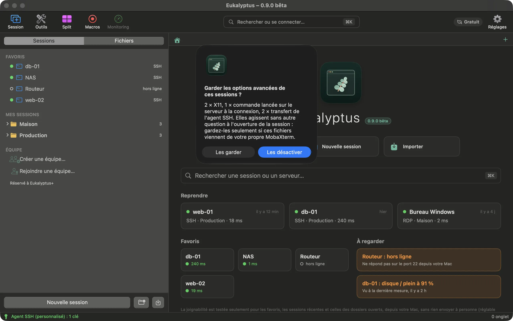

# Importer ses sessions MobaXterm sur Mac

Des dizaines de serveurs rangés en dossiers dans MobaXterm, et un nouveau Mac : personne n'a envie de tout ressaisir. Eukalyptus lit directement le fichier de sessions de MobaXterm. Voici où le trouver sur le PC, comment l'importer, et ce qui est repris.

> **En bref**
>
> - Deux fichiers possibles : MobaXterm.ini, ou un export .mxtsessions.
> - Dossiers, hôtes, ports, utilisateurs, rebonds SSH, clés et options RDP sont repris.
> - SSH, SFTP, Telnet, Mosh, RDP, VNC, FTP, série, shell et navigateur : dix types de session.
> - Les mots de passe ne sont pas repris ; les options qui agissent seules sont gardées sur accord.

**Dans cet article**

1. [Récupérer ses sessions sur le PC Windows](#récupérer-ses-sessions-sur-le-pc-windows)
2. [Importer dans Eukalyptus](#importer-dans-eukalyptus)
3. [Ce qui est repris](#ce-qui-est-repris)
4. [Les options avancées, gardées sur accord](#les-options-avancées-gardées-sur-accord)
5. [Après l'import : mots de passe et clés](#après-limport--mots-de-passe-et-clés)
6. [Termius, fichiers .rdp et sauvegarde](#termius-fichiers-rdp-et-sauvegarde)
7. [Quand l'import ne trouve rien](#quand-limport-ne-trouve-rien)
8. [Questions fréquentes](#questions-fréquentes)

## Récupérer ses sessions sur le PC Windows

MobaXterm range toutes vos sessions dans un seul fichier texte. Deux façons de le récupérer :

### Exporter les sessions (le plus simple)

1. Dans MobaXterm, faites un clic droit sur **« User sessions »**, dans le panneau Sessions à gauche.
2. Choisissez **« Export all sessions to file »** et enregistrez le fichier `.mxtsessions`.

### Copier MobaXterm.ini

Le fichier de configuration contient les mêmes sessions. Son emplacement dépend de l'édition :

- **Édition installée** : `%APPDATA%\MobaXterm\MobaXterm.ini`, soit en général `C:\Users\votre-nom\AppData\Roaming\MobaXterm\MobaXterm.ini`. Collez `%APPDATA%\MobaXterm` dans la barre d'adresse de l'Explorateur.
- **Édition portable** : `MobaXterm.ini` est à côté de l'exécutable, sur la clé USB ou dans le dossier où vous l'avez posé.

Mettez le fichier sur le Mac comme vous voulez : clé USB, dossier partagé, e-mail à vous-même. Il ne contient pas de mot de passe en clair, mais il liste vos serveurs : ne le laissez pas traîner dans un espace partagé.

## Importer dans Eukalyptus

1. Au premier lancement, l'écran de bienvenue propose **« Importer mes sessions MobaXterm »**. Plus tard : menu **Fichier › Importer des sessions MobaXterm…**, ou clic droit sur « User sessions ».
2. Choisissez votre fichier `MobaXterm.ini` ou `.mxtsessions`.
3. Cochez ou non **« Activer l'agent forwarding sur les sessions SSH importées »**. MobaXterm le désactive par défaut ; cochez-le si vos rebonds ou vos commandes Git sur le serveur ont besoin de vos clés.
4. Si certaines sessions ont des options avancées, Eukalyptus demande s'il faut les garder (voir plus bas).
5. Le rapport s'affiche : nombre de sessions importées, sessions écartées et pourquoi.

Les sessions arrivent dans un dossier **« Import MobaXterm »**, avec l'arborescence de vos dossiers d'origine. Le fichier est lu en UTF-8 ou, à défaut, en Windows-1252, l'encodage des anciennes versions : les accents des noms de dossiers sont conservés.

## Ce qui est repris

Le format du fichier de MobaXterm n'est pas documenté. Eukalyptus le lit d'après la description des paramètres de session embarquée dans MobaXterm lui-même, champ par champ :

- **Pour toutes les sessions** : le nom, le dossier, l'hôte, le port, l'utilisateur et le commentaire, qui devient la note de la session.
- **SSH** : X11 forwarding, compression, commande à lancer, clé privée, agent forwarding et passerelle SSH, qui devient un rebond (`ssh -J`).
- **RDP** : console d'administration, disques et imprimantes partagés, presse-papiers, résolution (dont le plein écran), son et passerelle SSH.
- **VNC** : la passerelle SSH, reprise comme un tunnel.
- **SFTP, FTP, Telnet, Mosh** : la connexion, et la clé privée pour SFTP et Mosh.
- **Série** : la vitesse. Un port Windows (`COM3`) est signalé : remplacez-le par le port du Mac, de la forme `/dev/tty.usbserial-…`.
- **Shell et navigateur** : le type de session et l'adresse de la page.

Ne sont pas repris : les sessions WSL, Rsh, XDMCP, « File » et AWS S3 de MobaXterm, ainsi que les mots de passe. Le rapport d'import liste les sessions laissées de côté.

## Les options avancées, gardées sur accord

*Pendant l'import : les options qui agissent seules sont comptées, et désactivées par défaut.*

Certaines options agissent sans autre question à l'ouverture de la session : une commande lancée sur le serveur, le X11 forwarding, l'agent forwarding, des options `ssh` libres, et en RDP le partage des disques et des imprimantes du Mac. Dans un fichier reçu d'un tiers, elles pourraient servir à piéger une session. Eukalyptus les compte, par type, et demande :

- **« Les désactiver »** (bouton par défaut) : les sessions sont importées sans elles. Vous les réactivez une par une dans la fiche de la session.
- **« Les garder »** : seulement si le fichier vient de votre propre MobaXterm.

Les adresses invalides, par exemple un nom d'hôte qui commence par un tiret et ressemble à une option de `ssh`, sont écartées et comptées dans le rapport.

## Après l'import : mots de passe et clés

### Les mots de passe

À la première connexion, entrez le mot de passe et enregistrez-le : il est rangé dans le Trousseau macOS, et l'afficher ou le copier demande Touch ID ou le mot de passe du Mac. Mieux, passez aux [clés SSH](./cles-ssh-mac.md) : le gestionnaire de clés d'Eukalyptus en crée une et l'installe sur le serveur.

### Les clés privées

MobaXterm enregistre des chemins Windows (`_ProfileDir_\.ssh\id_ed25519`, `C:\…`). Eukalyptus garde le nom du fichier et le cherche dans `~/.ssh` sur le Mac. Copiez donc vos clés dans `~/.ssh` **avant** l'import, puis protégez-les :

1. Copiez les fichiers de clé (par exemple `id_ed25519`) dans le dossier `.ssh` de votre dossier personnel.
2. Dans le Terminal : `chmod 600 ~/.ssh/id_ed25519`. OpenSSH refuse une clé lisible par d'autres comptes.
3. Une clé au format PuTTY (`.ppk`) doit d'abord être convertie, avec PuTTYgen sur le PC (Conversions › Export OpenSSH key) ou sur le Mac après `brew install putty` : `puttygen cle.ppk -O private-openssh -o ~/.ssh/cle`.

Une clé introuvable n'empêche pas l'import : la session utilisera votre agent SSH, et le rapport cite les clés manquantes.

## Termius, fichiers .rdp et sauvegarde

- **Termius** : Fichier › Importer des sessions Termius… lit un CSV (modèle d'import de Termius) ou une configuration OpenSSH.
- **Fichiers .rdp** : Fichier › Importer des sessions RDP… reprend un fichier, un dossier entier ou une archive `.zip`. Voir [le guide RDP](./rdp-mac-bureau-a-distance.md).
- **Sauvegarde** : Fichier › Exporter les sessions (.eukalyptus)… crée un fichier sans mot de passe, pour un autre Mac ou une sauvegarde.

## Quand l'import ne trouve rien

### « 0 session importée »

Le fichier ne contient sans doute pas de section de sessions. Ouvrez-le dans un éditeur de texte : les sessions sont sous des titres `[Bookmarks]`, `[Bookmarks_1]`… S'il n'y en a pas, c'est peut-être le fichier d'une autre installation de MobaXterm : refaites un export depuis le clic droit sur « User sessions ».

### Une session s'ouvre mais refuse la connexion

Vérifiez l'utilisateur et la clé dans la fiche de la session. Une passerelle SSH reprise de MobaXterm devient un rebond : le serveur de rebond doit être joignable depuis le Mac, pas seulement depuis le PC.

Pour tout ce qu'Eukalyptus fait d'autre, voir [la meilleure alternative à MobaXterm sur Mac](./meilleure-alternative-mobaxterm-mac.md).

## Questions fréquentes

Les mots de passe enregistrés dans MobaXterm sont-ils repris ?

Non. MobaXterm les chiffre avec son mot de passe principal, et un fichier de sessions n'a pas à transporter de secrets. Eukalyptus demande chaque mot de passe à la première connexion et peut l'enregistrer dans le Trousseau macOS.

L'import modifie-t-il mon installation MobaXterm ?

Non. Eukalyptus lit une copie du fichier, sans rien y écrire : vous pouvez garder MobaXterm sur votre PC aussi longtemps que vous voulez.

Puis-je importer plusieurs fois ?

Oui. Chaque import crée ses sessions dans le dossier « Import MobaXterm », que vous pouvez renommer, réorganiser ou supprimer.

Mes sessions S3 et WSL de MobaXterm sont-elles reprises ?

Non : les sessions WSL, Rsh, XDMCP, « File » et AWS S3 de MobaXterm ne sont pas reprises, et le rapport d'import les liste. Pour S3, créez une session S3 dans Eukalyptus, avec le même point d'accès.

Est-ce gratuit ?

Oui, l'import comme le reste de l'application, sans compte.

