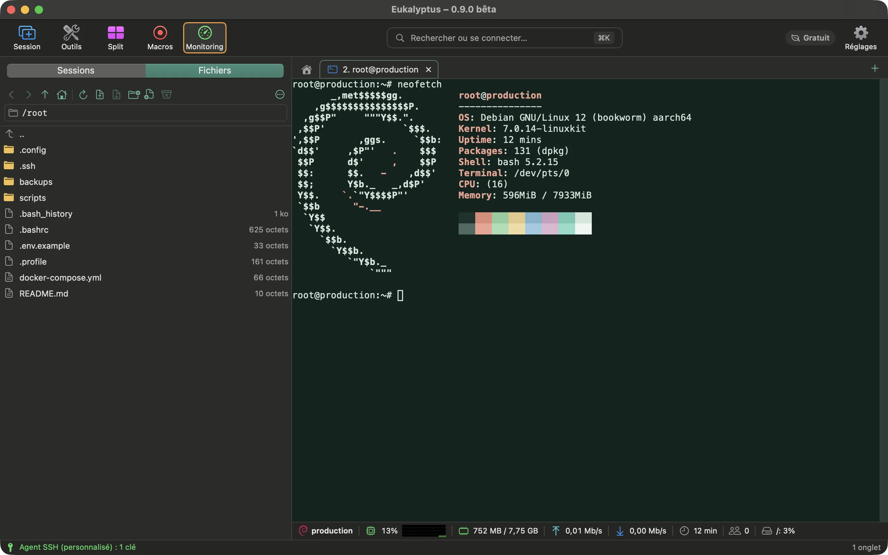
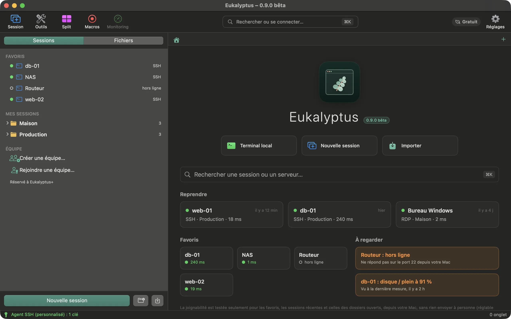
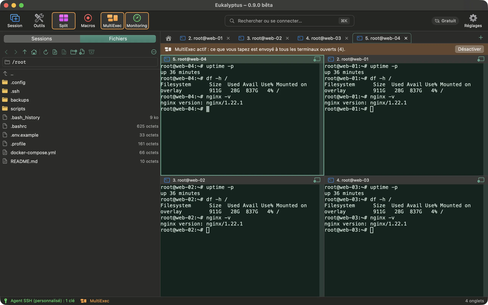

# La meilleure alternative à MobaXterm sur Mac

MobaXterm est l'outil préféré de beaucoup d'administrateurs, mais il n'existe que pour Windows. Voici comment retrouver sur Mac ses sessions, son navigateur de fichiers, ses tunnels et ses macros, dans une application native, gratuite et sans limite : Eukalyptus.

> **En bref**
>
> - MobaXterm n'a pas de version Mac : il faut une application conçue pour macOS.
> - Eukalyptus réunit terminal SSH, SFTP, tunnels, macros, X11, bureau à distance et outils réseau dans une seule app.
> - Vos sessions MobaXterm s'importent en quelques clics.
> - Gratuit, sans compte, sans pistage, sans limite de sessions. Mac Apple silicon, macOS 14 ou plus.

**Dans cet article**

1. [MobaXterm n'existe pas sur Mac](#mobaxterm-nexiste-pas-sur-mac)
2. [Ce qu'on attend d'une alternative](#ce-quon-attend-dune-alternative-à-mobaxterm)
3. [Ce que vous retrouvez dans Eukalyptus](#ce-que-vous-retrouvez-dans-eukalyptus)
4. [Migrer en deux minutes](#migrer-depuis-mobaxterm-en-deux-minutes)
5. [Sécurité et vie privée](#sécurité-et-vie-privée)
6. [Combien ça coûte](#combien-ça-coûte)
7. [Questions fréquentes](#questions-fréquentes)

## MobaXterm n'existe pas sur Mac

MobaXterm rassemble dans une seule fenêtre un terminal SSH, un navigateur SFTP, des tunnels, des macros, un serveur X et des clients de bureau à distance. C'est précisément ce qui le rend si pratique pour qui gère plusieurs serveurs. Mais c'est un programme Windows : l'éditeur ne propose pas de version pour macOS.

Quand on passe sur Mac, on se retrouve donc à jongler : un terminal d'un côté, un client SFTP de l'autre, un outil de bureau à distance ailleurs, et des sessions à retaper dans chacun. Faire tourner MobaXterm dans une machine virtuelle Windows est possible, mais c'est lourd, lent à lancer, et l'on perd ce qui fait le confort d'un Mac : ses raccourcis, le Trousseau, le glisser-déposer vers le Finder, le mode sombre.

Eukalyptus a été écrit pour cela : reprendre l'idée d'un poste de travail unique pour l'administrateur, avec une vraie application macOS.

## Ce qu'on attend d'une alternative à MobaXterm

Avant de comparer des outils, voici la liste de ce qu'il faut retrouver pour ne pas perdre ses habitudes :

- **Une application native**, rapide à ouvrir, qui respecte macOS.
- **Des sessions rangées** en dossiers, avec une connexion rapide.
- **Un navigateur de fichiers (SFTP)** ouvert avec chaque connexion SSH.
- **Des tunnels SSH** et des **macros**, sans limite artificielle.
- **Le X11 forwarding** pour les applications graphiques du serveur.
- **Le bureau à distance** (RDP, VNC) dans le même outil.
- **L'import de ses sessions**, pour ne rien ressaisir.
- **Un prix clair** : pas de fonction essentielle bloquée derrière un abonnement.

Voyons ce qu'Eukalyptus en fait, point par point.

## Ce que vous retrouvez dans Eukalyptus

*Un terminal SSH, le navigateur SFTP de la même connexion à gauche, et la barre de monitoring du serveur en bas.*

### Des sessions rangées, une connexion rapide

Vos serveurs s'organisent dans un arbre de dossiers (« Mes sessions »), avec des favoris, une icône par type de session, un point qui dit si le serveur répond et un double-clic pour se connecter. La palette de commandes (`⌘K`) cherche une session et accepte directement `user@hôte:port`. Les types de session couvrent SSH, SFTP, FTP et FTPS, Telnet, Mosh, port série, RDP, VNC, S3 et même un navigateur web intégré.

*Les sessions en dossiers, avec un filtre et des sessions récentes sur l'accueil.*

### Un terminal SSH qui s'appuie sur OpenSSH

Eukalyptus lance l'OpenSSH du système : votre `~/.ssh/config`, vos clés, votre agent (y compris celui de Bitwarden), le ProxyJump et l'agent forwarding fonctionnent comme d'habitude. Le terminal propose des onglets, la recherche (⌘F), le zoom, neuf thèmes, et une autocomplétion qui suggère la commande à partir de votre historique, jamais de mots de passe. À la fin d'une session, un écran propose *Entrée* pour fermer ou *R* pour relancer. Une reconnexion automatique peut aussi relancer la session après une coupure réseau. En option, le terminal colore les mots-clés à la volée : erreurs en rouge, alertes en jaune, réussites en vert, adresses IP en cyan, sans toucher à ce que les programmes colorent eux-mêmes.

### Le navigateur SFTP, ouvert avec chaque session

Chaque connexion SSH affiche à gauche les fichiers du serveur. Le navigateur réutilise la connexion du terminal (ControlMaster) : une seule authentification. On y navigue, on envoie et on télécharge des fichiers et des dossiers avec leur progression, on renomme, on règle les droits dans un éditeur graphique (cases rwx, mode octal), et on glisse un fichier directement vers le Finder ou le Bureau.

Un double-clic sur un fichier l'ouvre dans l'**éditeur de code intégré**, avec coloration pour plus de vingt langages et de formats de configuration (shell, nginx, yaml, python, json…), recherche et remplacement. Quand vous enregistrez avec ⌘S, le fichier repart sur le serveur en gardant ses droits, et l'app vous prévient si quelqu'un l'a modifié entre-temps.

### La surveillance du serveur, sans rien installer dessus

Sous chaque session SSH, une barre affiche en direct l'utilisation du processeur (avec son historique), la mémoire, les débits réseau, la durée de fonctionnement, les utilisateurs connectés et l'occupation des disques. Elle utilise la connexion déjà ouverte : aucun agent à installer sur le serveur. Elle fonctionne avec les serveurs Linux et macOS.

### Des tunnels et des macros sans limite

Le gestionnaire de tunnels SSH gère les redirections locales, distantes et SOCKS, en nombre illimité. Les macros s'enregistrent, se rejouent avec leurs pauses et se modifient. Une session peut aussi lancer une macro toute seule à son ouverture, après le délai de votre choix.

### MultiExec et affichage en mosaïque

Pour agir sur une grille de machines, le bouton Split affiche tous les terminaux ouverts côte à côte, et MultiExec envoie ce que vous tapez à tous à la fois. Pratique pour vérifier une version ou relancer un service sur quatre serveurs en une seule frappe.

*MultiExec : la même commande envoyée à quatre serveurs, en mosaïque.*

### X11 forwarding

Pour lancer une application graphique d'un serveur et l'afficher sur votre Mac, cochez l'option X11 de la session. Eukalyptus s'appuie sur XQuartz, le serveur X gratuit pour macOS, à installer une seule fois. Il retrouve l'affichage de XQuartz tout seul et, si XQuartz manque, explique quoi installer au lieu du message d'erreur de ssh.

### Bureau à distance

Les sessions RDP s'ouvrent dans un onglet, avec un client intégré (FreeRDP) : aucune autre application à installer. Le mot de passe est rangé dans le Trousseau, et le client couvre les usages d'un administrateur :

- **Copier-coller** du texte, des images et des fichiers, dans les deux sens, entre le Finder et l'Explorateur Windows.
- **Partage avec le Mac** : les dossiers de votre choix, les imprimantes, les cartes à puce et le son.
- **Plein écran**, et un mode qui étend le bureau Windows sur tous les écrans du Mac.
- **Comptes Microsoft Entra ID**, passerelle RD, programme à lancer à la place du bureau, équilibreur de charge, console Hyper-V et Restricted Admin.
- **Affichage fluide** (RDPGFX), option **Retina** pour un texte net, et reconnexion automatique après une coupure.

Les sessions VNC s'ouvrent dans Partage d'écran, le client VNC de macOS. RDP et VNC peuvent passer par un tunnel SSH automatique quand le serveur n'est pas joignable directement.

### Fichiers, buckets et outils réseau

Le même navigateur de fichiers sert pour le FTP et le FTPS, et pour les buckets S3 (AWS, MinIO, Cloudflare R2, Backblaze B2, Wasabi, Scaleway, OVHcloud…), avec envoi, téléchargement et liens présignés. Côté diagnostic, on trouve un scanner réseau, le ping, le traceroute, la résolution DNS et la liste des ports à l'écoute du Mac, sans quitter l'application. La **capture du réseau** montre qui parle à qui, avec un résumé en français (protocoles non chiffrés, connexions refusées, noms introuvables) et un enregistrement en `.pcap` pour Wireshark. Le **Wake-on-LAN** réveille une machine éteinte du réseau local et, si vous donnez son nom, indique quand elle répond. Les outils dont vous vous servez le plus s'épinglent dans la barre du haut.

### Mots de passe et clés SSH

Le gestionnaire de mots de passe range les secrets dans le Trousseau macOS ; les afficher ou les copier demande Touch ID ou le mot de passe du Mac, et la copie est effacée du presse-papiers au bout de 30 secondes. Le gestionnaire de clés SSH liste celles de `~/.ssh` et de l'agent, génère de nouvelles clés (Ed25519, RSA, ECDSA) et les installe sur un serveur.

Pour approfondir : [le client SSH](./client-ssh-mac.md), [le navigateur SFTP](./client-sftp-mac.md), [le bureau à distance RDP](./rdp-mac-bureau-a-distance.md), [les tunnels SSH](./tunnel-ssh-mac.md), [le X11 forwarding](./x11-forwarding-mac-xquartz.md), [les clés SSH](./cles-ssh-mac.md), [les buckets S3](./client-s3-mac.md), [la capture du réseau](./capture-reseau-mac.md) et [le Wake-on-LAN](./wake-on-lan-mac.md) ont chacun leur guide.

## Migrer depuis MobaXterm en deux minutes

1. [Téléchargez Eukalyptus](https://eukalyptus.app/telecharger) et installez-le : l'installateur .pkg se lance comme n'importe quelle application Mac.
2. Au premier lancement, l'écran de bienvenue propose **« Importer mes sessions MobaXterm »**. Choisissez votre fichier `MobaXterm.ini` ou l'export de vos sessions (`.mxtsessions`). Plus tard, le bouton d'import en bas du panneau de gauche ouvre le même import.
3. Vos dossiers et vos hôtes sont recréés. Entrez chaque mot de passe une seule fois : il part directement dans le Trousseau macOS.

Où trouver le fichier sur le PC, ce qui est repris, et que faire de vos clés : tout est détaillé dans [le guide de l'import des sessions MobaXterm](./importer-sessions-mobaxterm-mac.md).

Vous avez aussi des fichiers `.rdp` ? Fichier › « Importer des sessions RDP (.rdp, dossier ou .zip)… » reprend un fichier, un dossier entier (sous-dossiers compris) ou une archive `.zip`, avec l'adresse, l'utilisateur, la passerelle et les options de chaque session.

Les mots de passe ne sont pas repris : Eukalyptus les demande une fois et les range dans le Trousseau, au lieu de les lire dans un fichier. Vous pouvez garder MobaXterm tant que vous voulez : l'import ne touche pas à vos fichiers d'origine. Un export au format `.eukalyptus`, lui aussi sans mot de passe, permet ensuite de sauvegarder vos sessions ou de les copier sur un autre Mac.

## Sécurité et vie privée

Eukalyptus ne demande aucun compte et ne passe par aucun serveur pour vous connecter aux vôtres. Vos mots de passe vivent dans le Trousseau macOS, jamais dans un fichier ni dans un export. Les mises à jour sont proposées au lancement ; la liste des versions est signée et l'app vérifie l'empreinte du fichier et sa signature avant d'installer quoi que ce soit. Tous les échanges réseau de l'application, quand ils ont lieu et ce qu'ils contiennent, sont décrits en détail sur la page [Sécurité](https://eukalyptus.app/securite).

## Combien ça coûte

Eukalyptus est gratuit, et complet : autant de sessions, de tunnels et de macros que vous voulez, sans durée d'essai. **Eukalyptus+** est une licence facultative à 21 €, payée une seule fois et valable à vie : elle soutient son auteur, donne accès aux nouvelles versions 15 jours avant tout le monde et permet de choisir une icône et une couleur pour chaque session. Elle ne retire jamais rien à la version gratuite. Le détail est sur la page [Tarifs](https://eukalyptus.app/tarifs).

À titre de repère, la Home Edition gratuite de MobaXterm est limitée à 12 sessions enregistrées, 2 tunnels SSH et 4 macros, et lever ces limites demande sa version Professional (49 € par utilisateur, hors taxes). Ces chiffres sont ceux de son site officiel, relevés le 27 octobre 2026. Pour le tableau complet, fonction par fonction, voir la page [Eukalyptus ou MobaXterm](https://eukalyptus.app/alternative-mobaxterm-mac).

## Questions fréquentes

MobaXterm existe-t-il sur Mac ?

Non. MobaXterm est un logiciel pour Windows et l'éditeur ne propose pas de version macOS. Pour retrouver ses usages sur Mac, il faut une application faite pour macOS, comme Eukalyptus.

Eukalyptus est-il vraiment gratuit ?

Oui. Toutes les fonctions sont gratuites, sans limite de sessions, de tunnels ou de macros, et sans compte à créer. Eukalyptus+ (21 €, une seule fois) est facultatif : il soutient le projet et ajoute quelques avantages annexes, sans jamais retirer une fonction à la version gratuite.

Puis-je reprendre mes sessions MobaXterm ?

Oui. Eukalyptus lit le fichier MobaXterm.ini ou l'export de vos sessions (.mxtsessions) et recrée vos dossiers et vos hôtes. Les mots de passe ne sont pas repris : vous les saisissez une fois et ils sont rangés dans le Trousseau macOS.

Sur quels Mac fonctionne Eukalyptus ?

Sur les Mac Apple silicon (puces de la série M) avec macOS 14 ou plus récent. Eukalyptus existe aussi pour Windows 10 et 11 (installateur .exe), avec les mêmes fonctions pour l'essentiel ; seul Mosh n'y est pas encore disponible.

Faut-il créer un compte pour l'utiliser ?

Non. Il n'y a ni compte, ni pistage, et rien ne passe par nos serveurs pour vous connecter aux vôtres.

Et le X11 forwarding ?

Il est pris en charge, avec XQuartz (gratuit), qu'Eukalyptus n'embarque pas. Il suffit de cocher l'option dans la session ; si XQuartz manque, l'app explique quoi installer.

---

MobaXterm est une marque de Mobatek, citée ici pour comparer. Eukalyptus n'a aucun lien avec cet éditeur. Les limites de MobaXterm viennent de ses pages [éditions Home et Professional](https://mobaxterm.mobatek.net/download.html) et [fonctionnalités](https://mobaxterm.mobatek.net/features.html), relevées le 27 octobre 2026. Une information a changé ? Écrivez à [contact@eukalyptus.app](mailto:contact@eukalyptus.app), nous la corrigeons.
