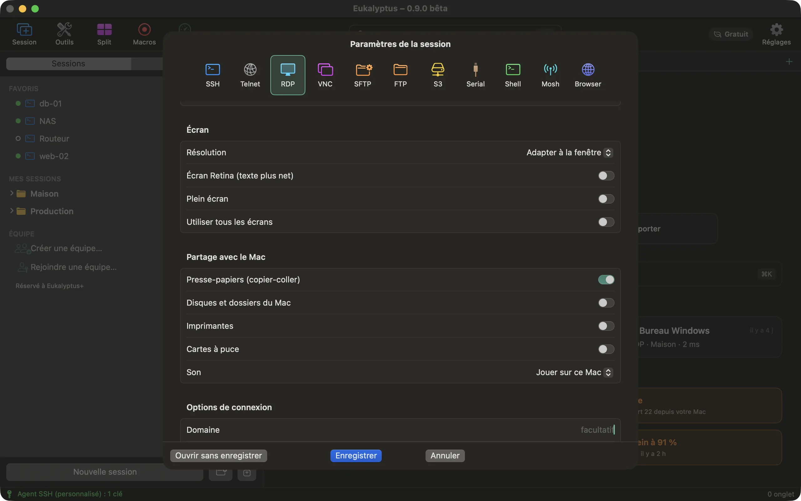

# Bureau à distance RDP sur Mac : se connecter à Windows

Ouvrir le bureau d'un PC ou d'un serveur Windows depuis un Mac, copier un fichier d'un côté à l'autre, imprimer, passer par la passerelle de l'entreprise : tout se fait dans un onglet d'Eukalyptus, avec son client RDP intégré. Voici comment préparer Windows, régler la session et résoudre les échecs de connexion.

> **En bref**
>
> - Le client RDP (FreeRDP) est intégré : aucune autre application à installer.
> - Copier-coller du texte, des images et des fichiers dans les deux sens ; dossiers, imprimantes, cartes à puce et son partagés au choix.
> - Plein écran, tous les écrans du Mac, Retina, passerelle RD, Entra ID, Hyper-V.
> - Import des fichiers .rdp, un par un, par dossier ou en .zip.

**Dans cet article**

1. [RDP en deux mots](#rdp-en-deux-mots)
2. [Préparer le PC ou le serveur Windows](#préparer-le-pc-ou-le-serveur-windows)
3. [Créer la session dans Eukalyptus](#créer-la-session-dans-eukalyptus)
4. [Clavier, souris et raccourcis](#clavier-souris-et-raccourcis)
5. [Copier-coller du texte, des images et des fichiers](#copier-coller-du-texte-des-images-et-des-fichiers)
6. [Partager des dossiers, des imprimantes et le son](#partager-des-dossiers-des-imprimantes-et-le-son)
7. [Plein écran et plusieurs écrans](#plein-écran-et-plusieurs-écrans)
8. [Passerelle RD, Entra ID et réglages d'entreprise](#passerelle-rd-entra-id-et-réglages-dentreprise)
9. [Atteindre un Windows qui n'est pas exposé](#atteindre-un-windows-qui-nest-pas-exposé)
10. [Reprendre ses fichiers .rdp](#reprendre-ses-fichiers-rdp)
11. [Quand la connexion échoue](#quand-la-connexion-échoue)
12. [Questions fréquentes](#questions-fréquentes)

## RDP en deux mots

Le RDP (Remote Desktop Protocol) est le protocole de bureau à distance de Microsoft. Le PC ou le serveur Windows écoute sur le port TCP `3389` ; le client affiche son écran et lui envoie le clavier et la souris. La connexion est chiffrée en TLS, et l'authentification réseau (NLA) vérifie votre compte *avant* d'ouvrir une session Windows, ce qui protège le serveur des connexions anonymes.

*Schéma : Le Mac se connecte en RDP au port 3389 du serveur Windows, en TLS avec NLA ; le presse-papiers et les dossiers partagés passent par la même connexion.*

| Votre Mac |  | Windows |  | Votre session |
|---|---|---|---|---|
| Eukalyptus client FreeRDP | RDP (TLS + NLA) → | Bureau à distance port 3389 | ouvre → | bureau, fichiers imprimantes, son |

## Préparer le PC ou le serveur Windows

1. **Activer le Bureau à distance** : sur Windows 10 ou 11 Professionnel, Paramètres › Système › Bureau à distance ; sur Windows Server, Gestionnaire de serveur › Serveur local › Bureau à distance. Les éditions Famille ne peuvent pas recevoir de connexion RDP.
2. **Garder l'authentification réseau (NLA)** cochée : c'est le réglage par défaut, et Eukalyptus l'utilise.
3. **Autoriser le compte** : les administrateurs le sont d'office ; pour un autre compte, ajoutez-le au groupe « Utilisateurs du Bureau à distance ».
4. **Ouvrir le port 3389** dans le pare-feu, pour le réseau local seulement (l'activation du Bureau à distance crée la règle).

## Créer la session dans Eukalyptus

1. Cliquez sur **Nouvelle session** et choisissez le type **RDP**.
2. Indiquez l'**hôte** (nom ou adresse IP), l'**utilisateur** et, pour un compte de domaine, le **domaine**. Le mot de passe peut être enregistré : il est rangé dans le Trousseau macOS.
3. Dans **Écran**, choisissez la résolution ; par défaut, le bureau Windows suit la taille de l'onglet. L'option **Écran Retina** demande un bureau en pixels Retina et agrandit l'interface de Windows à 200 %, pour un texte plus net.
4. Double-cliquez sur la session. À la première connexion, Eukalyptus affiche l'empreinte du certificat du serveur ; vérifiez-la, puis acceptez. Si elle change plus tard, vous êtes prévenu.

La barre de l'onglet propose Ctrl+Alt+Suppr (que macOS ne peut pas envoyer au clavier), le plein écran, la reconnexion et la déconnexion. Après une coupure réseau, la session se reconnecte seule (réglage « Se reconnecter seul après une coupure »).

## Clavier, souris et raccourcis

- **⌘ joue le rôle de Ctrl** (réglage par défaut) : ⌘C, ⌘V et ⌘Z copient, collent et annulent dans Windows, comme sur le Mac.
- **La disposition du clavier du Mac** est transmise, y compris les claviers ISO (la touche à gauche du Z).
- **La souris et la molette** fonctionnent comme attendu, avec le curseur du serveur.

## Copier-coller du texte, des images et des fichiers

Le presse-papiers est partagé par défaut, dans les deux sens. Le **texte** passe avec ses accents et ses fins de ligne converties. Les **images** passent d'une capture d'écran du Mac à Paint, et l'inverse. Les **fichiers et dossiers** se copient dans le Finder et se collent dans l'Explorateur Windows, et l'inverse : la barre de l'onglet montre l'avancement.

Ce qui vient de Windows est limité à 128 Mo et 500 éléments par copie ; au-delà, utilisez un dossier partagé. Les fichiers reçus portent l'attribut de quarantaine de macOS, comme un téléchargement : une app ou un script venu du serveur passe par Gatekeeper avant de s'ouvrir.

## Partager des dossiers, des imprimantes et le son

*Écran et partages d'une session RDP : tout se règle dans la fiche de la session.*

Dans « Paramètres de la session », le bloc **Partage avec le Mac** règle ce que Windows peut utiliser :

- **Disques et dossiers du Mac** : choisissez les dossiers à partager (Téléchargements par défaut). Ils apparaissent dans l'Explorateur, sous « Ce PC ».
- **Imprimantes** : les imprimantes du Mac sont proposées dans Windows.
- **Cartes à puce** : pour les comptes qui s'authentifient par carte.
- **Son** : joué sur ce Mac (par défaut), sur le serveur, ou coupé.

Les dossiers, imprimantes et cartes à puce sont désactivés par défaut : ne partagez que ce dont la session a besoin, surtout avec un serveur qui ne vous appartient pas.

## Plein écran et plusieurs écrans

Le bouton **Plein écran** sort la session dans sa propre fenêtre, en plein écran macOS. Le mode **Tous les écrans** étend un seul bureau Windows sur tous les écrans du Mac, en respectant leur disposition (y compris un écran placé à gauche ou au-dessus du principal). Pour en sortir : `Ctrl+Option+Cmd+F` ou le bouton de la barre. L'**affichage fluide** (RDPGFX) est activé par défaut pour les mouvements et les défilements.

## Passerelle RD, Entra ID et réglages d'entreprise

Le volet « Entreprise et options avancées » s'ouvre de lui-même dès que l'un de ses réglages est utilisé :

- **Passerelle RD** : son adresse, « Toujours » ou « Sauf pour les adresses du réseau local », et des identifiants identiques au serveur ou différents (rangés à part dans le Trousseau).
- **Compte Microsoft Entra ID** : la connexion se fait sur la page de Microsoft, dans une fenêtre ; Eukalyptus ne voit pas votre mot de passe.
- **Programme à lancer** à la place du bureau, avec son dossier de travail.
- **Équilibreur de charge** (RD Connection Broker) pour les fermes de serveurs.
- **Machine virtuelle Hyper-V** : son identifiant ouvre sa console, sur le port 2179.
- **Restricted Admin** : votre mot de passe n'est pas envoyé au serveur.
- **Chiffrement RDP classique**, uniquement pour les très anciens serveurs : il peut être intercepté, laissez-le désactivé sinon.

## Atteindre un Windows qui n'est pas exposé

N'ouvrez jamais le port 3389 sur Internet : c'est l'une des cibles les plus attaquées. Trois solutions propres : une passerelle RD, un VPN, ou un rebond SSH. Pour ce dernier, renseignez le champ **Passerelle SSH** de la session (par exemple `utilisateur@bastion:22`) : Eukalyptus ouvre lui-même le tunnel SSH, puis la session RDP à travers lui. Le principe est détaillé dans [le guide des tunnels SSH](./tunnel-ssh-mac.md).

## Reprendre ses fichiers .rdp

Fichier › **« Importer des sessions RDP (.rdp, dossier ou .zip)… »** reprend un fichier, un dossier entier (ses sous-dossiers deviennent des dossiers de sessions) ou une archive `.zip`. L'adresse, l'utilisateur, le domaine, l'écran, les partages, la passerelle et les options sont repris. Le mot de passe enregistré dans un .rdp ne l'est pas (il est chiffré pour le compte Windows qui l'a créé). Par prudence, ce qui agit sans votre accord (dossiers partagés, programme à lancer, passerelle) est proposé désactivé ; vous pouvez le garder si les fichiers viennent de vous. Vous venez de Windows ? Lisez aussi [notre comparatif des outils pour Mac](./meilleure-alternative-mobaxterm-mac.md).

## Quand la connexion échoue

### Aucune réponse du serveur

Le Bureau à distance n'est pas activé, le port 3389 est fermé par un pare-feu, ou le PC est en veille. Vérifiez depuis le Mac avec `nc -vz adresse-du-pc 3389`. Un PC éteint ou en veille se démarre à distance par le [Wake-on-LAN](./wake-on-lan-mac.md), depuis Eukalyptus.

### Identifiants refusés

Pour un compte de domaine, renseignez le champ Domaine, ou écrivez l'utilisateur sous la forme `DOMAINE\utilisateur`. Pour un compte Microsoft sur un PC personnel, l'utilisateur est l'adresse e-mail du compte, et le mot de passe celui du compte (pas le code PIN Windows Hello).

### Le certificat a changé

C'est normal après une réinstallation ou un renouvellement de certificat. Sinon, ne continuez pas : quelqu'un peut se trouver entre vous et le serveur.

### Un très ancien serveur refuse la connexion

Les serveurs antérieurs à Windows Server 2008 et Windows Vista ne connaissent pas NLA, et les plus anciens (Windows 2000, Server 2003 sans SP1) pas même TLS. Désactivez « Authentification réseau (NLA) », puis, en dernier recours, activez « Chiffrement RDP classique » pour ce serveur seulement.

## Questions fréquentes

Faut-il installer une autre application pour le RDP ?

Non. Le client RDP (FreeRDP) est intégré à Eukalyptus : la session s'ouvre dans un onglet, à côté de vos terminaux.

Quel port utilise le RDP ?

Le port TCP 3389 par défaut. Une console de machine virtuelle Hyper-V utilise le port 2179.

Le micro, la caméra ou l'USB sont-ils redirigés ?

Non. Eukalyptus partage le presse-papiers, les dossiers de votre choix, les imprimantes, les cartes à puce et le son joué sur le Mac.

Les applications publiées seules (RemoteApp) sont-elles prises en charge ?

Pas encore. En attendant, le réglage « Programme à lancer » ouvre un programme à la place du bureau Windows.

Et le VNC ?

Les sessions VNC s'ouvrent dans Partage d'écran, le client VNC de macOS, et peuvent passer elles aussi par un tunnel SSH.

Est-ce gratuit ?

Oui, comme tout Eukalyptus : sans limite de sessions et sans compte.

