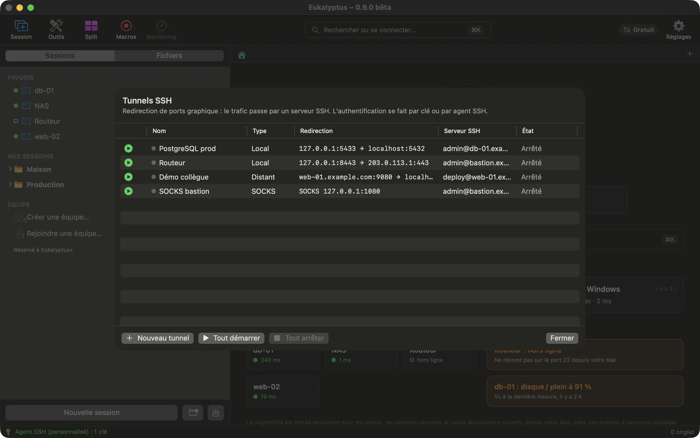

# Tunnel SSH sur Mac : redirection locale, distante et SOCKS

Accéder à une base de données qui n'écoute qu'en local, ouvrir l'interface d'un équipement derrière un serveur, exposer un service de votre Mac : un tunnel SSH fait tout cela sans VPN. Voici les trois types, expliqués avec des schémas, puis comment les créer sur Mac avec Eukalyptus.

> **En bref**
>
> - Un tunnel SSH fait passer le trafic d'un port par une connexion SSH chiffrée.
> - Trois types : local (-L), distant (-R) et proxy SOCKS (-D).
> - Dans Eukalyptus : Outils › Tunnels SSH…, un formulaire, un bouton de lecture. Sans limite de tunnels.
> - Gratuit, sans compte, avec vos clés et votre agent SSH.

**Dans cet article**

1. [Qu'est-ce qu'un tunnel SSH ?](#quest-ce-quun-tunnel-ssh-)
2. [Redirection locale (-L)](#redirection-locale--l--atteindre-un-service-derrière-le-serveur)
3. [Redirection distante (-R)](#redirection-distante--r--exposer-un-service-de-votre-mac)
4. [Proxy SOCKS (-D)](#proxy-socks--d--sortir-par-le-serveur)
5. [Créer un tunnel dans Eukalyptus](#créer-un-tunnel-dans-eukalyptus)
6. [Trois exemples concrets](#trois-exemples-concrets)
7. [Bonnes pratiques de sécurité](#bonnes-pratiques-de-sécurité)
8. [Quand ça ne marche pas](#quand-ça-ne-marche-pas)
9. [Questions fréquentes](#questions-fréquentes)

## Qu'est-ce qu'un tunnel SSH ?

Une connexion [SSH](./client-ssh-mac.md) ne sert pas qu'à ouvrir un terminal : elle peut aussi transporter, de façon chiffrée, d'autres connexions. C'est ce qu'on appelle un tunnel, ou une redirection de port. On y recourt quand un service n'est pas ouvert sur Internet (une base de données, une interface d'administration) mais que vous avez un accès SSH à une machine qui, elle, peut l'atteindre.

Les schémas ci-dessous se lisent de gauche à droite ; le trait épais est la connexion SSH, qui est chiffrée.

## Redirection locale (-L) : atteindre un service derrière le serveur

Vous ouvrez un port sur **votre Mac** ; tout ce qui s'y connecte ressort du serveur SSH vers la destination de votre choix, vue depuis le serveur. C'est le tunnel le plus courant.

*Schéma : Redirection locale : le Mac écoute sur le port 8080, le trafic passe par le serveur SSH et rejoint le port 80 de la destination.*

| Votre Mac |  | Serveur SSH |  | Destination |
|---|---|---|---|---|
| écoute sur<br>127.0.0.1:8080 | tunnel SSH → | serveur.exemple.fr | connexion → | localhost:80<br>(vu du serveur) |

*Équivalent en ligne de commande (-N : pas de shell, seulement la redirection)*

```sh
ssh -N -L 8080:localhost:80 utilisateur@serveur.exemple.fr
```

Ouvrez ensuite `http://localhost:8080` dans votre navigateur : vous voyez le site qui tourne sur le port 80 du serveur, même s'il n'est pas exposé à l'extérieur.

## Redirection distante (-R) : exposer un service de votre Mac

L'inverse : c'est le **serveur SSH** qui ouvre un port, et le trafic qui s'y connecte revient vers un service accessible depuis votre Mac. Pratique pour montrer à un collègue le site que vous développez en local.

*Schéma : Redirection distante : le serveur SSH écoute sur le port 9000, le trafic revient par le tunnel vers le port 3000 du Mac.*

| Votre Mac |  | Serveur SSH |  | Un client |
|---|---|---|---|---|
| application sur<br>localhost:3000 | ← tunnel SSH | écoute sur<br>le port 9000 | ← connexion | se connecte à<br>serveur:9000 |

*Équivalent en ligne de commande*

```sh
ssh -N -R 9000:localhost:3000 utilisateur@serveur.exemple.fr
```

Par défaut, le serveur n'écoute que sur sa propre interface locale (`localhost`). Pour que d'autres machines s'y connectent, l'administrateur du serveur doit autoriser `GatewayPorts` dans la configuration de sshd.

## Proxy SOCKS (-D) : sortir par le serveur

Au lieu d'une destination fixe, le Mac ouvre un **proxy SOCKS** : toute application que vous configurez pour l'utiliser (navigateur, client de messagerie…) sort sur Internet depuis le serveur SSH. Utile pour accéder à tout un réseau interne depuis un navigateur, sans créer un tunnel par service.

*Schéma : Proxy SOCKS : le Mac ouvre un proxy sur le port 1080, et les applications sortent par le serveur SSH vers n'importe quelle destination.*

| Votre Mac |  | Serveur SSH |  | Le réseau |
|---|---|---|---|---|
| proxy SOCKS sur<br>127.0.0.1:1080 | tunnel SSH → | serveur.exemple.fr | connexions → | n'importe quelle<br>destination |

*Équivalent en ligne de commande*

```sh
ssh -N -D 1080 utilisateur@serveur.exemple.fr
```

Dans Réglages Système › Réseau (détails de votre connexion › Proxys), ou dans les réglages de votre navigateur, indiquez un proxy SOCKS sur `127.0.0.1`, port `1080`. OpenSSH parle SOCKS 4 et SOCKS 5 : pour que les noms DNS soient aussi résolus par le serveur, le client doit utiliser SOCKS 5 avec résolution distante (par exemple `curl --socks5-hostname 127.0.0.1:1080`).

## Créer un tunnel dans Eukalyptus



*Les tunnels enregistrés : un bouton pour démarrer, la redirection en clair, l'état de chacun.*

1. Ouvrez **Outils › Tunnels SSH…** puis cliquez sur **Nouveau tunnel**.
2. Choisissez le **type** : redirection de port locale, distante ou dynamique (proxy SOCKS). Une phrase en dessous décrit en clair ce que le tunnel va faire.
3. Renseignez « Écoute sur ce Mac » (adresse et port ; pour une redirection distante, « Écoute sur le serveur SSH ») et, sauf pour le SOCKS, le « Serveur de destination » (hôte et port).
4. Renseignez le **serveur SSH** : hôte, port, utilisateur. Le champ « Clé privée » reste vide pour utiliser votre agent SSH.
5. Enregistrez, puis cliquez sur le bouton de lecture : le voyant passe au vert quand le tunnel est établi, et au rouge si la connexion échoue.

Les tunnels sont enregistrés : vous les relancez ou les arrêtez d'un clic, sans retaper la commande. Il n'y a pas de limite de nombre, et le bouton « Tunnels » de la barre du haut s'allume quand l'un d'eux est actif.

### Ce que fait Eukalyptus en coulisse

Chaque tunnel est un processus `/usr/bin/ssh` lancé avec `-N -T` (pas de shell), `ExitOnForwardFailure=yes` (si la redirection ne peut pas s'établir, le tunnel s'arrête au lieu de rester ouvert sans rien rediriger), `ServerAliveInterval=30` (une coupure est détectée) et `BatchMode=yes` : un tunnel tourne en arrière-plan et ne peut pas demander de mot de passe. Il s'authentifie donc par clé ou par l'agent SSH ; voir [le guide des clés SSH](./cles-ssh-mac.md).

## Trois exemples concrets

### Se connecter à une base de données qui n'écoute qu'en local

Une base PostgreSQL sur un serveur n'accepte que les connexions locales, c'est une bonne pratique. Créez un tunnel **local** : écoute sur `127.0.0.1`, port `5433` ; destination `localhost`, port `5432` ; serveur SSH : votre serveur. Votre outil de base de données se connecte alors à `127.0.0.1:5433`, comme si la base était sur le Mac.

### Ouvrir l'interface d'un équipement du réseau interne

Un routeur ou un NAS n'est joignable que depuis le réseau du serveur. Tunnel **local** : écoute sur le port `8443` de votre Mac, destination `192.168.1.1` port `443`. Ouvrez `https://localhost:8443`. Le navigateur peut se plaindre du certificat, puisque le nom ne correspond pas : c'est normal dans ce cas.

### Naviguer depuis le réseau du serveur

Un tunnel **dynamique** sur le port `1080`, puis un proxy SOCKS dans le navigateur : vos pages sortent par le serveur, ce qui donne accès aux sites réservés à son réseau.

## Bonnes pratiques de sécurité

- **Gardez l'écoute sur `127.0.0.1`** (c'est la valeur par défaut). Écouter sur `0.0.0.0` expose le tunnel à tout votre réseau local.
- **Ne tunnelisez que ce qui est nécessaire** : un tunnel est un accès au réseau du serveur, au même titre que votre connexion SSH.
- **Préférez les clés** au mot de passe (voir [le guide des clés SSH](./cles-ssh-mac.md)) et arrêtez les tunnels que vous n'utilisez plus.

## Quand ça ne marche pas

- **« bind \[127.0.0.1\]:8080: Address already in use »** : un autre programme écoute déjà sur ce port du Mac (`lsof -nP -iTCP:8080 -sTCP:LISTEN` le montre). Choisissez un autre port d'écoute.
- **« administratively prohibited: open failed »** : le serveur interdit le transfert de ports (`AllowTcpForwarding no` dans `sshd_config`). Il faut demander à son administrateur de l'autoriser.
- **Connexion refusée côté destination** : vérifiez que le service écoute bien à l'adresse et au port indiqués, *vu depuis le serveur* (testez avec `curl localhost:80` sur le serveur).
- **Voyant rouge** : la redirection n'a pas pu s'établir, ou le serveur SSH est injoignable ou refuse l'authentification. Un tunnel ne demande jamais de mot de passe : vérifiez que votre clé est chargée dans l'agent, puis essayez d'ouvrir une session normale sur le même serveur.

## Questions fréquentes

<details>
<summary>Quelle est la différence entre -L et -R ?</summary>

Avec -L, un port s'ouvre sur votre Mac et mène vers un service accessible depuis le serveur. Avec -R, c'est l'inverse : un port s'ouvre sur le serveur et mène vers un service accessible depuis votre Mac.

</details>

<details>
<summary>Un tunnel SSH est-il un VPN ?</summary>

Pas tout à fait. Un tunnel ne redirige que les ports que vous choisissez (ou, avec SOCKS, les applications que vous configurez), alors qu'un VPN redirige tout le trafic du Mac. Pour atteindre un service précis, un tunnel est plus simple et ne demande rien à installer sur le serveur.

</details>

<details>
<summary>Combien de tunnels puis-je créer dans Eukalyptus ?</summary>

Autant que vous voulez, sans limite. Vous les enregistrez, puis vous les démarrez et les arrêtez d'un clic.

</details>

<details>
<summary>Le trafic est-il chiffré ?</summary>

Oui entre votre Mac et le serveur SSH. Entre le serveur SSH et la destination finale, la connexion est normale : elle n'est chiffrée que si le service l'est lui-même.

</details>
