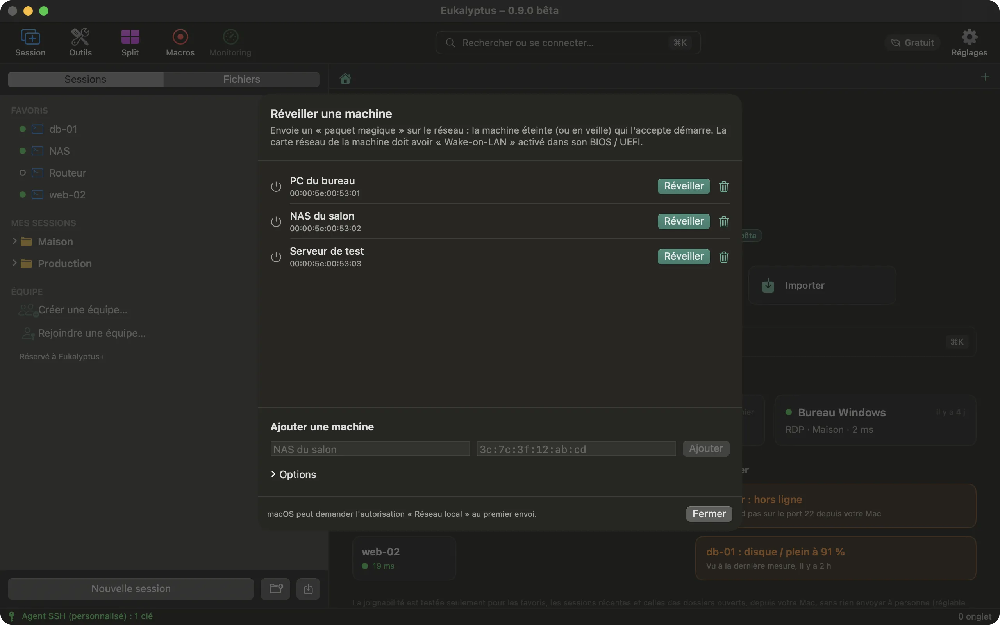

# Wake-on-LAN depuis un Mac : réveiller un PC ou un NAS à distance

Un PC de jeu à allumer pour une session de bureau à distance, un NAS mis en veille la nuit, un serveur de test éteint pour économiser l'électricité : le Wake-on-LAN les démarre par le réseau. Voici comment le préparer, puis réveiller vos machines d'un clic depuis un Mac.

> **En bref**
>
> - Le Wake-on-LAN démarre une machine éteinte avec un « paquet magique » envoyé sur le réseau local.
> - Il s'active dans le BIOS ou l'UEFI de la machine, et dans les réglages de sa carte réseau.
> - Dans Eukalyptus : Outils › Réveiller une machine, un nom, une adresse MAC, un bouton.
> - Eukalyptus indique quand la machine répond, et retient la liste de vos machines.

**Dans cet article**

1. [Comment fonctionne le Wake-on-LAN](#comment-fonctionne-le-wake-on-lan)
2. [Préparer la machine à réveiller](#préparer-la-machine-à-réveiller)
3. [Trouver l'adresse MAC](#trouver-ladresse-mac)
4. [Réveiller une machine avec Eukalyptus](#réveiller-une-machine-avec-eukalyptus)
5. [Réveiller une machine d'un autre réseau](#réveiller-une-machine-dun-autre-réseau)
6. [Depuis l'extérieur : passer par un serveur SSH](#depuis-lextérieur--passer-par-un-serveur-ssh)
7. [Quand la machine ne se réveille pas](#quand-la-machine-ne-se-réveille-pas)
8. [Questions fréquentes](#questions-fréquentes)

## Comment fonctionne le Wake-on-LAN

Une machine éteinte, mais toujours branchée, laisse sa carte réseau sous tension. Cette carte surveille un message précis : le **paquet magique**, fait de six octets `FF` suivis de seize fois son adresse MAC. Quand elle le reçoit, elle démarre l'ordinateur.

*Schéma : Wake-on-LAN : le Mac diffuse un paquet magique sur le réseau local, la carte réseau de la machine éteinte le reconnaît et la démarre.*

| Votre Mac |  | Réseau local |  | Machine éteinte |
|---|---|---|---|---|
| paquet magique<br>UDP, port 9 | diffusion → | diffusion<br>192.168.1.255 | réveil → | sa carte réseau<br>la démarre |

Le paquet est envoyé en **diffusion** (broadcast) : toutes les machines du réseau le reçoivent, seule celle dont l'adresse MAC correspond se réveille. C'est aussi pour cela qu'il ne traverse pas les routeurs : il reste sur le réseau local.

## Préparer la machine à réveiller

1. **Dans le BIOS ou l'UEFI** : activez l'option, selon le fabricant « Wake on LAN », « Power On By PCI-E » ou « Resume by LAN ». Désactivez « ErP » ou « Deep Sleep » s'ils existent : ces modes coupent la carte réseau.
2. **Sous Windows** : Gestionnaire de périphériques › carte réseau › Propriétés. Dans « Gestion de l'alimentation », cochez « Autoriser ce périphérique à sortir l'ordinateur du mode veille » et « N'autoriser que le paquet magique… ». Dans « Avancé », activez « Wake on Magic Packet ». Si le réveil ne marche qu'après une mise en veille et pas après un arrêt, désactivez le démarrage rapide (Options d'alimentation).
3. **Sous Linux** : vérifiez avec `ethtool`, et rendez le réglage permanent (NetworkManager ou systemd-networkd).
4. **Sur un NAS** (Synology, QNAP, TrueNAS…) : l'option se trouve dans les réglages d'alimentation ou de matériel.

*Linux : voir et activer le Wake-on-LAN de la carte eth0 (« g » = paquet magique)*

```sh
sudo ethtool eth0 | grep Wake-on
sudo ethtool -s eth0 wol g
```

Branchez la machine en Ethernet : la plupart des cartes Wi-Fi ne restent pas à l'écoute une fois l'ordinateur éteint.

## Trouver l'adresse MAC

L'adresse MAC est l'identifiant de la carte réseau, six paires de caractères comme `3c:7c:3f:12:ab:cd`. Notez-la quand la machine est allumée :

*Windows (PowerShell), Linux, ou depuis le Mac pour une machine qui vient de répondre*

```text
Get-NetAdapter | Select-Object Name, MacAddress
ip link show
arp -a
```

Le **scanner réseau** d'Eukalyptus liste les machines qui répondent sur le réseau local ; juste après, `arp -a` donne leur adresse MAC. Votre box internet affiche aussi, en général, la liste des appareils connectés avec leur adresse MAC.

## Réveiller une machine avec Eukalyptus



*Vos machines enregistrées : un clic sur « Réveiller » envoie le paquet magique.*

1. Ouvrez **Outils › Réveiller une machine (Wake-on-LAN)…**, ou épinglez l'outil « Réveil » dans la barre du haut.
2. Dans « Ajouter une machine », donnez un **nom** (« NAS du salon ») et l'**adresse MAC**. Les écritures `3c:7c:3f:12:ab:cd`, `3c-7c-3f-12-ab-cd`, `3c7c.3f12.abcd` et `3c7c3f12abcd` sont acceptées.
3. Facultatif mais utile : le **nom ou l'adresse de la machine** (`nas.local`, `192.168.1.20`). Eukalyptus s'en sert pour vous dire quand elle répond.
4. Cliquez sur **Réveiller**.

Le paquet part sur chaque réseau IPv4 actif du Mac, en diffusion, puis en diffusion générale. Si vous avez donné son nom, Eukalyptus envoie ensuite un ping toutes les quatre secondes, pendant trois minutes au plus, et affiche « elle est démarrée » dès qu'elle répond. Le démarrage prend en général une à deux minutes.

Au premier envoi, macOS peut demander l'autorisation « Réseau local » pour Eukalyptus : acceptez-la, sans quoi le paquet ne part pas. Vos machines restent dans la liste : le prochain réveil se fait d'un seul clic. Ensuite, ouvrez votre session [de bureau à distance](./rdp-mac-bureau-a-distance.md) ou [SSH](./client-ssh-mac.md).

## Réveiller une machine d'un autre réseau

Si la machine est sur un autre réseau de votre site, par exemple un VLAN de serveurs, indiquez son **adresse de diffusion** dans « Adresse de diffusion » : `192.168.20.255` pour le réseau `192.168.20.0/24`. Le paquet est alors envoyé à cette adresse seulement.

Pour qu'il arrive, le routeur entre les deux réseaux doit relayer la diffusion dirigée (sur un équipement Cisco, `ip directed-broadcast` sur l'interface du réseau de destination). Beaucoup de routeurs la bloquent par défaut, et c'est voulu : n'ouvrez ce relais que pour le réseau concerné.

## Depuis l'extérieur : passer par un serveur SSH

Hors de chez vous, le paquet magique ne peut pas traverser Internet. La solution la plus propre est de l'envoyer depuis une machine allumée du réseau (un Raspberry Pi, un serveur, un NAS), à laquelle vous vous connectez en SSH avec Eukalyptus :

*Sur la machine allumée (Debian, Ubuntu) : installer l'outil, puis réveiller*

```sh
sudo apt install wakeonlan
wakeonlan 3c:7c:3f:12:ab:cd
```

Une **macro** d'Eukalyptus peut retenir cette commande, pour la rejouer d'un clic dans la session. Évitez en revanche de rediriger un port UDP de votre box vers l'adresse de diffusion du réseau : n'importe qui sur Internet pourrait alors envoyer des paquets à tout votre réseau.

## Quand la machine ne se réveille pas

### Rien ne se passe

- Vérifiez l'**adresse MAC** : celle de la carte Ethernet, pas celle du Wi-Fi.
- Vérifiez que la carte reste allumée machine éteinte : un voyant clignote en général sur la prise réseau.
- Testez depuis le même réseau, sans VLAN ni routeur entre le Mac et la machine.
- Sous Windows, désactivez le démarrage rapide, puis éteignez complètement.

### « Envoi impossible »

macOS bloque l'accès au réseau local : Réglages Système › Confidentialité et sécurité › Réseau local, puis activez Eukalyptus.

### Vérifier que le paquet part bien

Ouvrez la [capture du réseau](./capture-reseau-mac.md) d'Eukalyptus en observant « Un port précis… » (9), lancez le réveil, puis arrêtez : le paquet doit apparaître dans la liste. S'il part mais que la machine ne démarre pas, le problème est de son côté (BIOS, carte, alimentation).

## Questions fréquentes

<details>
<summary>Le Wake-on-LAN fonctionne-t-il en Wi-Fi ?</summary>

Rarement pour la machine à réveiller : la plupart des cartes Wi-Fi sont coupées quand l'ordinateur est éteint. Branchez-la en Ethernet. Le Mac qui envoie le paquet, lui, peut être en Wi-Fi sur le même réseau.

</details>

<details>
<summary>Peut-on réveiller une machine par Internet ?</summary>

Pas directement : le paquet magique est diffusé sur le réseau local et ne traverse pas les routeurs. Passez par une machine allumée du réseau, en SSH, ou par la fonction de réveil de votre box ou de votre NAS.

</details>

<details>
<summary>Faut-il installer quelque chose sur la machine à réveiller ?</summary>

Non. Le réveil est géré par la carte réseau et le BIOS (ou l'UEFI), avant tout système. Il suffit d'activer l'option.

</details>

<details>
<summary>Quel port utilise Eukalyptus ?</summary>

Le port UDP 9, en diffusion sur chaque réseau IPv4 actif du Mac, puis en diffusion générale (255.255.255.255).

</details>

<details>
<summary>Est-ce gratuit ?</summary>

Oui, comme tous les outils d'Eukalyptus.

</details>
